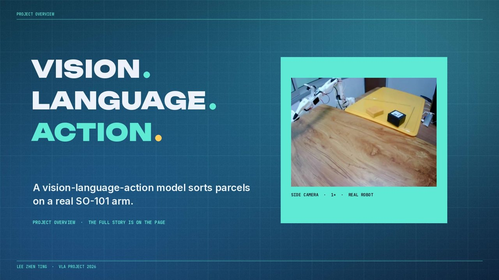
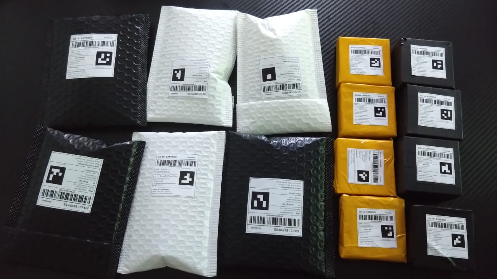
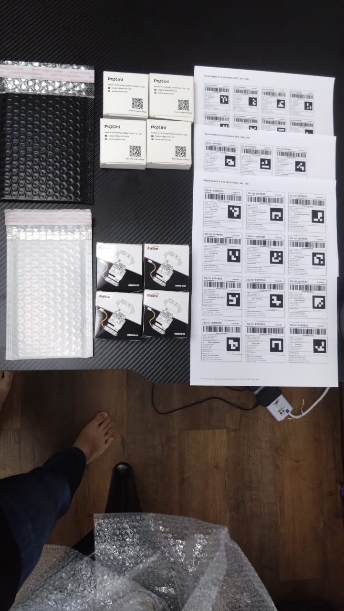
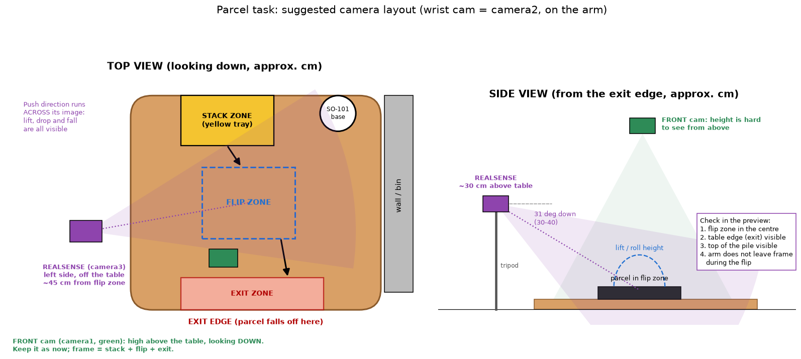
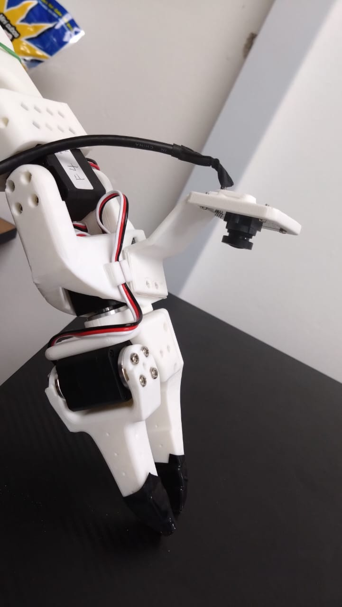
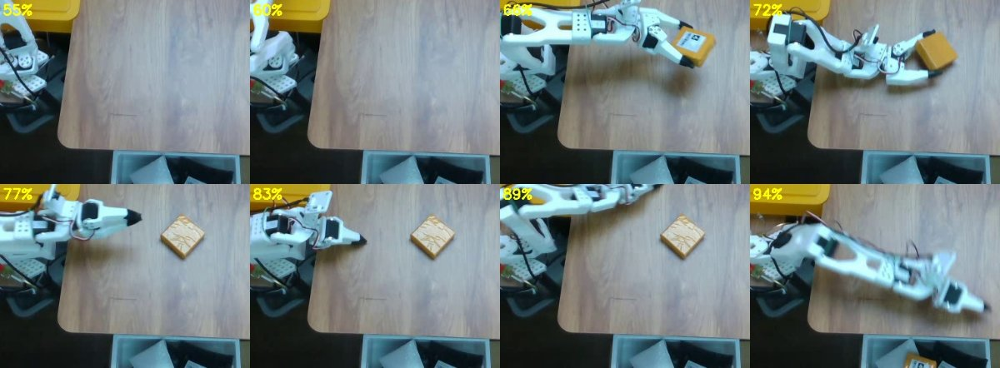
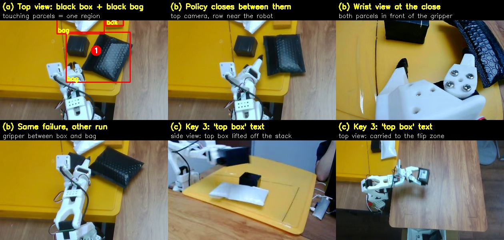

# Parcel Sorting with a LeRobot SO-101 Arm: Diffusion Policy and SmolVLA

[](https://www.python.org/downloads/)
[](LICENSE)
[](https://github.com/huggingface/lerobot)
[](https://huggingface.co/Low101)
[](https://timeisgold5168.github.io/)

One low-cost SO-101 arm learns parcel sorting from my own
demonstrations. The arm picks a parcel from a heap and places it in a
flip zone. If the label is up, the arm flips the parcel. Then it pushes
the parcel off the table, label down. I trained Diffusion Policy and
the SmolVLA vision-language-action (VLA) model on one 6 GB laptop GPU.
I tested each change on the real robot.

> **Built on LeRobot.** This code extends the
> [LeRobot](https://github.com/huggingface/lerobot) code of Hugging
> Face, and it does not run without it. Install LeRobot at commit
> `64b23178` with the patch in [`docs/patches/`](docs/patches) first.
> See [Requirements](#requirements) and [Installation](#installation).

[](https://timeisgold5168.github.io/)

*Click the image for the project page: the project in under 3
minutes, a video for each phase, and the
[full 8-minute video](https://timeisgold5168.github.io/videos/portfolio_video.mp4).*

---

## Quick Results

| Area | Result |
|---|---|
| One parcel cycle, skill text to home | **23.7 s** |
| B-spline policy, cube task, time to home | **3× speed**: 4.5 s against 11.9 s |
| Diffusion plan time on the robot, TensorRT FP16 | **87 → 18 ms**, error 0.15° |
| SmolVLA plan time, compiled denoising | 258 → 148 ms |
| Text shift, distinct texts / one-word texts | **3.41° / 0.40°** (noise 1.6°) |
| 4-kind heap, skill texts by human input | **4/4 cleared**, no help (one run) |
| 4-kind heap, one text for all skills | 0/6 successes |
| Flip skill in the benchmark | 1 wrong label in 108 cleared parcels |

---

## Table of Contents

- [Task Description](#task-description)
- [Hardware and Setup](#hardware-and-setup)
- [Models](#models)
- [The Project in 7 Phases](#the-project-in-7-phases)
- [Diffusion Policy against SmolVLA](#diffusion-policy-against-smolvla)
- [Problems Faced and Solutions](#problems-faced-and-solutions)
- [Repository Layout](#repository-layout)
- [Requirements](#requirements)
- [Installation](#installation)
- [Record Your Own Demos](#record-your-own-demos)
- [Train](#train)
- [Download My Models](#download-my-models)
- [Run on the Robot](#run-on-the-robot)
- [Evaluate](#evaluate)
- [Hugging Face Resources](#hugging-face-resources)
- [Tools and Technologies](#tools-and-technologies)
- [Limits and Next Steps](#limits-and-next-steps)
- [References](#references)
- [Acknowledgements and License](#acknowledgements-and-license)

---

## Task Description

**Task:** pick one parcel from the heap, place it in the flip zone,
flip it if the label is up, push it off the table label down, and go
back home. One parcel is one episode.

<p>
  
  
</p>

*Left: the four self-made parcel kinds. Right: the materials and the
printed labels.*

The task is not easy for a small arm and a small dataset:

- **Four parcel kinds:** orange box, black box, black bag and white
  bag. The black box and the black bag look alike.
- **Two grasps:** the arm holds a box by its side walls and a bag by
  its edge.
- **Heaps:** parcels touch each other, sit at the far edge, or sit on
  top of other parcels.
- **Label side:** the arm must find the label side and flip only the
  parcels with the label up.

**Dataset B** (`parcel-sort-b`): 99 operator demos, 73,444 frames, 3
cameras at 30 fps, 20 heaps, 61 episodes with a flip and 38 with no
flip.

**Scoring:** each shipping label has its own ArUco marker. After a
run, OpenCV reads the marker: parcel ID, position, and label up or
down. A script scores every benchmark run, so no person counts.

---

## Hardware and Setup

| Item | Value |
|---|---|
| Arm | SO-101 follower (12 V, Feetech STS3215) |
| Teleoperation | SO-101 leader (5 V), for demos and DAgger takeover |
| Top camera | RealSense colour stream, YUYV, 848×480 at 30 fps (`camera1`) |
| Wrist camera | USB camera, MJPG, 640×480 at 30 fps (`camera2`) |
| Side camera | USB camera, MJPG, 640×480 at 30 fps (`camera3`) |
| GPU | Laptop NVIDIA RTX PRO 500 Blackwell, 6 GB |
| Parcels | 4 self-made kinds, labels with a unique ArUco marker |

The names in brackets are the SmolVLA camera inputs. The same 6 GB GPU
trains the models and runs the robot, one job at a time.

<p>
  
  
</p>

*Left: the camera layout of the first parcel plan. Right: the wrist
camera sits one joint back, so the 180° label flip does not hit the
table.*

---

## Models

### 1. Diffusion Policy [2]

```
Input:     3 cameras (resized to 240x424) + 6 joint states
Network:   ResNet18 encoders + 1D U-Net (256, 512, 1024): 89M parameters
           (the default 278M did not fit 6 GB)
Output:    64 actions (horizon), 2 observation steps
Training:  from scratch, 80k steps, batch 16, AMP, 9.4 h
Inference: DDIM 10 steps (B-spline version: 5)
```

### 2. SmolVLA [1]

```
Base:      lerobot/smolvla_base (450M parameters)
Trained:   the action expert only (100M); the vision encoder is frozen
Input:     3 cameras (top, wrist, side -> camera1, camera2, camera3),
           6 joint states and a task text
Output:    50 actions per chunk, flow matching with 10 steps
Training:  80k steps, batch 12, LR warmup 1000, cosine decay 80k, 27.4 h
```

### 3. B-spline Policy (BSP) [5]

A normal policy predicts one joint target for each 30 fps frame. A
B-spline policy predicts one smooth curve for the next 1.2-1.5 s: 16
knot times and the control points of the 6 joints. A 50 Hz loop reads
the curve by the clock. Thus the same curve plays at 1×, 2× or 3× with
no new training. Each new curve starts at the point nearest to the
last command, with a short blend. Details:
[`parcel_vla/bsp/README.md`](parcel_vla/bsp/README.md).

| Run | Init | Steps | Batch | Time | Loss |
|---|---|---|---|---|---|
| `diffusion_parcel_b_80k` | scratch | 80k | 16 | 9.4 h | 0.005 |
| `diffusion_bsp_parcel_b_40k` | Diffusion B | 40k | 16 | 5.1 h | 0.018 |
| `smolvla_parcel_b_80k` | `smolvla_base` | 80k | 12 | 27.4 h | 0.025 |
| `smolvla_bsp_parcel_b_40k` | SmolVLA B | 40k | 12 | 13.8 h | 0.100 |
| `smolvla_parcel_b_fb_15k` (step 10k) | SmolVLA B | 15k | 12 | 5.2 h | 0.032 |
| `smolvla_parcel_b_sk3d_10k` | SmolVLA B | 10k | 12 | 3.5 h | 0.034 |
| `smolvla_parcel_b_sk5d_10k` | SmolVLA B | 10k | 12 | 3.4 h | 0.038 |

The loss shows that a run converged. It does not rank the models,
because each policy has its own loss.

---

## The Project in 7 Phases

Each phase starts from a problem of the phase before it. Every model
change passed three gates, in this order: an offline test on held-out
demos, a start test (does the arm still leave home?), and robot runs.

### Phase 01: Setting up

The task must be possible for the robot, and the result must be
measurable. The 180° label flip made the wrist camera hit the table,
so I moved the camera one joint back. A new base height gives an
easier grasp on every parcel. Each setup fix took less time than more
training.

### Phase 02: Designing approaches, from push to pick and place

The first design (dataset A1, 100 demos) pushed each parcel off the
tray. Each demo pushed in a different way, so there was no single
motion to copy. On the robot, the model needed 3 tries and 38 s for
one bag. Dataset B has 99 new demos, each with one smooth place of
2-2.5 s and one grasp for each parcel type.

### Phase 03: Model comparison, Diffusion Policy against SmolVLA

Both policies train on the same 99 demos and one task text.

| Offline test, dataset B | T1 error ↓ | T2 flip /99 ↑ |
|---|---|---|
| SmolVLA B | **1.91°** | 95 |
| SmolVLA-BSP B | 2.39° | 93 |
| Diffusion B | 2.02° | 95 |
| Diffusion-BSP B | 3.08° | 91 |

*T1: mean error of the 5 arm joints over the next 1 s (lower is
better). T2: correct flip decisions (higher is better).*

Offline, SmolVLA fits the demos best. On the robot, Diffusion-BSP
needed the least help: on a 5-parcel heap at 1.5×, it cleared 5/5
parcels in 86 s, 3 with no help. Lesson: the offline ranking is not
the robot ranking.



No heap above 3 parcels was cleared with no help. The pushes move
other parcels to the far edge, where only 14 of the 99 demos reach.
This is how I found the far-edge problem (phase 04).

Speed: a TensorRT FP16 export makes a Diffusion plan 4.8× faster on
the robot (87 → 18 ms), and a C++ control loop holds each 20 ms tick
within 0.4 ms. For SmolVLA, `torch.compile` cuts a denoising step from
13.2 to 3.4 ms. Vision and language still take a fixed 94 ms in every
plan. Details: [`results/inference_improvement/summary.md`](results/inference_improvement/summary.md).

### Phase 04: Fine-tuning, corrections one skill at a time

When the robot fails, I take over with the leader arm and record the
fix (DAgger [6]).

| Round | Data | Result |
|---|---|---|
| All failures at once | 83 corrections, 45 % of the frames | The arm stays at home: wrist roll at start 32° → 3.7° |
| Far edge | 16 short corrections, 7 % of the frames | Error 16.3° → 2.4°; the grasp works on the robot |
| Stacked boxes | 20 full demos + 30 short corrections | Error 3.5° → 1.8°; 3 of 5 stacks cleared |

**Takeaway:** a correction fixes a skill that the model already has,
for example the far-edge grasp. Stacked boxes were a new skill: only 5
of the 99 demos start with a box on a box. A new skill needs full
demos (about 20 good ones or more), not DAgger corrections.

### Phase 05: Skill texts and the live planner

With one task text for every parcel, SmolVLA ignores the text. A
distinct text for each skill makes the text count.

| Texts | Example | Text shift | Verdict |
|---|---|---|---|
| Differ in one word | "pick the **box** and place it in the flip zone" | 0.40° (noise 1.62°) | ignored |
| Distinct, no shared word | "grasp rigid box with wide grip and set it at flip zone", "pinch soft bag by its edge then drop onto table" | 3.41° (noise 1.63°) | read: the bag text wins 85 % of bag frames |



A planner can send the skill text. At home, it predicts which parcel
the policy takes next (SmolVLM2-500M probe, or colour regions in the
top view). On the way, a wrist probe checks it (99 % correct, 1 s
before the grasp). The planner runs next to SmolVLA on the same GPU
(1.9 GB at peak). With so little data, it is not reliable yet.

### Phase 06: Benchmarks

Success means all parcels cleared, 0 wrong labels and no help.

| Heap | One text for all skills | Skill texts by human input |
|---|---|---|
| 1 kind, 3 parcels | 4/4 | - |
| 1 kind, 4 parcels | 1/6 | - |
| 4 kinds, 4 parcels | 0/6 | **4/4 parcels in 113 s, no help** (one run) |

With one text, the model cannot select the skill in a mixed heap. The
top-box skill does not pass yet: on stacked boxes, the top-box text
wins only 41 % of the frames (pass: 80 %). SmolVLA does not see the
stack well, so the vision is the problem, not the text.

### Phase 07: Limits and next steps

See [Limits and Next Steps](#limits-and-next-steps).

---

## Diffusion Policy against SmolVLA

| Aspect | Diffusion Policy | SmolVLA |
|---|---|---|
| Parameters trained | 89M of 89M | 100M of 450M (action expert) |
| Vision | trained end to end | pretrained, frozen |
| Training on dataset B | 9.4 h | 27.4 h |
| Offline error (T1) | 2.02° | **1.91°** |
| Plan time on the robot | 87 ms, **18 ms** with TensorRT | 258 ms, 148 ms compiled |
| 5-parcel heap, BSP at 1.5× | **5/5 in 86 s** (3 with no help) | 4/5 in 219 s |
| Reads a task text | no | **yes**, with distinct texts |

Diffusion-BSP is the fastest model on the robot. The later phases use
SmolVLA, because only SmolVLA reads a text. This makes skill texts and
a planner possible.

---

## Problems Faced and Solutions

| # | Problem | Effect | Solution |
|---|---|---|---|
| 1 | ACT runs its 100-step chunk blind (cube task) | Jumps up to 69.9° at frames 100, 200, 300 | Temporal ensembling: max jump 3.1° |
| 2 | Start pose outside the demos; layout changed in every demo (cube task) | The policy ignores the cameras | Fixed home pose, tape marks, new demos |
| 3 | `prepare_observation_for_inference` converts images to float on the CPU | Control loop at 10-15 Hz | `fast_prepare`: uint8 to the GPU first, about 25 Hz |
| 4 | Rerun `rr.log` blocks; mpv reads the terminal keys | Loop at 5 Hz, keys do not work | Rerun off, mpv preview thread, global key listener |
| 5 | Diffusion uses DDPM with 100 steps | 0.8 s per plan | DDIM 10 steps: 0.1 s |
| 6 | Each B-spline plan starts from new noise | Jerks above 1× speed | `--blend 0.2 --ddim-steps 5 --max-step 6`: reversals 8.4 → 1.2 /s at 1.5× |
| 7 | `torch.compile` and the dynamic KV cache | Recompiles, then a corrupt cache | `StaticPrefixCache`: step 13.2 → 3.4 ms, max difference 0.106° |
| 8 | Three bugs in the RTC engine [7] | Pauses and jumps at chunk switches | `FREEZE=1 RTC_EXACT_DELAY=1 COMPILE=default`: pauses 11.9 % → 0 % |
| 9 | LR schedule decays over fewer steps than the run | 50k steps at the minimum LR | `--policy.scheduler_decay_steps` equal to the steps |
| 10 | Warm-start weights not cast to the init type | SmolVLA-BSP plan 325 ms | Cast to bf16: 223 ms |
| 11 | 83 DAgger corrections start in the middle of the task | The arm stays at home | One skill at a time, short corrections, 7 % share |
| 12 | Box data 33 % of the frames, fine-tuned twice | Stack grasp on normal boxes | One fine-tune on a balanced mix; skill texts |
| 13 | SmolVLM2 splits each image into many tiles | Planner: 17 s per decision | `do_image_splitting=False`: 1.5 s |

The full list, with the symptom, the cause and the test of each fix,
is the "bugs.log" panel of the
[project page](https://timeisgold5168.github.io/) (Engineering
view). The full technical record is [`docs/writeup.md`](docs/writeup.md).

---

## Repository Layout

```text
.
├── README.md
├── pyproject.toml           pip install -e .
├── parcel_vla/              the code, one folder for each part
│   ├── env.sh, paths.py     shared settings: devices, folders, namespace
│   ├── setup/               camera alignment, wrist focus guide, ArUco labels
│   ├── data/                recording with 3 cameras, heap schedules, checks
│   ├── training/            SmolVLA and Diffusion training
│   ├── bsp/                 B-spline policy: targets, training, decoding
│   ├── inference_improvement/  compiled denoising, TensorRT, C++ 50 Hz loop
│   ├── robot/               robot runs: skill keys, live planner, BSP executor
│   ├── evaluation/          offline tests (no robot)
│   ├── finetuning/          DAgger corrections, start test, checkpoint pick
│   ├── skill_texts/         skill-text datasets, language test, text splits
│   ├── planner/             VLM probes, top-view regions, live planner
│   ├── benchmark/           benchmark runs and score sheets
│   └── cube_warmup/         the first task (green cube)
├── results/                 the results that the project page shows
├── figures/                 the images of this README and the write-up
└── docs/                    write-up, test protocols, LeRobot patch
```

| Folder | Phase | Main files |
|---|---|---|
| [`setup/`](parcel_vla/setup) | 01 | `camera_align.py`, `focus_guide.py`, `labels/make_labels.py` |
| [`data/`](parcel_vla/data) | 02 | `record_parcel.sh`, `check_episodes.py`, `schedule_B.csv` |
| [`training/`](parcel_vla/training) | 03 | `train_smolvla.sh`, `train_diffusion.sh`, `train_mixed.py` |
| [`bsp/`](parcel_vla/bsp) | 03 | `make_targets.py`, `train_bsp.py`, `train_bsp_parcel.sh` |
| [`inference_improvement/`](parcel_vla/inference_improvement) | 03 | `fast_denoise.py`, `trt_plan.py`, `cpp_control.py`, `ctl/` |
| [`evaluation/`](parcel_vla/evaluation) | 03 | `offline_eval_b.py` |
| [`robot/`](parcel_vla/robot) | 03-06 | `run_parcel.sh`, `rollout_mixed.py`, `run_bsp_parcel.py` |
| [`finetuning/`](parcel_vla/finetuning) | 04 | `dagger_parcel.sh`, `trim_corrections.py`, `start_test.py` |
| [`skill_texts/`](parcel_vla/skill_texts) | 05 | `make_skill3.py`, `lang_test.py`, `splits/` |
| [`planner/`](parcel_vla/planner) | 05 | `live_planner.py`, `topview.py`, `train_planner.py` |
| [`benchmark/`](parcel_vla/benchmark) | 06 | `eval_parcel.sh`, `bench_sheets.py` |
| [`cube_warmup/`](parcel_vla/cube_warmup) | before 01 | `run_spot.sh`, `review_rollouts.py` |

Each folder has a README with its files and commands. Your new runs,
logs and result tables go to `runs/`, and checkpoints go to
`outputs/train/`. Git ignores both folders.

---

## Requirements

To use this code as it is, you need the same kind of setup:

- **LeRobot (required):** this code is built on the
  [LeRobot repository](https://github.com/huggingface/lerobot), and it
  does not run without it. Use commit `64b23178` with the patch in
  [`docs/patches/`](docs/patches). The code uses LeRobot in three ways:
  - It imports the LeRobot policies (Diffusion Policy, SmolVLA, ACT),
    the datasets, and the robot and camera drivers.
  - It runs the LeRobot commands `lerobot-train`, `lerobot-record` and
    `lerobot-rollout`, with extra settings.
  - It changes some LeRobot functions at run time: the Diffusion camera
    resize, the image prepare step, the SmolVLA denoising cache and the
    RTC engine. These changes expect the code of commit `64b23178`.
    Another LeRobot version can break them.
- **Robot:** an SO-101 follower arm. For demos and corrections, also
  an SO-101 leader arm.
- **Three fixed cameras** with these names. The models expect them:

  | Name | Place | Format |
  |---|---|---|
  | `top` | above the tray | 848×480, 30 fps (I used a RealSense colour stream) |
  | `wrist` | on the gripper, one joint back | 640×480, 30 fps |
  | `side` | beside the table | 640×480, 30 fps |

- **GPU:** an NVIDIA GPU with 6 GB of memory or more. Run one job at a
  time.
- **Software:** Linux, Python 3.10 or later, SciPy, and `v4l-utils`
  (it finds the RealSense colour node).
- **Optional:** TensorRT and `onnxruntime` (Diffusion FP16 engines),
  `g++` and `make` (C++ control loop), `reportlab` (label PDFs),
  `python3-tk` (camera alignment tools).
- **Scene:** a tray for the heap, a flip zone and a table edge. For
  script scoring, print the labels in
  [`parcel_vla/setup/labels/`](parcel_vla/setup/labels).

CAUTION: The record and run scripts move the arm. Before you start a
script, put the arm at the home pose and clear the workspace.

---

## Installation

Install LeRobot first, then this package in the same Python
environment.

1. Clone LeRobot:
   `git clone https://github.com/huggingface/lerobot && cd lerobot`.
2. Check out the base commit: `git checkout 64b23178`.
3. Install LeRobot: `pip install -e ".[feetech,smolvla,diffusion]"`.
4. Install SciPy for the B-spline code: `pip install scipy`.
5. Clone this repository:
   `git clone https://github.com/TimeisGold5168/Parcel_task_VLA_s0_101_arm.git`.
6. Apply the patch:
   `git apply Parcel_task_VLA_s0_101_arm/docs/patches/lerobot_episodic_skip_empty.patch`.
7. Install this package without dependencies:
   `pip install -e Parcel_task_VLA_s0_101_arm --no-deps`.
8. Log in to Hugging Face: `hf auth login`.
9. Set your devices and your Hugging Face name. Use the
   `/dev/serial/by-id` and `/dev/v4l/by-id` names, because they do
   not change after a reboot:

   ```bash
   export FOLLOWER_PORT=/dev/serial/by-id/<your follower arm>
   export LEADER_PORT=/dev/serial/by-id/<your leader arm>
   export WRIST_CAM=/dev/v4l/by-id/<your wrist camera>
   export SIDE_CAM=/dev/v4l/by-id/<your side camera>
   export TOP_CAM=/dev/video<N>   # empty: find the RealSense colour node
   export HF_USER=<your Hugging Face name>
   ```

Run the commands below from one folder, for example the LeRobot root.
Checkpoints go to `outputs/train/` in that folder. To use another
folder, set `TRAIN_DIR`. All settings are in
[`parcel_vla/env.sh`](parcel_vla/env.sh) and
[`parcel_vla/paths.py`](parcel_vla/paths.py).

---

## Record Your Own Demos

1. Put the arm at the home pose, and build heap 1 of the schedule.
2. Record the heap with the leader arm:

   ```bash
   STAGE=b REPO=$HF_USER/parcel-sort-b bash parcel_vla/data/record_parcel.sh 1
   ```

3. In each episode, push Space when the parcel is released label down
   in the flip zone.
4. Do the next heaps with `record_parcel.sh 2`, `3`, and so on.
5. Check the episodes:
   `python -m parcel_vla.data.check_episodes --root ~/.cache/huggingface/lerobot/$HF_USER/parcel-sort-b`.

Use one smooth motion for each parcel type, and one firm close of the
gripper. Consistent demos work better than more demos: dataset B has
fewer frames than dataset A1 and works.

---

## Train

### A. With the scripts of this repository

The defaults reproduce my dataset B models. Set `DATASET` and `RUN`
for your own data.

```bash
# SmolVLA: 80k steps, batch 12 (about 27 h on a 6 GB laptop GPU)
DATASET=$HF_USER/parcel-sort-b RUN=smolvla_parcel_b_80k \
  bash parcel_vla/training/train_smolvla.sh

# Diffusion Policy: 80k steps, batch 16, AMP (about 9 h)
DATASET=$HF_USER/parcel-sort-b RUN=diffusion_parcel_b_80k \
  bash parcel_vla/training/train_diffusion.sh

# B-spline versions: make the targets once, then warm start
python -m parcel_vla.bsp.make_targets --dataset parcel-sort-b --max-error 0.5
bash parcel_vla/bsp/train_bsp_parcel.sh smolvla
bash parcel_vla/bsp/train_bsp_parcel.sh diffusion

# Resume a stopped run
RESUME=1 RUN=smolvla_parcel_b_80k bash parcel_vla/training/train_smolvla.sh
```

For DAgger rounds and skill texts, see
[`parcel_vla/finetuning/`](parcel_vla/finetuning) and
[`parcel_vla/skill_texts/`](parcel_vla/skill_texts).

### B. With the LeRobot command line only

SmolVLA needs the camera rename map. Its three pretrained camera inputs
are `camera1`, `camera2` and `camera3`:

```bash
lerobot-train \
  --policy.path=lerobot/smolvla_base \
  --dataset.repo_id=$HF_USER/parcel-sort-b \
  --rename_map='{"observation.images.top": "observation.images.camera1",
                 "observation.images.wrist": "observation.images.camera2",
                 "observation.images.side": "observation.images.camera3"}' \
  --policy.scheduler_warmup_steps=1000 --policy.scheduler_decay_steps=80000 \
  --batch_size=12 --steps=80000 --save_freq=10000 \
  --policy.push_to_hub=false --output_dir=outputs/train/smolvla_parcel_b_80k
```

Diffusion Policy stacks the camera images before it resizes them. If
your cameras have different sizes, plain `lerobot-train` stops with a
shape error. Then use `python -m parcel_vla.training.train_mixed` with
the same arguments as `lerobot-train`, or record all three cameras at
the same size.

---

## Download My Models

NOTE: These models learned my scene: my tray, my camera poses, my
lighting and my self-made parcels. On another setup they will likely
not work as they are. Use them to test the code, or as a start point
to fine-tune on your own demos.

| Hub model | Policy | Model name in the scripts |
|---|---|---|
| [`Low101/diffusion_parcel_b_80k`](https://huggingface.co/Low101/diffusion_parcel_b_80k) | Diffusion, dataset B | `diffusion_b` |
| [`Low101/diffusion_bsp_parcel_b_40k`](https://huggingface.co/Low101/diffusion_bsp_parcel_b_40k) | Diffusion-BSP, dataset B | `diffusion_bsp_b` |
| [`Low101/smolvla_parcel_b_80k`](https://huggingface.co/Low101/smolvla_parcel_b_80k) | SmolVLA, dataset B | `smolvla_b` |
| [`Low101/smolvla_bsp_parcel_b_40k`](https://huggingface.co/Low101/smolvla_bsp_parcel_b_40k) | SmolVLA-BSP, dataset B | `smolvla_bsp_b` |
| [`Low101/smolvla_parcel_b_fb_15k`](https://huggingface.co/Low101/smolvla_parcel_b_fb_15k) | Far edge + box stack, step 10000 (benchmark model) | `smolvla_b_fb` |
| [`Low101/smolvla_parcel_b_sk3d_10k`](https://huggingface.co/Low101/smolvla_parcel_b_sk3d_10k) | 3 distinct skill texts | `smolvla_b_sk3d` |
| [`Low101/smolvla_parcel_b_sk5d_10k`](https://huggingface.co/Low101/smolvla_parcel_b_sk5d_10k) | 5 distinct skill texts | `smolvla_b_sk5d` |

Download a model into the checkpoint layout of the scripts. Then the
commands of the next section find it by its model name:

```bash
M=smolvla_parcel_b_sk3d_10k
hf download Low101/$M --local-dir outputs/train/$M/checkpoints/last/pretrained_model
```

---

## Run on the Robot

1. Put the arm at the home pose.
2. Build the heap.
3. Start the policy. Use one of the commands below.
4. Push the Right arrow to end an episode, or Esc to stop.

```bash
# SmolVLA with skill texts: keys 1/2/3 send the box, bag or top-box text
SKILL=bag bash parcel_vla/robot/run_parcel.sh smolvla_b_sk3d

# The same, with the live planner sending the skill (not reliable yet)
SKILL=bag PLANNER=drive bash parcel_vla/robot/run_parcel.sh smolvla_b_sk3d

# SmolVLA with RTC and the three fixes (the benchmark settings)
FREEZE=1 RTC_EXACT_DELAY=1 COMPILE=default ROLLOUT_ARGS="--inference.type=rtc \
  --inference.rtc.execution_horizon=10 --inference.queue_threshold=30" \
  bash parcel_vla/robot/run_parcel.sh smolvla_b

# Diffusion-BSP at 1.5x with the smooth settings
python -m parcel_vla.robot.run_bsp_parcel --model diffusion_bsp_b --level easy \
  --speed 1.5 --ddim-steps 5 --blend 0.2 --max-step 6

# Any checkpoint folder, with the settings of a model name
POLICY_PATH=/path/to/pretrained_model SKILL=box \
  bash parcel_vla/robot/run_parcel.sh smolvla_b_sk3d
python -m parcel_vla.robot.run_bsp_parcel --model smolvla_bsp_b --level easy \
  --policy-path /path/to/pretrained_model
```

For the skill-text models, the texts come from
[`parcel_vla/skill_texts/splits/`](parcel_vla/skill_texts/splits). For
TensorRT, build the engines first with
`python -m parcel_vla.inference_improvement.trt_plan build diffusion_bsp_b --dtype fp16`,
then add `--trt fp16`. For the C++ control loop, run
`make -C parcel_vla/inference_improvement/ctl`, then add
`--control cpp`.

---

## Evaluate

```bash
# Offline tests on dataset B (no robot): action error, flip decision, image swap
python -m parcel_vla.evaluation.offline_eval_b

# Language test of a skill-text model (held-out frames)
python -m parcel_vla.skill_texts.lang_test smolvla_parcel_b_sk3d_10k:010000 \
  --split outputs/train/skill3d_split.json

# One benchmark set on the robot, then the score sheets
bash parcel_vla/benchmark/eval_parcel.sh smolvla_b_fb --set kind2 \
  --level medium --episodes 5 --parcels 3
python -m parcel_vla.benchmark.bench_sheets rollout_bench_parcel_smolvla_b_fb_kind2
```

The score sheets go to `runs/bench/`. My scores are in
[`results/benchmark/`](results/benchmark). The results index is
[`results/README.md`](results/README.md).

---

## Hugging Face Resources

- **Profile:** [huggingface.co/Low101](https://huggingface.co/Low101)
- **Models:** the 7 models in [Download My Models](#download-my-models).
- **Datasets:** `parcel-sort-a` (A1, push, 100 episodes),
  `parcel-sort-b` (B, pick and place, 99 episodes) and the
  correction and skill-text sets. The datasets are private.
- **LeRobot:** [github.com/huggingface/lerobot](https://github.com/huggingface/lerobot)

---

## Tools and Technologies

| Category | Tools |
|---|---|
| ML framework | PyTorch, Hugging Face Transformers |
| Robot learning | LeRobot [4], commit `64b23178` (required) |
| Policies | Diffusion Policy [2], SmolVLA [1], ACT [3] (cube task) |
| Action representation | B-spline Policy [5] |
| Planner | SmolVLM2-500M and 2.2B, linear probes, OpenCV colour regions |
| Inference speed | `torch.compile`, TensorRT FP16, C++ control process, RTC [7] |
| Scoring | OpenCV ArUco markers |
| Model hosting | Hugging Face Hub |
| Hardware | SO-101 leader and follower (Feetech STS3215), RealSense, 2 USB cameras, laptop RTX PRO 500 Blackwell (6 GB) |

---

## Limits and Next Steps

| Area | Limit | Fix to try next |
|---|---|---|
| Vision | Touching dark parcels look like one region. | Use a better camera. Add a segmentation planner that splits touching parcels. |
| Stacks | SmolVLA does not see a stacked box well: the top-box skill fails. | Record 20-25 more box-stack demos, and let the planner find the stack and send the top-box text. |
| Consistency | On boxes, the gripper opens and closes many times before it holds. | My demos had this hesitant grip adjustment, and the model copied it. Record more consistent demos with one firm close. |
| Compute | A SmolVLA plan takes 148 ms, even compiled (6 GB laptop GPU). | More GPU compute and memory bandwidth make it faster. More memory only fits a larger planner. |

Also, most robot tests have few trials and one heap for each model.
They give an indication, not a controlled comparison.

---

## References

[1] Shukor et al., "SmolVLA: A Vision-Language-Action Model for
Affordable and Efficient Robotics," arXiv:2506.01844, 2025.

[2] Chi et al., "Diffusion Policy: Visuomotor Policy Learning via
Action Diffusion," RSS 2023.

[3] Zhao et al., "Learning Fine-Grained Bimanual Manipulation with
Low-Cost Hardware," RSS 2023.

[4] Cadene et al., "LeRobot: State-of-the-art Machine Learning for
Real-World Robotics in PyTorch," github.com/huggingface/lerobot, 2024.

[5] Han et al., "B-spline Policy: Accelerating Manipulation Policies
via B-spline Action Representations,"
[arXiv:2607.09648](https://arxiv.org/abs/2607.09648), 2026.

[6] Ross, Gordon and Bagnell, "A Reduction of Imitation Learning and
Structured Prediction to No-Regret Online Learning," AISTATS 2011.

[7] Black, Galliker and Levine, "Real-Time Execution of Action
Chunking Flow Policies," arXiv:2506.07339, 2025.

[8] Physical Intelligence, "π0: A Vision-Language-Action Flow Model for
General Robot Control," [arXiv:2410.24164](https://arxiv.org/abs/2410.24164), 2024.

[9] Physical Intelligence, "π0.5: a Vision-Language-Action Model with
Open-World Generalization," [arXiv:2504.16054](https://arxiv.org/abs/2504.16054), 2025.

[10] Shi et al., "Hi Robot: Open-Ended Instruction Following with
Hierarchical Vision-Language-Action Models,"
[arXiv:2502.19417](https://arxiv.org/abs/2502.19417), 2025.

---

## Contact

**Zhen Ting Lee**

- GitHub: [@TimeisGold5168](https://github.com/TimeisGold5168)
- Hugging Face: [@Low101](https://huggingface.co/Low101)
- Portfolio: [timeisgold5168.github.io](https://timeisgold5168.github.io/)

---

## Acknowledgements and License

This project builds on [LeRobot](https://github.com/huggingface/lerobot)
by Hugging Face (Apache 2.0). Some functions adapt LeRobot code, and
[`docs/patches/`](docs/patches) holds one change to the LeRobot source.
`parcel_vla/bsp/bspline.py` follows the official B-spline Policy code
(MIT License).

This repository: Apache 2.0 License. See [`LICENSE`](LICENSE).
