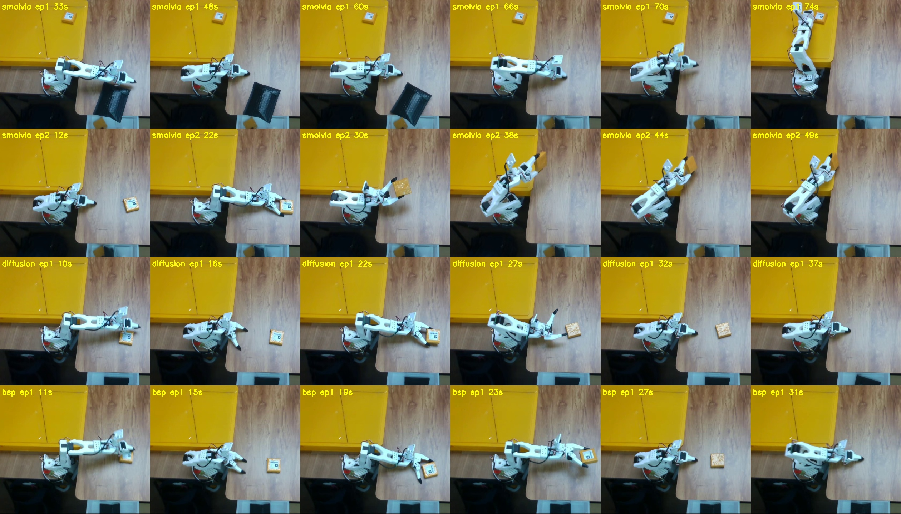

# Parcel sorting with a LeRobot SO-101 arm: Diffusion Policy and SmolVLA

This personal project teaches a low-cost SO-101 arm to sort parcels
by imitation learning. The arm picks a parcel from a heap and places it
in a flip zone. If the label is up, the arm flips the parcel. Then it
pushes the parcel off the table, label down. The project compares
Diffusion Policy and the SmolVLA vision-language-action (VLA) model. It
adds B-spline execution (BSP), TensorRT FP16 and a C++ 50 Hz control
loop. It also tests DAgger corrections, skill texts and a skill planner.
All training runs on one laptop GPU with 6 GB of memory.

![Diffusion-BSP B flips the labelled orange box][fig-flip]

[fig-flip]: parcel_task/figures/b_heap5_diffusion_bsp_flip.jpg

The full technical record, with every test, number and limit, is
[`writeup.md`](writeup.md). This page is a summary of it.

## Key results

| Area | Result |
|---|---|
| 5-parcel heap, Diffusion-BSP B, 1.5x | 5/5 cleared (3/5 with no help) |
| TensorRT FP16, Diffusion (robot) | plan mean 87 -> 18 ms |
| TensorRT FP16, Diffusion (offline) | error 0.149 deg against PyTorch |
| C++ control process (robot) | tick max 24.1 -> 20.4 ms |
| Skill-text shift, one-word texts | 0.40 deg |
| Skill-text shift, distinct texts | 3.41 deg |
| Noise level, distinct-text model | 1.63 deg |
| Benchmark, 1 kind, 3 parcels | 4/4 successes |
| Benchmark, 1 kind, 4 parcels | 1/6 successes |
| Benchmark, 4 kinds, 4 parcels | 0/6 successes |
| Flip skill in the benchmark | 1 wrong label in 108 cleared parcels |

Notes:

- The benchmark model is `smolvla_b_fb` 10k. A success is a heap with
  all parcels cleared, 0 wrong labels and 0 help.
- The skill-text shift is on the bag frames of the held-out episodes.
  It is the change of the next 1 s of predicted arm actions when the
  box text replaces the bag text.
- The heap tests are one heap for each model. They give an indication,
  not a controlled comparison.

Main findings:

1. Diffusion-BSP gives the best results on the robot, but offline
   scores ranked it last. Robot tests are necessary.
2. Many DAgger corrections that start in the middle of the task stop
   the start motion. Short fragments of one skill keep it.
3. One VLA policy does not select the skill well in a heap with many
   parcel kinds. A planner that sends a skill text is the next step.
4. SmolVLA reads a task text only when the texts share no word.

## Hardware and setup

| Item | Value |
|---|---|
| Arm | SO-101 follower (12 V, Feetech STS3215) |
| Teleoperation | SO-101 leader (5 V) |
| Top camera | RealSense colour, 848x480, 30 fps (`camera1`) |
| Wrist camera | USB camera, 640x480, 30 fps (`camera2`) |
| Side camera | USB camera, 640x480, 30 fps (`camera3`) |
| GPU | Laptop NVIDIA RTX PRO 500 Blackwell, 6 GB |
| Parcels | Orange box, black box, black bag, white bag |
| Labels | Shipping labels with a unique ArUco marker |

The names in brackets are the SmolVLA camera inputs. The same 6 GB GPU
trains the models and runs the robot, but not at the same time.

## The project, phase by phase

### 1. Cube warm-up (ACT, Diffusion, SmolVLA)

The first task is "pick the green cube and place it into the bin". The
first ACT model jerked at each chunk end, and the rollout start pose
was outside the demos. A fixed layout, taped marks and one home pose
fixed this. All 51 demos of `second-act-attempt` used one spot, so the
policy failed at new spots. The 151 episodes of `third-act-attempt`
spread the cube over five X marks, and the models then read the cube
position.

### 2. Robustness tests

- Language: SmolVLA ignores the colour word. "green" and "red" move
  the prediction no more than random noise.
- Image changes: SmolVLA has the lowest error under every change.
  Diffusion is the most sensitive to lighting.
- Distractor: a blue cube on a trained spot pulls SmolVLA, not ACT or
  Diffusion. SmolVLA picked 0/6 on a trained spot and 3/3 off it
  (Fisher p = 0.012).

### 3. B-spline execution (BSP)

Each BSP prediction is one B-spline segment: 16 knot times and 16
control points for the 6 joints. A 50 Hz control thread samples the
curve by the wall clock, so the speed does not depend on the inference
rate. Diffusion-BSP jerked above 1x, because each plan starts from new
random noise. The settings `--ddim-steps 5 --max-step 6 --blend 0.2`
cut the direction reversals at 2x from 8.3 to 2.5 per second. Details:
[`bsp/README.md`](bsp/README.md).

### 4. Parcel task, dataset A1 (push approach)

Dataset A1 (`Low101/parcel-sort-a`) has 100 episodes and 101,642
frames with 3 cameras. The operator pushes or pulls the parcel from
the stack zone. On the easy level, Diffusion-BSP succeeded in all 5
episodes. The push from the stack zone was the weak phase on the robot.



### 5. Faster inference

- A compiled SmolVLA denoising step (`bsp/fast_denoise.py`) takes
  3.1 ms, not 13.2 ms. The output stays within 0.106 deg of eager.
- The LeRobot RTC engine plans while the arm moves. Three fixes
  (`FREEZE=1`, `RTC_EXACT_DELAY=1`, `COMPILE=default`) make the chunk
  switches smooth. Sync mode stops for 11.9% of the run. RTC with the
  fixes stops for 0%.

### 6. Parcel task, dataset B (pick and place)

Dataset B (`Low101/parcel-sort-b`) has 99 episodes and 73,444 frames.
The arm picks each parcel and places it in the flip zone. Results on
the 5-parcel heap:

| Model | Cleared | Run time |
|---|---|---|
| Diffusion-BSP B, 1.5x | 5/5 (3/5 with no help) | 86 s |
| SmolVLA-BSP B, 1.5x | 4/5 | 219 s |
| SmolVLA B, RTC | 3/5 | 231 s (time limit) |

![Diffusion-BSP B, stack zone at the start and end of each episode][fig-zone]

[fig-zone]: parcel_task/figures/b_heap5_diffusion_bsp_zone.jpg

A box on a box fails with all models, because the data has only about
5 such starts. On the 8-parcel heap, no model clears all parcels with
no help. The models also use the bag push on the black box.

### 7. Diffusion against SmolVLA

Diffusion-BSP B is the fastest and the best on the 5-parcel heap.
SmolVLA is the smoothest model, and all its flips were correct. Its
time loss is in the wait at home and the hover before the grasp. The
DAgger and skill-text work uses SmolVLA B. Only SmolVLA reads a task
text.

### 8. DAgger corrections, and why round 1 stalled

In round 1, the operator recorded 83 corrections with the leader arm.
They were about 45% of the merged frames. Both fine-tuned models then
stayed at home. Each correction ended with about 1.4 s at home with no
motion, and no correction had the start motion. A start test shows the
cause:

| Home-pose frame | Wrist roll turn |
|---|---|
| Old SmolVLA B | 32 deg |
| Control, dataset B only (5k) | 27 deg |
| DAgger, tails cut (5k) | 6.5 deg |

Lesson: many corrections that start in the middle of the task pull the
model away from the start motion.

### 9. One skill at a time

Round 2 adds one skill at a time. The far-edge fragments are 7% of the
mix, so the start motion stays (29.4 deg), and the far-edge grasp works
on the robot. Round 3 adds stacked-parcel corrections on top, and the
model tilts to the new grasp on normal boxes. Round 4 merges each part
one time. `smolvla_b_all` 10k does each new case, but on normal heaps
it does not select a skill firmly.

### 10. Benchmark

The benchmark uses `smolvla_b_fb` 10k, with RTC. Each set has its own
dataset (`eval_parcel.sh --set <name>`) and score sheet in `bench/`.

| Heap | Episodes | Success | Parcels cleared | Help |
|---|---|---|---|---|
| 1 kind, 2 parcels | 6 | 4 | 12/12 | 2 |
| 1 kind, 3 parcels (pilot) | 4 | 4 | 12/12 | 0 |
| 2 kinds, 3 parcels | 8 | 2 | 24/24 | 7 |
| 3 kinds, 3 parcels | 10 | 5 | 25/30 | 4 |
| 1 kind, 4 parcels | 6 | 1 | 18/23 | 5 |
| 4 kinds, 4 parcels | 6 | 0 | 17/24 | 17 |

The number of parcel kinds and the number of parcels both have an
effect. The large step is from 1 kind to a mixed heap.

### 11. Skill texts and the skill planner

All datasets had one task text, so SmolVLA ignored the text. The
skill-text models give each skill its own text:

| Skill | Text (`sk3d`, `sk5d`) |
|---|---|
| Box | "grasp rigid box with wide grip and set it at flip zone" |
| Bag | "pinch soft bag by its edge then drop onto table" |
| Top box | "lift upper carton off stacked pile" |

- SmolVLA ignores texts that differ in one word ("box", "bag").
- Texts with no shared word change the grasp. On the robot, key 3
  (top-box text) and then key 2 (bag text) give the correct skill for
  each parcel.
- The image selects the target, and the text selects the grasp.
- `sk5d` keeps 5 texts, but the 2 new skills (13 and 16 episodes) do
  not learn. A skill needs approximately 20 good episodes or more.

![Touching parcels and the skill switch][fig-skill]

[fig-skill]: parcel_task/figures/skill_text_findings.jpg

The planner (`planner/`) selects the skill text. A linear probe on
SmolVLM2-2.2B features selects the correct skill in 81% of the home
frames. A wrist probe on SmolVLM2-500M finds box or bag in 99% of the
frames, 1 s before the grasp. A black box that touches a black bag
looks like one parcel to the planner and to the policy.

### 12. Performance engineering

Every change is measured against one fixed reference. Details:
[`bsp/bench_results/summary.md`](bsp/bench_results/summary.md).

| Change | Result |
|---|---|
| Diffusion, TensorRT FP16 | plan p50 87.7 -> 13.1 ms (offline) |
| SmolVLA, TensorRT BF16 | no gain, error 2.330 deg, not used |
| C++ control process | all ticks within 0.4 ms of 20 ms |
| C++ servo driver, sync read | bus max 5.5 -> 1.4 ms |

Faster plans remove the holds, but direction reversals and success do
not change. The seam jump comes from the difference between plans.

### 13. Limits and next steps

Limits:

- Most robot tests have few trials and one heap for each model.
- One operator labelled the planner frames and rated the runs.
- The far edge, the black box and a box on a box stay weak.

Next steps:

1. Record 20-25 new box-stack demos of good quality.
2. Use these demos as the box-stack skill, with a skill text.
3. Add a better parcel detection to the planner, for example a
   detector or a depth camera.
4. Record the same scene with two texts and two targets.

## Repository layout

```text
.
├── README.md           This page
├── writeup.md          Full technical record
├── backup_hf.sh        Back up datasets and models to the Hub
├── parcel_task/        Parcel task: record, train, evaluate, run
│   └── figures/        Figures of the write-up
├── bsp/                B-spline policy: targets, training, executor
│   ├── ctl/            C++ 50 Hz control process (bsp_ctl)
│   └── bench_results/  Plan and control benchmark results
├── planner/            Skill planner: VLM probes, top view, live planner
├── bench/              Benchmark score sheets (scores.csv for each set)
├── parcel_labels/      ArUco shipping labels and camera tests
├── patches/            Patch for the LeRobot source
├── models/             Dataset A1 checkpoints (Git LFS)
├── baseline_pre10/     Code, packages and commit before items 10-12
├── docs/               Cube-task test protocols and plans
├── site/               Portfolio web page
├── video/              Tools for the portfolio video
├── approach_demo/      Camera layout of the parcel task
├── camcheck/           Camera alignment logs (cube task)
├── image_perturbations/  Images of the robustness test (cube task)
├── spot_review/        Spot-test review data (cube task)
├── wrtie_up_materials/ Photos for the write-up
└── *.py, *.sh, *.csv   Cube-task tools and results
```

Cube-task tools at the repository root:

| File | Purpose |
|---|---|
| `run_robot_test.sh` | Robot test of one cube model |
| `run_spot.sh` | One test spot for every model, then auto-score |
| `run_configs.sh` | Inference-config comparison on one spot |
| `review_rollouts.py` | Auto-score spot-test rollouts |
| `vlm_frames.py` | Frame grids for a vision-model judge |
| `camera_align.py` | Live front-camera alignment to an episode |
| `focus_guide.py` | Live focus guide for the wrist camera |
| `delete_last_episode.sh` | Delete the last episodes of a rollout |
| `upload_for_colab.sh` | Upload the data for the Colab fine-tune |
| `results*.csv` | Cube-task robot results |

## How to reproduce

### Set up

1. Clone LeRobot: `git clone https://github.com/huggingface/lerobot`.
2. Check out the base commit: `git -C lerobot checkout 64b23178`.
3. Install LeRobot: `pip install -e ".[feetech,smolvla,diffusion]"`.
4. Clone this repository into `lerobot/outputs/portfolio`.
5. Go to the LeRobot root: `cd lerobot`.
6. Apply the patch:
   `git apply outputs/portfolio/patches/lerobot_episodic_skip_empty.patch`.
7. Run `git lfs install`, then `git -C outputs/portfolio lfs pull`.

Run all commands from the LeRobot root. Some scripts set `PY`, `BIN`
or `TRAIN` to `/home/zhenting.lee/miniforge3/envs/lerobot/bin`. If
your path is different, change these lines. The record and run
scripts find the arms and cameras by their `/dev/serial/by-id` and
`/dev/v4l/by-id` names. Change these names to your devices.

### Record

1. Put the arm at the home pose.
2. Record one heap of the dataset B schedule:
   `STAGE=b bash outputs/portfolio/parcel_task/record_parcel.sh 1`.
3. Push Space after the release, before the exit push.
4. Check the episodes with `parcel_task/check_episodes.py`.

### Train

1. Make the B-spline targets:
   `python outputs/portfolio/bsp/make_targets.py --dataset parcel-sort-b
   --max-error 0.5`.
2. Train the four dataset B models in a queue (about 56 h):
   `bash outputs/portfolio/parcel_task/queue_b.sh`.
3. Train one BSP model by hand with `bsp/train_bsp.py`. The usage is
   in the file header.
4. Make the skill texts:
   `python outputs/portfolio/parcel_task/make_skill3.py --variant
   distinct`.
5. Train the skill-text model:
   `VARIANT=distinct bash outputs/portfolio/parcel_task/queue_skill3.sh`.

### Evaluate

1. Run the offline tests:
   `python outputs/portfolio/parcel_task/offline_eval_b.py`.
2. Put the arm at the home pose, and build the heap.
3. Run the robot test:
   `bash outputs/portfolio/parcel_task/eval_parcel.sh diffusion_bsp_b
   --level hard --episodes 5 --speed 1.5 --blend 0.2`.
4. For a benchmark set, add `--set <name>` (for example `kind2`).
5. Make the score sheets:
   `python outputs/portfolio/parcel_task/bench_sheets.py
   rollout_bench_parcel_smolvla_b_fb_kind2`.
6. Fill in `bench/<dataset>/scores.csv`.

The full benchmark command, with the RTC flags, is in
[`writeup.md`](writeup.md), section "Portfolio benchmark".
For TensorRT, build the engines with
`bsp/trt_plan.py build <model> --dtype fp16`, then add `--trt fp16`.
For C++ control, run `make -C outputs/portfolio/bsp/ctl`, then add
`--control cpp`.

## Datasets and models

The datasets and models are on the Hugging Face Hub in the namespace
`Low101`. They are private, and the upload is not complete.
`backup_hf.sh` uploads them (`bash outputs/portfolio/backup_hf.sh
datasets`, then `models`).

| Dataset | Content |
|---|---|
| `parcel-sort-a` | Dataset A1, push approach, 100 episodes |
| `parcel-sort-b` | Dataset B, pick and place, 99 episodes |
| `parcel-sort-b-fb` | Dataset B + far edge + box-stack demos |
| `parcel-sort-b-all` | Round 4 balanced mix of all skills |
| `parcel-sort-b-sk3` | 3 skill texts that differ in one word |
| `parcel-sort-b-sk3d` | 3 skill texts with no shared word |
| `parcel-sort-b-sk5d` | 5 skill texts with no shared word |
| `parcel-skill-boxstack` | Box-on-box demos, as recorded |
| `parcel-skill-boxstack-cut` | 20 box-on-box demos, start wait cut |
| `parcel-approach-demo` | First approach demo: reach, then pull |
| `second-act-attempt` | Cube task, 51 episodes |
| `third-act-attempt` | Cube task, 151 episodes |
| `lerobot-so101-first-act_20261015_205345` | Cube task, first dataset |
| `lerobot-so101-learning_20261015_*` | Cube task, 3 early sets |

| Model | Policy |
|---|---|
| `diffusion_parcel_b_80k` | Diffusion, dataset B |
| `diffusion_bsp_parcel_b_40k` | Diffusion-BSP, dataset B |
| `smolvla_parcel_b_80k` | SmolVLA, dataset B (`smolvla_b`) |
| `smolvla_bsp_parcel_b_40k` | SmolVLA-BSP, dataset B |
| `smolvla_parcel_b_fb_15k` | Far edge + box stack (`smolvla_b_fb`) |
| `smolvla_parcel_b_sk3d_10k` | 3 distinct skill texts |
| `smolvla_parcel_b_sk5d_10k` | 5 distinct skill texts |

`backup_hf.sh` uploads the last checkpoint of each run. For
`smolvla_parcel_b_fb_15k`, this is step 15000. The benchmark used
step 10000.

The folder `models/` holds the four dataset A1 checkpoints in Git LFS:
`diffusion_parcel_a1_80k`, `diffusion_bsp_parcel_40k`,
`smolvla_parcel_a1_80k` and `smolvla_bsp_parcel_20k`. Each folder is a
LeRobot `pretrained_model` folder. The BSP folders also have
`bsp.json`. Without Git LFS, the `model.safetensors` files are small
text pointers.

## Documents

| Document | Content |
|---|---|
| [`writeup.md`](writeup.md) | Full technical record: cube and parcel task |
| [`bsp/README.md`](bsp/README.md) | How each policy predicts B-splines |
| [`docs/README.md`](docs/README.md) | Cube-task test protocols and plans |
| [`bench/README.md`](bench/README.md) | Benchmark sets and score columns |

## License

Apache-2.0. See [`LICENSE`](LICENSE). `bsp/bspline.py` follows the
official B-spline Policy code (MIT licence).
