# SO-101 pick-and-place: ACT vs Diffusion Policy vs SmolVLA

> This is the full technical record, in the order of the tests. It
> keeps the file names of the time of each test. The
> [README](../README.md#repository-layout) shows the new place of each
> script. Raw logs, the dataset A1 checkpoints and some early result
> tables are not in this repository.

Task: pick a green cube and place it into a bin with a LeRobot SO-101
arm, trained by imitation learning from teleoperated demonstrations.

## Hardware

- SO-101 follower (12 V, Feetech STS3215) and SO-101 leader (5 V).
- Cameras: wrist camera + fixed front (top-down) camera, 640x480, 30 fps.
- Training laptop: NVIDIA RTX PRO 500 Blackwell, 6 GB VRAM.

## Datasets

| Dataset | Episodes | Frames | Cube start positions |
|---|---|---|---|
| `lerobot-so101-first-act` | 50 | 32,589 | Varied cube and bin layout, inconsistent home pose |
| `second-act-attempt` | 51 | 26,583 | One fixed spot (blue-taped square) |
| `third-act-attempt` | 151 | 66,907 | Episodes 0-80: blue square (30 with random offsets/rotations); 81-150: five taped X marks, 14 each |

## Models

### How they differ

| | ACT | Diffusion Policy | SmolVLA |
|---|---|---|---|
| Starting knowledge | Only an ImageNet image encoder; everything else learned from the 151 episodes | Same | Internet-scale vision and language, plus robot pretraining on community data |
| Reads instructions | No | No | Yes |
| How it outputs actions | Predicts the chunk directly (one pass); trained as a variational autoencoder with L1 loss | Removes noise over 10 steps; U-Net | Removes noise over 10 steps with flow matching; transformer |
| Can represent several valid ways to do the task | Limited: tends to average them | Yes | Yes |
| Size (as trained here) | 52M | 89M | 450M (100M trained) |
| Chunk length | 100 steps (3.3 s) | 32 steps run out of 64 predicted | 50 steps (1.7 s) |
| Speed on the laptop | Fastest | Medium | Slowest |

In one sentence: ACT and Diffusion are specialists trained from scratch on
this one task; SmolVLA is a generalist that already understands images and
language, adapted to this task.

### Training settings (6 GB laptop GPU)

| Model | Data | Start from | Steps | Batch | Notes |
|---|---|---|---|---|---|
| ACT `act_second_attempt` | 51 square eps | scratch | 100k | 8 | Baseline |
| ACT `act_square_ft20k` | eps 0-80 (square) | ACT 100k | +20k | 8 | Square-only fine-tune |
| ACT `act_all_ft50k` | all 151 | ACT 100k | +50k | 8 | |
| Diffusion `diffusion_all_100k` | all 151 | scratch | 100k | 16 | U-Net shrunk to (256, 512, 1024): default 278M params did not fit 6 GB; images resized to 320x240, 90% random crop; DDIM, 10 inference steps |
| SmolVLA `smolvla_all_100k` | all 151 | `lerobot/smolvla_base` | 100k | 12 | Batch 12 = largest that fits (16 OOM); cameras renamed front->camera1, wrist->camera2, 1 empty camera slot; LR decay stretched to 100k steps; mixed precision not supported; ~35 h |

## Debugging story (first attempt)

1. First ACT model jerked at frames 100, 200, 300 (largest jump 69.9 deg):
   it ran the whole 100-step chunk blind before re-planning.
   Temporal ensembling reduced the largest jump to 3.1 deg, but the arm
   then stalled and never closed the gripper.
2. Comparing rollouts with the demos showed the rollout start pose was
   outside the training data (shoulder lift about -58 deg vs -92 to -104 in
   the demos) and the table layout varied too much across demos.
3. Camera-reliance test: on demo frames the policy's predicted reach
   followed swapped front-camera images fully (shift about 1.0), but on
   rollout frames the cameras had about 4x less influence: the live scene
   looked unfamiliar, so the policy ignored it.
4. Fix:
   - Re-recorded a new dataset (`second-act-attempt`) with the green cube
     at one stable starting position instead of a changing layout.
   - Added static tape markers on the table (blue squares for the cube
     and the bin) so the scene could be reset to the same layout before
     every episode.
   - Returned the arm to the same home pose before each episode.
   - Kept temporal ensembling at rollout time to remove the chunk jumps.

## Second attempt: why it did not generalise

The stable layout fixed the first attempt: the policy now worked at the
taped spot. But all 51 episodes of `second-act-attempt` started the cube in
the same blue square, so the policy failed at any new position. Recording 100
more episodes (`third-act-attempt`) spread across five X marks addressed this.

## Offline evaluation (no robot)

Test 1: mean absolute error (deg, 5 arm joints) of the next 1 s of
predicted actions vs the human demo. (*) = positions not in that model's
training data.

| Model | Blue square | X marks |
|---|---|---|
| ACT 100k (51 square eps) | 2.55 | 9.33 (*) |
| ACT square +20k (81 square eps) | 1.13 | 7.59 (*) |
| ACT all +50k, at 25k | 1.33 | 2.39 |
| ACT all +50k, at 50k | 1.16 | 1.82 |
| Diffusion at 50k | 2.90 | 3.53 |
| Diffusion at 100k | 1.43 | 1.64 |

Test 2: image swap at motion start (300 pairs of X-mark episodes). Keep the
arm state, swap in camera images from an episode with the cube at another X.
0 = prediction ignores the swap, 1 = fully follows the other cube.

| Model | Swap both cameras | Swap front only |
|---|---|---|
| ACT 100k (51 square eps) | 0.00 | 0.00 |
| ACT square +20k | 0.02 | 0.00 |
| ACT all, at 25k | 0.41 | 0.32 |
| ACT all, at 50k | 0.75 | 0.56 |
| Diffusion at 50k | 0.12 | 0.09 |
| Diffusion at 100k | 0.41 | 0.30 |

Takeaways:
- Square-only models ignore the cameras for choosing where to reach; more
  data at the same spot did not help, spreading cube positions did.
- ACT all at 50k fits best and reads the cube position most strongly.
- Diffusion at 100k fits about as well but uses the images less.
- Limits: the 151-episode models were evaluated on their own training
  data; offline scores rank models but do not replace robot success rates.

SmolVLA on Test 1 and Test 2: TODO.

### Language test (SmolVLA, offline, 837 demo frames)

Same frames, same noise seed, only the instruction changed. "Shift" =
change in the predicted next 1 s of arm actions vs the training
instruction (deg); "error" = vs the human actions (deg).

| Instruction | Shift | Error |
|---|---|---|
| Training: "pick green cube and place into the bin" | 0.00 | 1.03 |
| "pick the red cube and place into the bin" | 0.91 | 1.39 |
| "take the cube out of the bin and put it on the table" | 3.54 | 3.72 |
| "" (empty) | 4.13 | 4.33 |
| "wave at the camera" | 5.47 | 5.59 |
| Control: training instruction, different noise seed | 0.81 | 1.04 |

Finding: changing "green" to "red" moves the predictions no more than
random noise does, so the model ignores the colour word. Rewriting the
whole sentence does change the actions, but only by making them worse,
not by doing a different task. Trained on a single instruction, SmolVLA
treats the text as a fixed input; it reacts to unfamiliar text, not to
its meaning. Following instructions needs data with several different
instructions.

### Robustness to image changes (offline, 837 demo frames)

Error of the next 1 s of arm actions vs the human actions (deg), with
synthetic changes applied to the camera images. (+x%) = increase over
the unchanged images.

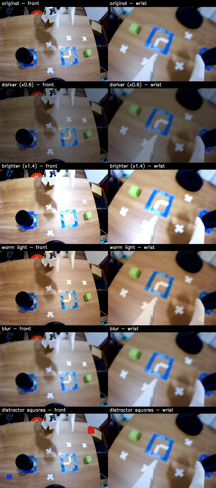

| Change | ACT all @50k | Diffusion @100k | SmolVLA @100k |
|---|---|---|---|
| None | 1.44 | 1.48 | 1.03 |
| Darker (x0.6) | 1.68 (+17%) | 2.24 (+51%) | 1.43 (+39%) |
| Brighter (x1.4) | 1.75 (+22%) | 2.62 (+77%) | 1.54 (+50%) |
| Warm light | 1.48 (+3%) | 1.92 (+30%) | 1.21 (+17%) |
| Blur | 4.00 (+178%) | 2.92 (+97%) | 2.48 (+142%) |
| Two coloured squares pasted in | 1.44 (+0%) | 1.47 (-1%) | 1.09 (+6%) |

Findings:
- SmolVLA has the lowest error under every change.
- ACT degrades least, in relative terms, under lighting changes but
  worst under blur.
- Diffusion is the most sensitive to lighting.
- The pasted squares barely mattered for any model. They were static
  and far from the cube, so real distractor objects on the table are
  the stronger test.
- Limits: training-set frames and synthetic image changes; robot trials
  are the real test.

## Robot evaluation

Protocol: `docs/test_protocol.md` (10 taped spots, 2 trials each, same home
pose and layout for every model). Raw results: `results.csv`.

| Model | Seen spots | New spots | Overall |
|---|---|---|---|
| ACT 100k (baseline) | TODO | TODO | TODO |
| ACT all +50k | TODO | TODO | TODO |
| Diffusion 100k | TODO | TODO | TODO |
| SmolVLA 100k | TODO | TODO | TODO |

### Finding: a distractor on a trained spot pulls SmolVLA, not ACT or Diffusion (open)

Status: observed by the operator on 2026-10-24 (spot SQ, condition
SQD, model `smolvla`). A controlled test must confirm it. A vision
model (Gemini) check from frame grids was not reliable: it reported
picks that did not occur. Use a measured landing point instead.

Observation:

- Condition SQD puts a blue cube next to the green cube.
- If the blue cube is on an X mark or another spot used for the green
  cube in training, SmolVLA goes first to a point between the two
  cubes.
- If the blue cube is on a spot that training did not use, SmolVLA
  ignores it and picks the green cube.

First measurement (scorer, 2026-10-24). "On a trained spot" = blue
cube within 1.2 cm (half a cube width) of a training start position.
Both models scored 10/10 at SQ without the blue cube.

| Model | Blue cube position | Trials | Picked | Placed | First close to the side |
|---|---|---|---|---|---|
| `smolvla` | On a trained spot (0.0-1.0 cm) | 6 | 0 | 0 | 0.3-5.1 cm |
| `smolvla` | Not on a trained spot (1.8-5.6 cm) | 3 | 3 | 2 | 1.6-1.8 cm |
| `act_aug` | On a trained spot (0.2-1.2 cm) | 4 | 3 | 3 | 0.1-1.3 cm |
| `act_aug` | Not on a trained spot (2.1 cm) | 1 | 1 | 1 | 0.9 cm |
| `diffusion` | On a trained spot (0.1-0.9 cm) | 3 | 3 | 3 | 0.2-2.2 cm |
| `diffusion` | Not on a trained spot (4.8 cm) | 1 | 1 | 1 | 0.4 cm |

- `diffusion` trial 4 is not in the table: setup error. At t=0 the
  green cube was still in the bin; the operator moved it at about 14 s.

- One `smolvla` trial is not in the table: the scorer did not find the
  blue cube.
- `blue_train_cm` = blue cube to the nearest training start position.
  `blue_green_cm` = blue cube to green cube. It is 8.7-18.6 cm for all
  trials of both models, so the distance between the cubes does not
  explain the difference.
- The first close lands near the green cube (`close_frac` -0.14 to
  0.22), not half way to the blue cube. For `smolvla` the blue cube
  pulls the grasp to the side and the grasp misses. It does not make a
  "between" target.
- `smolvla`, on vs not on a trained spot (picked 0/6 vs 3/3): Fisher
  p = 0.012. Inside the second session only: 0/2 vs 3/3.
- Blue cube on a trained spot, picked: `smolvla` 0/6, `act_aug` 3/4,
  `diffusion` 3/3. `smolvla` vs `act_aug` + `diffusion` (0/6 vs 6/7):
  Fisher p = 0.005.
- Result: the effect is in SmolVLA, not in ACT or Diffusion. The same
  data and the same layout do not distract the two models that train
  their own vision encoder. So the cause is not only the data; the
  model type matters. A possible reason: SmolVLA keeps its pretrained
  vision encoder frozen, and its general "object" features respond to
  any cube. ACT and Diffusion train their ResNet on this scene, so
  their features can separate the green cube from the blue cube.
- The sample is small (13 trials with the blue cube on a trained
  spot), so this is a strong lead, not proof.
- Pixel-to-cm scale: median training cube size of the 5 nearest
  training start positions (fixed camera, so it holds for any light).

Episodes (video source for the write-up canvas):

- Datasets are in `~/.cache/huggingface/lerobot/Low101/<dataset>/`.
- Front video: `videos/observation.images.front/chunk-000/file-000.mp4`.
  Wrist video: the same path with `observation.images.wrist`.
- "Clip" = start and end time of the episode in that mp4 file (s).
- Frame grids: `runs/spot_review/vlm/<dataset>/ep<n>.jpg`.

| Dataset | Ep | Blue on trained spot | blue_train_cm | blue_green_cm | close_frac | close_off_cm | Stage | Clip (s) |
|---|---|---|---|---|---|---|---|---|
| rollout_smolvla_SQD_20261024_175929 | 0 | yes | 0.2 | 14.9 | 0.13 | 3.4 | none | 0.0-17.5 |
| rollout_smolvla_SQD_20261024_175929 | 1 | yes | 0.2 | 14.2 | 0.16 | 3.6 | reach | 17.5-35.6 |
| rollout_smolvla_SQD_20261024_175929 | 2 | yes | 0.2 | 15.0 | 0.12 | 5.1 | reach | 35.6-53.8 |
| rollout_smolvla_SQD_20261024_175929 | 3 | yes | 0.2 | 13.9 | 0.02 | 2.6 | reach | 53.8-72.2 |
| rollout_smolvla_SQD_20261024_180518 | 0 | no | 3.1 | 12.7 | 0.05 | 1.8 | place | 0.0-12.8 |
| rollout_smolvla_SQD_20261024_180518 | 1 | yes | 0.0 | 16.5 | 0.22 | 1.3 | none | 12.8-30.4 |
| rollout_smolvla_SQD_20261024_180518 | 2 | no | 5.6 | 18.6 | 0.11 | 1.6 | place | 30.4-42.7 |
| rollout_smolvla_SQD_20261024_180518 | 3 | yes | 1.0 | 8.7 | 0.13 | 0.3 | reach | 42.7-60.4 |
| rollout_smolvla_SQD_20261024_180518 | 4 | not found | - | - | - | - | place | 60.4-72.9 |
| rollout_smolvla_SQD_20261024_180518 | 5 | no | 1.8 | 12.8 | 0.04 | 1.8 | lift | 72.9-90.8 |
| rollout_act_aug_SQD_20261024_183632 | 0 | yes | 1.2 | 12.3 | 0.08 | 0.9 | reach | 0.0-20.1 |
| rollout_act_aug_SQD_20261024_183632 | 1 | no | 2.1 | 10.3 | 0.03 | 0.9 | place | 20.1-32.2 |
| rollout_act_aug_SQD_20261024_183632 | 2 | yes | 0.9 | 9.0 | -0.14 | 1.3 | place | 32.2-47.5 |
| rollout_act_aug_SQD_20261024_183632 | 3 | yes | 0.2 | 14.6 | -0.06 | 0.1 | place | 47.5-61.7 |
| rollout_act_aug_SQD_20261024_183632 | 4 | yes | 0.4 | 17.5 | 0.02 | 1.1 | place | 61.7-81.9 |
| rollout_diffusion_SQD_20261024_184444 | 0 | yes | 0.4 | 17.8 | 0.09 | 0.2 | place | 0.0-14.3 |
| rollout_diffusion_SQD_20261024_184444 | 1 | no | 4.8 | 13.3 | 0.11 | 0.4 | place | 14.3-27.2 |
| rollout_diffusion_SQD_20261024_184444 | 2 | yes | 0.1 | 15.7 | 0.03 | 0.9 | place | 27.2-40.7 |
| rollout_diffusion_SQD_20261024_184444 | 3 | setup error | - | - | - | - | lift | 40.7-60.4 |
| rollout_diffusion_SQD_20261024_184444 | 4 | yes | 0.9 | 8.8 | 0.03 | 2.2 | place | 60.4-79.5 |

Model comparison video pair (blue cube on a trained spot, same spot
type, different model):

- `smolvla` misses: `rollout_smolvla_SQD_20261024_175929` ep 3 (blue
  0.2 cm from a trained spot, clip 53.8-72.2 s).
- `act_aug` picks and places: `rollout_act_aug_SQD_20261024_183632`
  ep 3 (blue 0.2 cm from a trained spot, clip 47.5-61.7 s).
- `diffusion` picks and places: `rollout_diffusion_SQD_20261024_184444`
  ep 2 (blue 0.1 cm from a trained spot, clip 27.2-40.7 s).

Best video pair (same session, same model, only the blue cube moves):

- Blue on a trained spot, grasp misses:
  `rollout_smolvla_SQD_20261024_180518` ep 3 (clip 42.7-60.4 s).
- Blue off the trained spots, first grasp works and the cube goes in
  the bin: `rollout_smolvla_SQD_20261024_180518` ep 2 (clip
  30.4-42.7 s).
- Backup for the miss: `rollout_smolvla_SQD_20261024_175929` ep 3
  (clip 53.8-72.2 s). The green cube stays in the square and the arm
  goes to the bin empty (checked by eye).

Related: the instruction test ("pick blue cube and place into the
bin", green and blue cube on the table). SmolVLA still goes for the
green cube. Dataset `rollout_smolvla_SQDUO_20261024_181315`:

| Ep | Stage | Clip (s) | Note |
|---|---|---|---|
| 0 | none | 0.0-17.1 | no grasp |
| 1 | lift | 17.1-33.9 | lifts the green cube, not the blue cube |

Possible cause (hypothesis):

- The policy learned where cubes appear more strongly than which color
  to pick. The instruction says "green cube", but the training data
  never had a second cube, so color was not needed.
- The same spatial prior can explain the bias toward the square. In
  training, 81 of 151 episodes put the cube on the square.

Test to confirm it (if time allows):

1. Keep the green cube on one spot, for example SQ.
2. Put the blue cube on a trained spot (an X mark) for 10 trials.
3. Put the blue cube on an untrained spot at the same distance for 10
   trials.
4. Record the first approach target: green, blue, or between.
5. Compare `pick_success`, `task_success` and `miss_cm` between the
   two groups.
6. Repeat with `smolvla_aug` and, if time allows, with ACT and
   Diffusion.

Evidence for the write-up: one side-by-side video pair (blue cube on
a trained spot and on an untrained spot) and one small table of first
approach targets.

## B-spline execution (BSP): faster and smoother motion (open)

Reference: B-spline Policy, https://b-spline-policy.github.io/.

### What we built

- ACT-BSP and Diffusion-BSP: the same models, but each prediction is
  one B-spline segment. A segment is 16 knot times and 16 control
  points for the 6 joints. Both models start from the trained
  baselines and train on `third-act-attempt` (ACT 30k steps,
  Diffusion 40k steps).
- Executor `parcel_vla/robot/run_bsp.py`: a 50 Hz control thread samples the
  curve by wall-clock time, tau = elapsed x 30 fps x speed. A
  planner thread makes the next segment when the current one is 50%
  used. Thus the speed does not depend on the inference rate.
- Debug tools: `--sweep` (one episode per speed, debug logs),
  `parcel_vla/bsp/diagnose_bsp.py` (per-episode table) and
  `parcel_vla/bsp/grid_executor.py` (offline grid test of the executor
  settings on demo frames).

### First robot runs (cube at SQ, 1 trial per speed)

ACT-BSP succeeded at 1x, 1.5x, 2x and 2.5x (8.7 s, 12.9 s, 8.0 s,
6.2 s). One trial per speed is not enough for a claim.

### Problem: Diffusion-BSP jerks above 1x

The user saw jerks at 1.35x with the default settings. The first
sweep (10 DDIM steps, `--max-step 4`, no blend) showed the cause:

- At each segment switch, the new segment starts 7-9 deg (p95, arm
  joints) away from the last command. This happens at every speed.
- Inside a segment the motion is smooth up to 2x (0% clamped ticks).
- The 4 deg per tick limit spreads each jump over 2-3 ticks. The
  user sees this as a jerk.
- Higher speed gives more switches per second (1.8/s at 1x, 4.9/s at
  3x). Direction reversals increase from 4.6/s to 23.2/s.

Cause: Diffusion starts each plan from new random noise, so two
plans 0.3 s apart do not agree.

### Offline grid test (demo frames, no robot)

DDIM steps x noise, 30 frame pairs, plans 15 frames apart (arm
joints, deg):

| DDIM steps | Plan time | Error vs demo (median) | Jump between plans (p90) |
|---|---|---|---|
| 10 | 88 ms | 5.4 | 11.2 |
| 5 | 48 ms | 5.1 | 10.3 (6.7 fixed noise) |
| 3 | 32 ms | 5.9 | 11.8 |
| 2 | 23 ms | 19.9 | 22.4 |

Executor simulation (4 episodes, 1,920 settings):

- A 0.2 s blend between segments cuts reversals 4-10x up to 2.5x.
  It does not increase the error against the demo.
- `--max-step` does not change smoothness. It sets how closely the
  arm follows the curve at high speed (p95 error at 3x: 36 deg at
  step 4, 15 deg at step 8).
- With the blend, fixed noise gives no clear gain.

### Robot results after the fix

Settings: `--ddim-steps 5 --max-step 6 --blend 0.2`. Direction
reversals per second (lower is smoother):

| Speed | Old settings | New, random noise | New, fixed noise |
|---|---|---|---|
| 1x | 4.6 | 0.5 | 0.1 |
| 1.5x | 8.4 | 1.2 | 1.6 |
| 2x | 8.3 | 2.5 | 3.5 |
| 2.5x | 19.1 | 6.8 | 7.6 |

- Ticks cut by the step limit: 1.5-8% before, 0-0.4% after.
- Plan time: 115-140 ms before, 85-93 ms after.
- 2x with the new settings is smoother than 1x with the old ones.
  The simulation predicted 2.2 reversals/s at 2x; the robot gave 2.5.

Success, all runs with the new settings (1 trial per speed per
sweep, 4 sweeps):

| Speed | Success | Done (s) |
|---|---|---|
| 1x | 3/3 | 8.7-12.9 |
| 1.25x-1.75x | 3/5 | 6.3-8.7 |
| 2x | 2/4 | 5.0-6.4 |
| 2.5x | 3/4 | 4.4-5.5 |
| 3x | 1/2 | 4.8 |

The old-settings sweep had 6/7. Smoothness is clearly better. A
success rate at the same level as 1x is not shown yet.

### Open questions

- Why do the failures above 1x happen? Look at the failure videos in
  `runs/bsp/sweep_*`.
- The arm lags its command by 13-30 deg (arm joints, at plan time),
  also at 1x. Thus it is not the servo speed limit. A possible cause:
  the gripper presses into the table or the cube during the grasp.
  Per-joint lag logs can show this.

### Next

5 trials at 1x and 5 at 2x with the locked settings. Then compare
success and completion time (claim: faster at equal success).

## Parcel task preparation: ArUco labels for benchmarking

The parcel task needs a score that does not depend on a person. Each
parcel has a shipping label with a unique ArUco marker, in place of
the QR code. The marker is for benchmarking after training, during
inference. A script finds the marker in the front camera after each
run. It gives the parcel ID, the parcel position and the label side:
if the marker is visible, the label is up. The policy does not get
the marker ID. The marker is only part of the label image, the same
in training and in inference.

### Label design

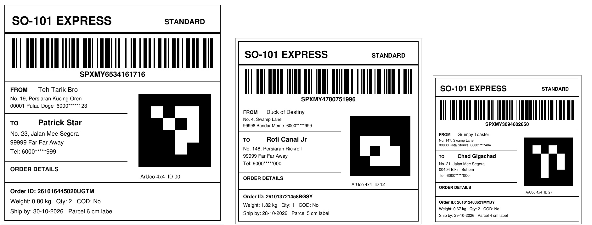

- Shopee-style layout: courier header, Code 128 tracking barcode,
  sender, recipient and order details, and an ArUco marker.
- All names, streets, towns and postcodes are fictional (for example
  "SpongeBob SquarePants, Conch Street, 00404 Bikini Bottom").
  Postcodes 00xxx and 99xxx and phone numbers 6000... do not exist in
  Malaysia.
- Sizes: 6 x 6 cm (marker 19.5 mm), 5 x 5 cm (16.3 mm) and 4 x 4 cm
  (13 mm). Dictionary `DICT_4X4_100`, one ID per label (IDs 0-50).
  `labels.csv` maps each ID to its size and tracking number.
- First design problem: a solid black header with white text was
  found as a false marker at camera resolution. The header is now
  black text on white. After this change, the rendered pages gave
  0 false detections.
- Print at 100% scale on matte paper. Each page has a 50 mm ruler to
  check the scale.

### Live camera test (front camera, 640 x 480)

The full 5 cm and 4 cm sheets were put flat on the table, in the
front camera view. `test_aruco_live.py` found the markers in each
frame and logged them.

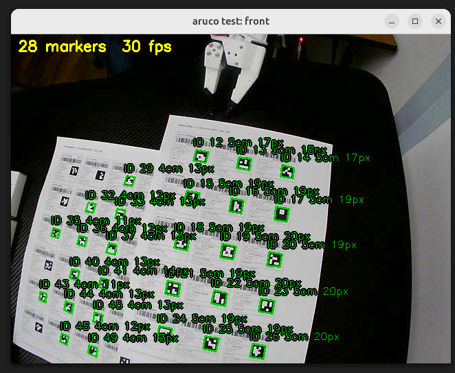

Video of the live test: `test_check_on_front_cam_aruco.webm` (70 s,
not in this repository).

Result, sheets not moving (160 s, 4754 frames at 30 fps):

| Label | Labels in view | Marker width | Found in >= 90% of frames | Found in < 50% of frames |
|---|---|---|---|---|
| 5 x 5 cm | 15 | about 19 px | 13 | 0 |
| 4 x 4 cm | 24 | about 12 px | 9 | 12 |

- 5 cm labels: the camera finds all of them in almost every frame.
- 4 cm labels: about half of them fail. Markers of 11-13 px are at the
  limit of the detector.
- False detections: 0 while the sheets did not move; 5 in 220,000
  detections in the full 22-minute front run. The wrist camera gave
  21 in 34,000. All false IDs were not in `labels.csv`, so a check
  against `labels.csv` removes them.
- The 6 cm sheet was only in view while it moved, so this test gives
  no detection rate for it. Its markers are larger than the 5 cm
  markers.

Decision: use 5 cm labels (or 6 cm) on the parcels for the benchmark.
Do not use 4 cm labels with the front camera at this distance.

Files: `parcel_vla/setup/labels/make_labels.py` (makes the label PDFs and
`labels.csv`), `parcel_vla/setup/labels/test_aruco_live.py` (live test, one
camera), `parcel_vla/setup/labels/parcel_labels_A4.pdf` (all labels) and
`parcel_vla/setup/labels/parcel_labels_test_A4.pdf` (one label per size).

## Parcel task: process and results

The parcel task is a small version of Figure AI's parcel sorting.
How the BSP versions of each policy are made: `parcel_vla/bsp/README.md`.

### Task

One parcel per episode:

1. Start at the home pose.
2. Move the parcel from the stack zone to the flip zone. Dataset A1
   pushes or pulls it. Dataset B and later pick it and place it.
3. If the label is up, flip the parcel.
4. Push the parcel off the table, label down.
5. Go back to the home pose.

Parcels: black box, yellow box, black bag and white bag. Each one has
an ArUco shipping label (see the label section above).

### Setup

| Camera | Device | Size | Policy name (SmolVLA) |
|---|---|---|---|
| Top | RealSense colour (YUYV) | 848x480 | `camera1` |
| Wrist | USB camera 2607053 (MJPG) | 640x480 | `camera2` |
| Side | USB camera 2607071 (MJPG) | 640x480 | `camera3` |

The 848x480 top view has the same 16:9 field of view as 1280x720
with less than half the pixels. At 1280x720, the encoder dropped
frames.

### Dataset A1 (`Low101/parcel-sort-a`, private)

- 100 episodes, 101,642 frames, 30 fps, 3 cameras.
- 15 heaps, from `parcel_vla/data/schedule_A1.csv`: 25 episodes for each
  parcel kind, 63 with the label up and 37 with the label down.
- One task text: "sort the parcel so the label faces down and push
  it off the table".
- Phase marks: the operator presses Space at the end of the push and
  at the end of the flip. `parcel_task/phase_marks_A1.csv` has the
  marks. The phases are push, flip and exit.
- The phases are only in the marks file. The dataset has one task,
  and all models are full-task models.

Medians: 39 s for an episode with a flip, and 21 s without a flip.

Tools (now in `parcel_vla/data/`):

| File | Purpose |
|---|---|
| `record_parcel.sh` | Record one heap of the schedule (3 cameras) |
| `record_preview.py` | `lerobot-record` with a live 3-camera preview and Space marks |
| `check_episodes.py` | Check the episode lengths, marks and video frames |
| `cut_phases.py` | Segments for each phase, from the marks |
| `make_schedule.py` | Make the heap schedule |

### Models

| Model | Start from | Steps | Batch | Final loss |
|---|---|---|---|---|
| `diffusion_parcel_a1_80k` | scratch | 80k | 16 | 0.005 |
| `diffusion_bsp_parcel_40k` | `diffusion_parcel_a1_80k` | 40k | 16 | 0.016 |
| `smolvla_parcel_a1_20k` | `lerobot/smolvla_base` | 20k | 12 | 0.068 |
| `smolvla_parcel_a1_80k` | `smolvla_parcel_a1_20k` | +60k | 12 | 0.029 |
| `smolvla_bsp_parcel_20k` | `smolvla_parcel_a1_80k` | 20k | 12 | 0.131 |

- Diffusion: each camera is resized to 240x424 before the stack
  (`parcel_vla/training/train_mixed.py`). Other settings: U-Net
  (256, 512, 1024), horizon 64, 2 observation steps and AMP.
- SmolVLA 80k: a fine-tune from step 20k with a new LR schedule
  (warmup 1000, cosine decay over 60k). A plain resume to 80k would
  run 50k steps at the minimum LR.
- Training ran on the laptop GPU (6 GB), one job at a time
  (`parcel_task/queue_smolvla80k.sh`). SmolVLA 80k took about 20 h,
  and SmolVLA-BSP took about 18 h.
- The dataset A1 checkpoints are not in this repository. The dataset
  B models are on the Hugging Face Hub (see `README.md`).

### Offline evaluation (no robot)

Script: `parcel_vla/evaluation/offline_eval.py`. Results:
`parcel_task/offline_eval/`. SmolVLA is the 20k checkpoint here.

- Held-out: 7 episodes that are not in training.
- Training reference: 7 training episodes.

Test 1: mean absolute error (deg, 5 arm joints) of the next 1 s of
predicted actions, compared with the human demo. For BSP, frames
outside the segment range are not scored.

| Model | Push | Flip | Exit | All, held-out | All, training ref |
|---|---|---|---|---|---|
| Diffusion | 6.57 | 5.97 | 8.78 | 6.94 | 2.30 |
| Diffusion-BSP | 6.84 | 7.21 | 10.43 | 7.86 | 3.03 |
| SmolVLA 20k | 6.93 | 6.36 | 9.13 | 7.30 | 4.12 |

Phase columns are held-out errors.

Test 2: label decision. At the end of the push, the model must choose
"flip" (label up) or "exit" (label down). The predicted next 1 s is
compared with the futures of all training episodes. The demo motion
shows the choice about 0.5 s after the mark. Thus the test uses
mark + 15 frames and mark + 30 frames.

| Model | Correct at +15 (100 training eps) | Correct at +30 |
|---|---|---|
| Probe on the demo futures | 89 | 92 |
| Diffusion | 82 | 81 |
| Diffusion-BSP | 83 | 83 |
| SmolVLA 20k | 87 | 78 |

The 7 held-out episodes are too few for a result.

Test 3: image swap at the decision point (100 pairs). Keep the arm
state of a flip episode, and use the images of a no-flip episode (or
the opposite way). "Follows" = the prediction changes to the kind of
the images.

| Model | Follows the images, +15 | +30 |
|---|---|---|
| Diffusion | 0.75 | 0.69 |
| Diffusion-BSP | 0.72 | 0.68 |
| SmolVLA 20k | 0.78 | 0.61 |

Findings: all three models read the label from the images. The exit
phase has the largest error offline.

### Robot pipeline fixes

| Problem | Cause | Fix |
|---|---|---|
| The control loop ran at 10-15 Hz | `prepare_observation_for_inference` converts the images to float on the CPU | `fast_prepare` sends uint8 to the GPU first (`parcel_vla/robot/rollout_mixed.py`). The loop now runs at about 25 Hz |
| SmolVLA motion jittered | Noise between the actions in a chunk | Moving average of 7 actions on the chunk (`SMOOTH=7`) |
| The loop dropped to 5 Hz with no image | The Rerun viewer blocked `rr.log` | Rerun is off by default. An mpv preview reads the newest frame in a thread |
| Keys did not work during a run | mpv read the terminal keys | `--input-terminal=no`, and a global key listener |
| Diffusion was slow | DDPM, 100 steps (0.8 s) | DDIM, 10 steps (0.1 s) |

Scripts:

- `parcel_vla/robot/run_parcel.sh`: Diffusion or SmolVLA through
  `lerobot-rollout`.
- `parcel_vla/robot/run_bsp_parcel.py`: Diffusion-BSP, with the BSP
  executor and a 3-camera episode video.
- `parcel_vla/benchmark/eval_parcel.sh`: one entry point for all models.

`eval_parcel.sh` flags:

- `--level easy|medium|hard`
- `--episodes`, `--parcels`, `--parcel`, `--where`, `--label`
- `--time`, `--speed`, `--no-record`

Logs: `runs/eval_logs/` and `results/robot/results_bsp_parcel.csv`.

Levels:

- Easy: 2-3 parcels, near the flip zone, not at the edge of the stack
  zone.
- Hard: more than 4 parcels, at the edge of the stack zone. The black
  box is also a hard case.

### Robot comparison (easy level)

Scene: a black bag with the label down, then a yellow box with the
label up. SmolVLA is the 20k checkpoint.

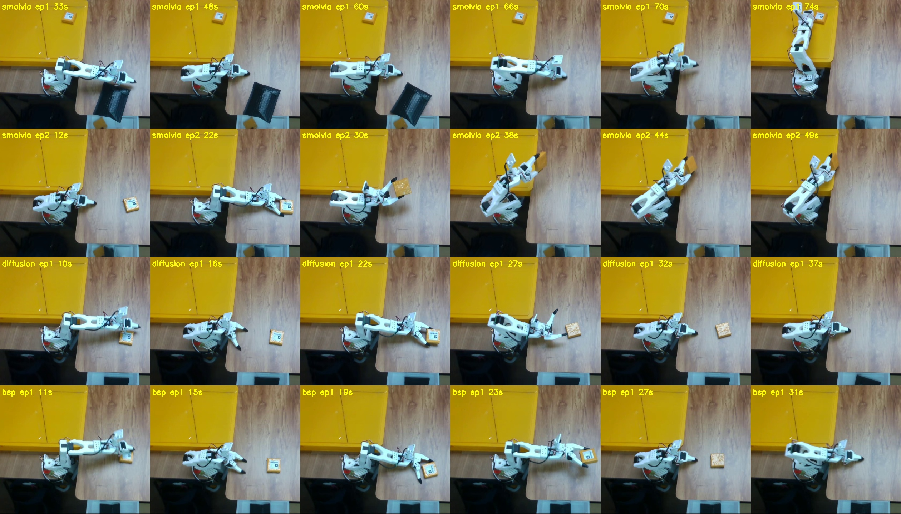

| Model | Black bag (no flip) | Yellow box (flip) |
|---|---|---|
| Diffusion-BSP, 1.5x | One push, done in 12-15 s | Flip and exit, done in 32-35 s |
| Diffusion | 3 push attempts, 38 s | Good flip and exit, 37 s |
| SmolVLA 20k | Slow exit (about 66 s), then it went to the next parcel | Flip attempt with gripper chatter; fail |

- All three models chose the correct branch (flip or no flip).
- Diffusion-BSP succeeded in all 5 episodes (1 at 1x, 4 at 1.5x).
- The ranking is the opposite of the offline ranking: Diffusion-BSP
  was the best on the robot.
- On the robot, the push from the stack zone was the weak phase, not
  the exit.
- Limits: few trials, easy level only, and BSP ran at 1.5x.

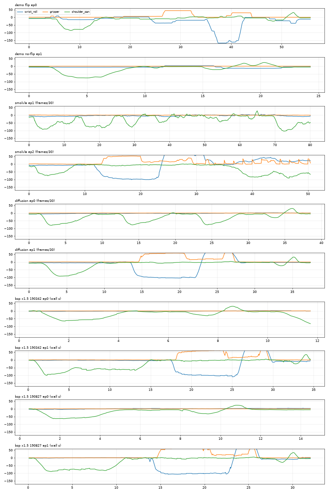

### SmolVLA 80k and SmolVLA-BSP on the robot (easy level)

- SmolVLA 80k: 2 episodes, good. It is the smoothest model on the
  robot: 1.1-1.2 direction reversals per second (SmolVLA 20k: about
  4).
- SmolVLA-BSP, first run (float32 VLM, random noise, no blend, plan
  325 ms): jerks at each segment switch, 2 fails.
- SmolVLA-BSP after the fixes (bfloat16 VLM, fixed noise, blend 0.2,
  plan 223 ms): 1 success in 48.4 s, 1.8 reversals per second.

The planning time sets the speed limit of a BSP model. The new plan
must arrive before the old segment ends:

```text
margin = (1 - f) * S / (30 * v) - L
v_max = (1 - f) * S / (30 * L)
```

f = `--replan-frac`, S = segment length (frames), v = `--speed`,
L = planning time. For SmolVLA-BSP (L = 0.22-0.3 s, S = 33-40), the
limit is about 1.8-3x; use 1.5x or less. The debug logs
(`--debug`, `parcel_vla/bsp/diagnose_bsp.py`) give the real margin and the
holds. Details, the time profile and the ways to plan faster:
`parcel_vla/bsp/README.md`, section 4.

### Faster inference: compiled denoising and RTC

Goal: shorter SmolVLA plans with the same output. Then no stops and
smooth chunk switches for the normal SmolVLA.

#### Procedure

We used a standard performance procedure. Each step uses the result
of the step before it.

1. Set the metric: plan time p50 and p95, and the output against a
   saved eager reference.
2. Make a repeatable benchmark (`parcel_vla/inference_improvement/bench_plan.py`): fixed frames,
   fixed noise, warm-up, CUDA sync, 30-40 repeats.
3. Measure the noise floor. Two eager runs give a difference of 0.
   The plan time changes by about 15% between processes (laptop GPU
   clock), so small gains need repeated runs.
4. Profile. Each denoising step launches about 1,215 small kernels.
   The GPU works for 3.2 ms of the 10-13 ms step, so the CPU launches
   are the bottleneck.
5. Find the limit before you write code: about 3.2 ms for each step.
6. Try the smallest change first, and read the compiler logs
   (`TORCH_LOGS="graph_breaks,recompiles"`).
7. Change one thing at a time, and measure after each change.
8. Put each change behind a flag, with the old path as the default.
9. Test offline (error in degrees), then on the robot (debug logs).

#### Compiled denoising step (`parcel_vla/inference_improvement/fast_denoise.py`)

Plain `torch.compile` on `denoise_step` failed in two ways:

- Recompile: `DynamicCache.crop()` changes the memory stride of the
  cache tensors after each step.
- Overwritten memory: the cache keeps a view of CUDA graph memory, and
  the next replay writes over it. PyTorch stops with an error. Without
  this check, the robot would get wrong actions.

The fix is `StaticPrefixCache`. It keeps the prefix K/V in fixed
buffers that the step only reads. `update()` returns
[prefix; suffix] and stores nothing, so `crop()` has nothing to undo.
The LeRobot source does not change.

SmolVLA-BSP (16 actions), cost of one step from the plan time at 1
and 10 steps:

| Variant | One step | Plan p50 / p95 (10 steps) |
|---|---|---|
| Eager | 13.2 ms | 236 / 333 ms |
| Static cache + `torch.compile` default | 3.4 ms | 144 / 157 ms |
| + `reduce-overhead` (CUDA graph) | 3.1 ms | 136 / 148 ms |

- The step is now at the GPU limit from the profile (3.2 ms).
- Kernel fusion gives most of the gain. The CUDA graph adds 0.3 ms.
- Accuracy is the same. The offline error on episode 45 is 2.859 deg
  (eager) and 2.858 deg (compiled). The maximum difference from eager
  is 0.106 deg, about one servo step (0.088 deg).
- Now the vision encoder and the prefix pass take about 95 of the
  136 ms. They are the next bottleneck.
- `run_bsp_parcel.py --compile default` uses this. The runner plans 3
  times before the first episode, because the first plan compiles
  (4-20 s).

#### Normal SmolVLA 80k with RTC

The normal SmolVLA uses synchronous inference: the arm stops for each
new chunk of 50 actions. LeRobot's RTC engine
(`--inference.type=rtc`) plans in a background thread while the arm
runs the current chunk.

We found three problems in the RTC path:

- Autograd overhead. RTC guidance runs the denoising under
  `enable_grad`, and all parameters have `requires_grad=True`. So
  PyTorch records an autograd graph that it never uses. `FREEZE=1`
  turns this off. The plan goes from 273 to 204 ms offline, with the
  same output.
- Delay off by one. The queue skips `ceil(latency x 30)` actions of
  the new chunk. This is often 1-2 more than the arm used, so the arm
  jumps ahead at each switch. `RTC_EXACT_DELAY=1` skips the actions
  really used.
- Compile outlier. The latency tracker keeps its all-time maximum.
  One slow compile plan would set the delay for the full run. The
  guidance path also compiles a second graph. `COMPILE=default`
  compiles both paths before the robot moves, and the tracker drops
  that plan.

Offline plan time (chunk 50, 10 flow steps):

| Variant | Plan p50 / p95 |
|---|---|
| Sync, eager | 182 / 187 ms |
| Sync, compiled | 142 / 154 ms |
| RTC, eager | 273 / 299 ms |
| RTC + freeze | 204 / 221 ms |
| RTC + freeze + compiled | 144 / 156 ms |
| RTC + freeze + compiled, 5 flow steps | 123 / 135 ms |

Robot results (easy level, one run for each variant, `SMOOTH=7`,
`execution_horizon=10`, `queue_threshold=30`). "Accel" is the 2nd
difference of the arm joints (deg per tick, p95). "Switch" means the
3 ticks after a new chunk starts.

| | sync | rtc | rtc_fix | rtc_fast | rtc_fast5 |
|---|---|---|---|---|---|
| Settings | - | RTC | + freeze, exact delay | + compile | + 5 steps |
| Pause time | 11.9% (38 stops) | 0.3% | 0-0.1% | 0% | 0% |
| Plan p50 / p95 (ms) | 190 / 223 | 300 / 350 | 215 / 270 | 142 / 158 | 123 / 141 |
| Actions used during a plan | - | 9 | 6 | 4 | 4 |
| Command accel, switch / inside | 7.3x | 3.0x | 1.1-1.6x | 1.1x | 1.1x |
| Measured accel at switch | 3.48 | 1.3 | 0.6-0.7 | 0.62 | 0.53 |
| RTC guidance error p95 (deg) | - | 5.6 | 1.4-1.7 | 0.8 | 1.6 |

- The arm moves at the same speed in all runs. Each action is one
  30 Hz demo frame, so the demo speed sets the motion speed.
- Sync mode stops 38 times (12% of the run). RTC removes the stops,
  so the task ends sooner.
- With plain RTC, the delay (9-10 actions) almost fills the
  `execution_horizon` (10), so the guidance error is large (5.6 deg).
- With `rtc_fast`, the delay is 4 actions and the switches are
  smooth (1.1x). The new chunk also starts from a newer camera image
  (0.13 s old, not 0.33 s).
- 5 flow steps save 20 ms more, but the guidance error doubles. We
  keep 10 steps.
- Limit: one run for each variant, with different motions. Only the
  large differences are clear.
- Our first RTC test used `SMOOTH=0`, but the sync default is
  `SMOOTH=7`. That test changed two things, so its jerk did not show
  the RTC effect.

Default from now on (`rtc_fast`):

```bash
RTC="--inference.type=rtc --inference.rtc.execution_horizon=10 \
  --inference.queue_threshold=30"
FREEZE=1 RTC_EXACT_DELAY=1 COMPILE=default ROLLOUT_ARGS="$RTC" \
  bash parcel_vla/robot/run_parcel.sh smolvla80k test
```

`DEBUG=1 LABEL=<name>` writes a log to `runs/debug_logs/`.
`python -m parcel_vla.robot.rollout_debug runs/debug_logs/*.npz`
compares the logs.

#### Lessons

- Profile first. The step looked slow because of GPU math, but the
  real cause was CPU launch overhead.
- Find the limit first. It tells you when to stop.
- Measure the noise floor of the timing and of the output before you
  compare.
- Read the compiler logs. A graph break or a recompile can remove the
  gain with no error.
- Faster inference does not make the arm move faster. It removes stops
  and makes the switches smooth. A faster motion needs time scaling
  (BSP `--speed`) or faster demos.
- Look at the full path, not only the model. Two of the three RTC
  problems were in the engine (autograd and delay), not in the
  network.

### New pick-and-place approach (pilot)

The push from the stack zone is not consistent in the demos. The
operator pushes or pulls in different ways for each parcel, so the
models retry.

1. First demo (`parcel-approach-demo`): reach over the heap with an
   open claw, then pull. It is the same for all kinds, but slow
   (25-35 s for each pull).
2. Grasp pilot (`parcel-grasp-pilot`, 4 episodes): use the same
   method as the flip.
   - Box: close the gripper on the side walls (wrist roll about
     -95 deg).
   - Bag: pinch the edge, then place it in the flip zone (wrist roll
     about 0 deg).

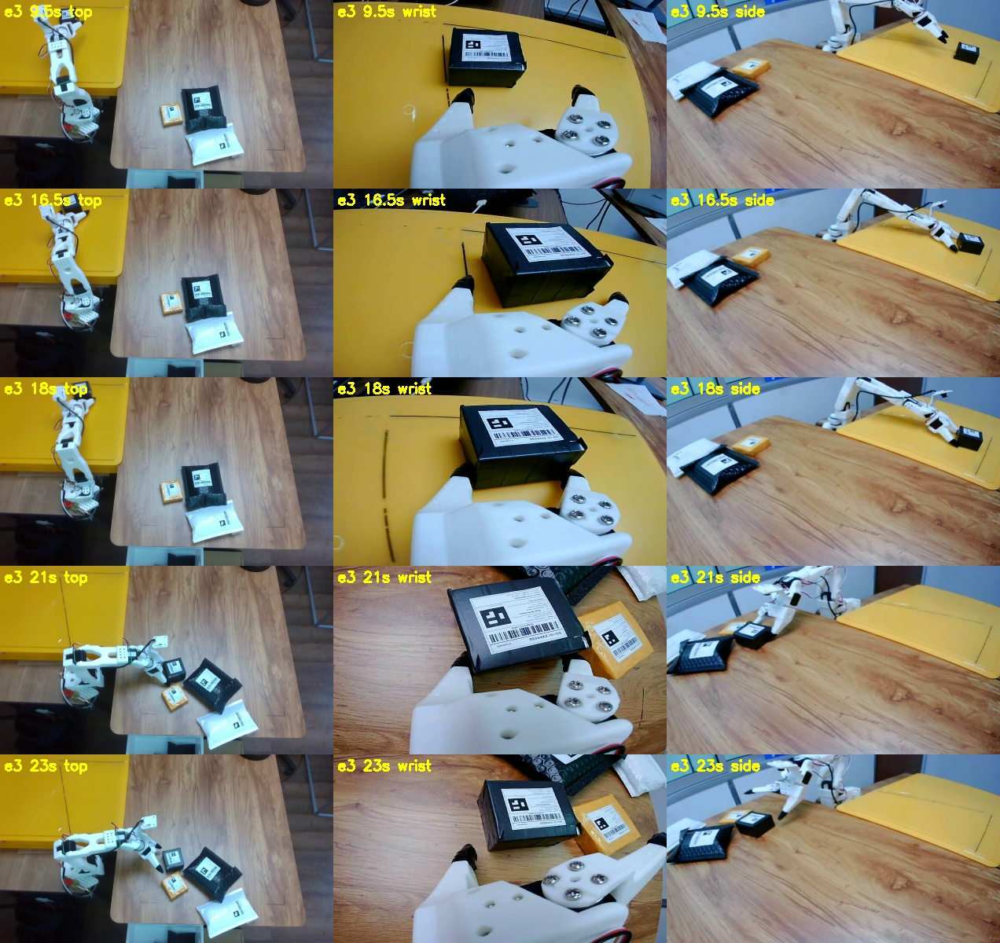

| Episode | Parcel | Alignment | Place |
|---|---|---|---|
| 0 | White bag | 13 s | 2.5 s |
| 1 | Yellow box | 16 s | 2 s |
| 2 | Black bag | 8 s | 2.3 s |
| 3 | Black box | 14.5 s | 2 s |

- The place is one smooth motion of 2-2.5 s in every episode.
- The two grasp modes have very different wrist rolls, so a policy
  can learn the split.
- The box grasp has almost the same wrist pose as the flip.
- The labels stay visible after the release.
- To improve: the alignment is slow (8-16 s). Turn the wrist and open
  the gripper during the reach.

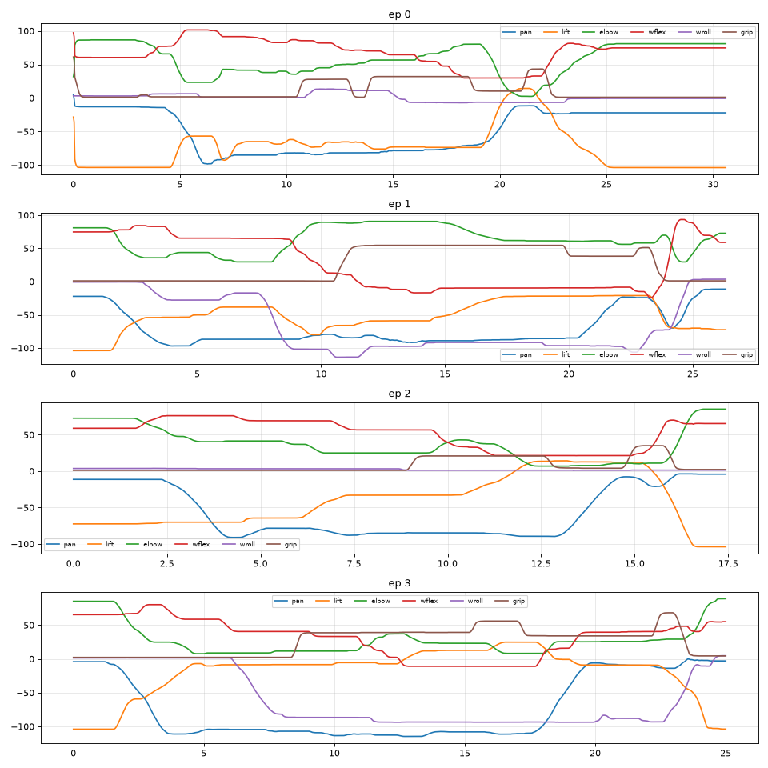

### Dataset B (`Low101/parcel-sort-b`, private)

Dataset B uses the grasp method of the pilot for all parcels.

- 99 episodes, 73,444 frames, 30 fps, 3 cameras. We removed one
  episode (old episode 88), because the operator grasped the parcel
  again after the release.
- 20 heaps. Each heap starts with 4-5 parcels. One episode sorts one
  parcel.
- Procedure: home pose, pick from the stack, place in the flip zone
  (and flip if the
  label is up), release with the label down, Space mark, exit push.
- 61 episodes have a flip and 38 have no flip. We found the kind from
  the wrist roll range before the mark (threshold 135 deg).
- About 25 s for each parcel.

Each heap starts with a pile, and the operator takes the top parcel
first. We looked at the first frame of all 99 episodes:

| Start state | Episodes (about) |
|---|---|
| A bag on a bag | 25 |
| A box on a bag | 5 (16, 35, 56, 65, 66) |
| A box on a box | 5 (40, 75, 76, 80, 81) |
| No parcel on another | 65 |

No episode starts with the black box on the yellow box.

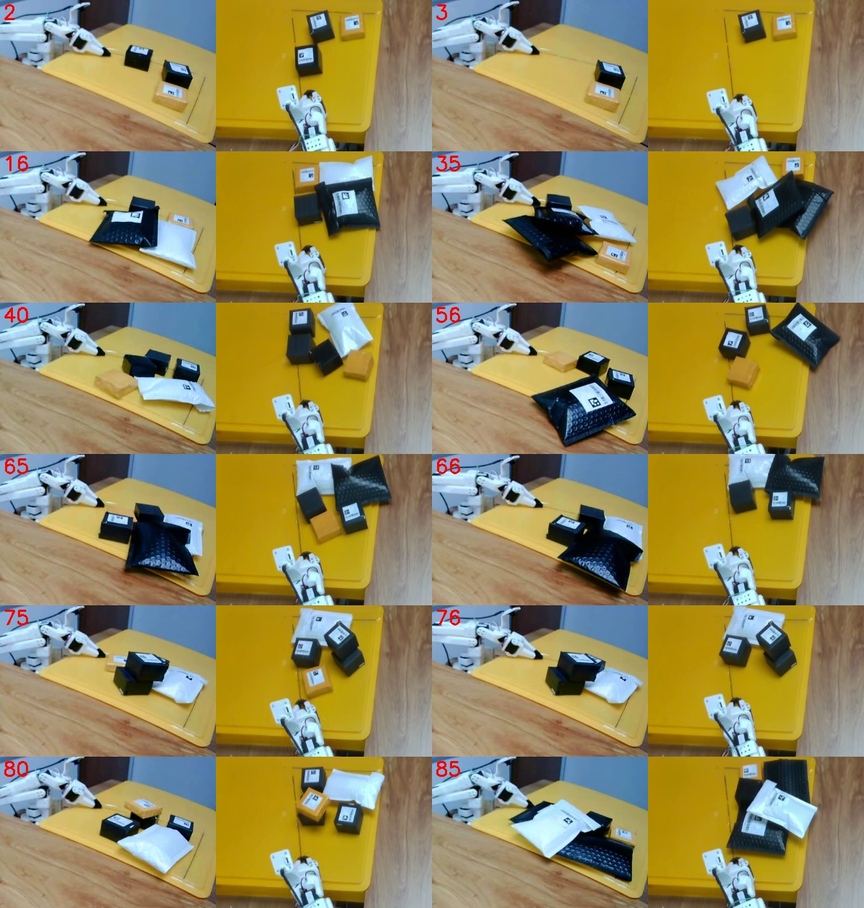

#### Models (dataset B)

All four trained one after the other on the laptop GPU
(`parcel_task/queue_b.sh`).

| Model | Start from | Steps | Time | Final loss |
|---|---|---|---|---|
| `smolvla_parcel_b_80k` | `lerobot/smolvla_base` | 80k | 27.4 h | 0.025 |
| `smolvla_bsp_parcel_b_40k` | `smolvla_parcel_b_80k` | 40k | 13.8 h | 0.100 |
| `diffusion_parcel_b_80k` | scratch | 80k | 9.4 h | 0.005 |
| `diffusion_bsp_parcel_b_40k` | `diffusion_parcel_b_80k` | 40k | 5.1 h | 0.018 |

- SmolVLA 80k uses `--policy.scheduler_decay_steps=80000`. Without
  it, the cosine schedule ends at 30k.
- `parcel_vla/bsp/train_bsp.py` now casts the warm-start weights to the dtype of
  the `--init` checkpoint. Before the fix, the SmolVLA VLM was float32,
  not bf16.

#### Offline evaluation (dataset B)

Script: `parcel_vla/evaluation/offline_eval_b.py`. Results:
`results/offline_eval_b/`.

Test 1 is the action error (deg, 5 arm joints, next 1 s). Test 2 is
the flip decision on the 99 training episodes (probe on the demo
futures: 95/99). Test 3 is the image swap: the share of predictions
that follow the swapped images.

| Model | Test 1, training ref | Test 1, held-out | Test 2 (of 99) | Test 3, flip images | Test 3, no-flip images |
|---|---|---|---|---|---|
| SmolVLA B 80k | 1.91 | 11.44 | 95 | 0.39 | 0.90 |
| SmolVLA-BSP B | 2.39 | 12.04 | 93 | 0.29 | 0.92 |
| Diffusion B | 2.02 | 11.56 | 95 | 0.47 | 0.95 |
| Diffusion-BSP B | 3.08 | 12.40 | 91 | 0.61 | 1.00 |

- The held-out episodes are old pilot episodes. Their approach is
  different, so the held-out error is high for all models.
- Test 3, flip images: the arm state is from a no-flip episode, and
  the images show a label up. Only 0.29-0.61 of the predictions
  change to a flip. Thus a missed flip is more likely than a wrong
  flip.

#### Robot results, easy level (dataset B)

Scene: a black bag and a yellow box, both with the label up, not on
each other. One heap for each model. We checked each episode in the
video.

| Model | Parcels sorted | Total time | Problems |
|---|---|---|---|
| SmolVLA-BSP B, 1.5x | 2/2 | 59 s | 27 s stop at the start |
| SmolVLA B, RTC | 2/2 | 73 s | One failed flip; the model found the bag again and flipped it |
| Diffusion-BSP B, 1.5x | 2/2 | 85 s | 45 s above the yellow box before the grasp |
| Diffusion B | 1/4 (2 heaps) | 52 s + 70 s | 6 missed grasps |

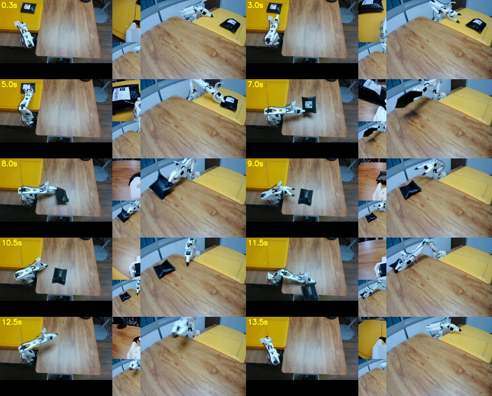

- The BSP models flip the black bag in 14-18 s. The demos take about
  25 s.
- The yellow box is the slow parcel for three models.
- Diffusion B closes the gripper next to the parcel (wrist camera).

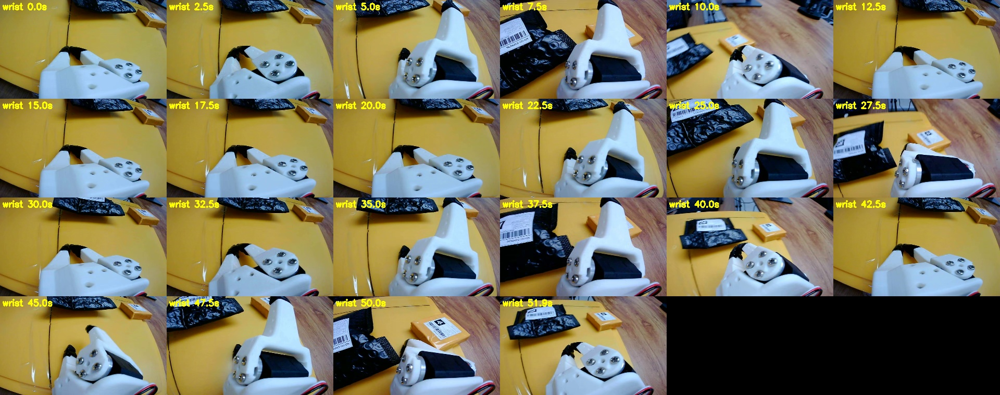

#### Robot results, stacked parcels (dataset B, medium level)

Scene: 4 parcels in two piles. The white bag is on the black bag (a
bag on a bag). The black box is on the yellow box (a box on a box).
Mixed labels. One heap for each model. Diffusion B was not tested.

| Model | Bag on bag | Box on box | Correct, no help |
|---|---|---|---|
| SmolVLA B, RTC (87 s) | Both correct. Two missed grasps on the white bag | Pushed off as one stack. Black box label up | 2/4 |
| SmolVLA-BSP B, 1.5x (141 s) | Both correct. A person put the white bag back once | Black box correct. Yellow box after 60 s of retries, label up | 2/4 (+1 with help) |
| Diffusion-BSP B, 1.5x (49 s) | White bag correct. Black bag flipped, but the exit push missed | Black box correct. The yellow box fell onto the table; the model did not go to it | 2/4 |

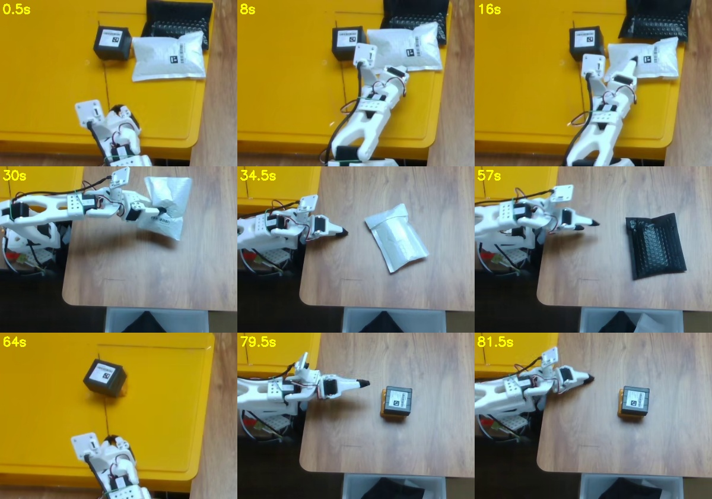

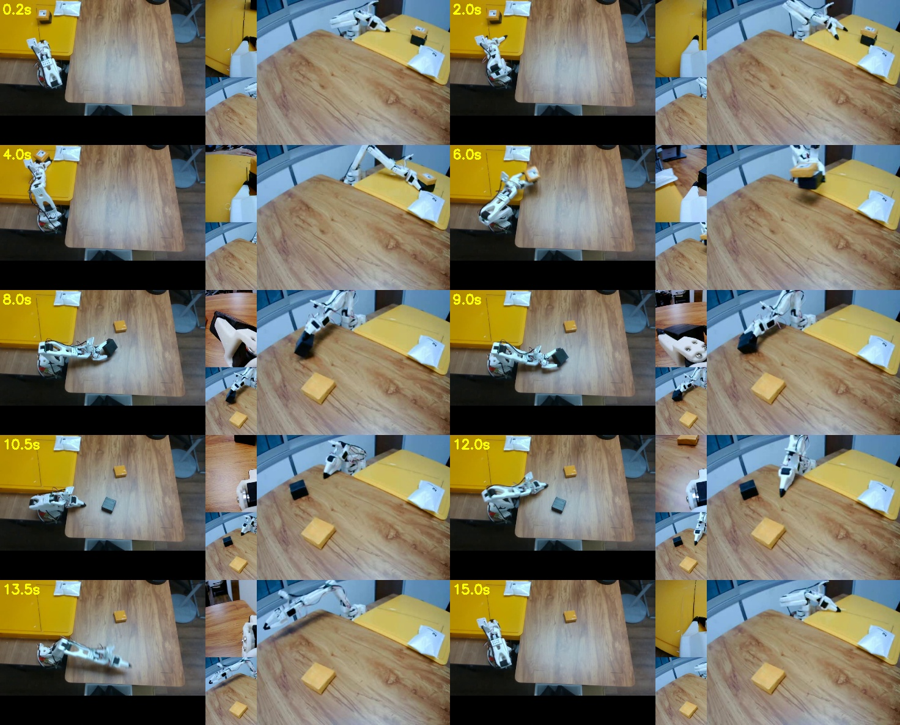

Findings:

- **The bag-on-bag pile works.** All three models took the top bag
  first. About 25 training episodes have this start state.
- **The box-on-box pile fails with all three models.** The training
  data has only about 5 box-on-box starts, and none with this pair.
  The models do not know how to separate two boxes:
  - SmolVLA B grasped both boxes and pushed them off as one stack.
  - SmolVLA-BSP B pulled the yellow box out from under the black box
    after 60 s, and released it with the label up.
  - Diffusion-BSP B dropped the yellow box on the table. The models
    did not see a parcel alone on the table in the demos, so it did
    not go to it.
- **Few demos for a state give no skill for that state.** The fix is
  more demos of the failed states, not more training steps.
- In SmolVLA-BSP episode 0, the model pulled the white bag to the
  stack edge. A person put the bag back at 22-25 s. The results file
  shows a success, but the episode had help.

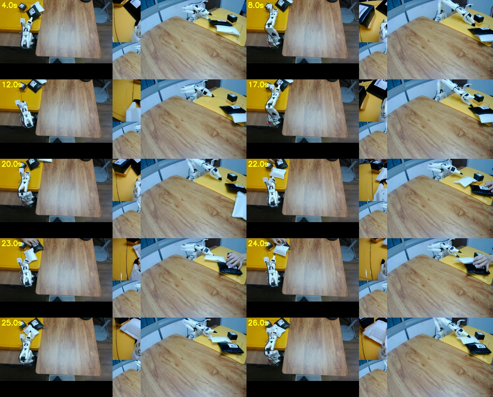

#### Robot results, 5-parcel heap (dataset B, hard level)

Scene: one heap of 5 parcels, like the training heaps. Bags on bags,
no box on a box. Parcels: black bag, black box, white bag, small
labelled orange box, plain orange box (label down). Mixed labels.
One heap for each model. The BSP runs use one episode for each
parcel. The SmolVLA RTC run uses one episode for the full heap, with
a 240 s limit.

| Model | Cleared | Run time | Labels correct |
|---|---|---|---|
| Diffusion-BSP B, 1.5x | 5/5 (3/5 with no help) | 86 s (15-23 s for each parcel) | 5/5 |
| SmolVLA-BSP B, 1.5x | 4/5 | 219 s | 4/4 |
| SmolVLA B, RTC | 3/5 | 231 s (time limit) | 3/3 |

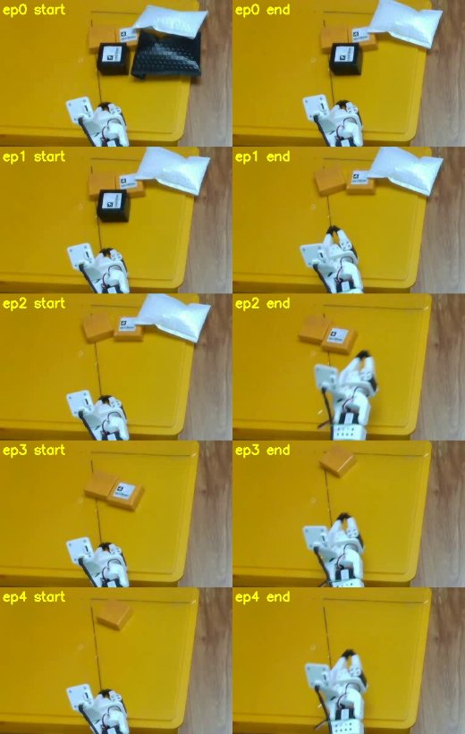

Findings:

- **Diffusion-BSP B cleared the heap, with hand help in 2 episodes.**
  A check of the video (Nov 20) shows a hand that pushes the box
  closer to the gripper in episode 3 (5-10.5 s) and episode 4 (3-10
  s). Episodes 0-2 have no help. Thus the result is 5/5 cleared, 3/5
  with no help. It flipped the
  labelled orange box (the label is up when the gripper holds the
  box, and the tape side is up after the release). It pushed the
  plain orange box with no flip, which is correct.
- **SmolVLA-BSP B did not grasp the small boxes.** In episode 2, the
  arm stayed at home for 27 s. Then it moved above the two small
  orange boxes for 50 s and pushed them a little, but the gripper did
  not close. The small labelled orange box stayed on the tray at the
  end. Episodes 0-2 also start with 17-27 s with no motion.
- **SmolVLA B (RTC) cleared 3 parcels in 231 s.** It moved above the
  black box for 75 s before the grasp. At the time limit, the small
  labelled orange box and the white bag stayed on the tray.
- **The SmolVLA problem is the grasp decision, not the motion.** All
  the flips that the SmolVLA models did were correct. The time loss
  is in the wait at home and in the hover before the grasp.
- The heap layout was not the same for each model, and there was one
  heap for each model. Thus, this result is an indication, not a
  controlled comparison.

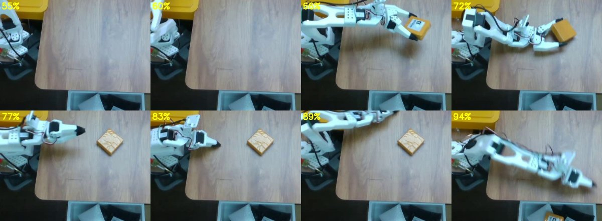

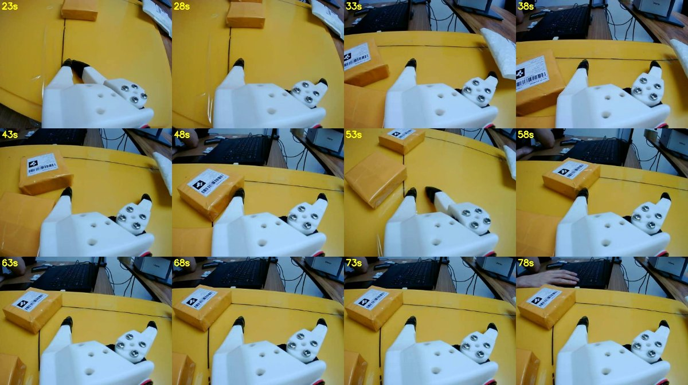

#### Robot results, 8-parcel heap (dataset B, hard level)

Scene: one heap of 8 parcels. The heap is wider than the training
heaps. Some parcels are at the far edge of the tray, and one orange
box is on another orange box. The BSP runs use one episode for each
parcel (8 episodes, 90 s each). The SmolVLA RTC run uses one episode
for the full heap, with a 400 s limit.

| Model | Success (log) | Success, no help | Main failure |
|---|---|---|---|
| Diffusion-BSP B, 1.5x | 6/8 | 5/8 | stops at the far edge |
| SmolVLA-BSP B, 1.5x | 3/8 | 1/8 | push moves other parcels |
| SmolVLA B, RTC | 8/8 in 341 s | - | black box as a bag |

"Success, no help" counts the episodes with no hand in the frames.
For the RTC run, the help events in the 341 s video are not counted.
The episode numbers below start at 0 (file `ep<n>`). The terminal
shows the number + 1.

Findings:

- **Diffusion-BSP B stops in front of parcels at the far edge.** In
  episode 2, the arm went to the black box and the orange boxes at
  the far edge in 6 s. Then it stayed there for 75 s with the gripper
  open, and did not grasp. In episode 3, the arm stayed in the same
  pose for 17 s. A hand pushed the black box closer at 23-29 s, and
  the arm grasped it at once. The model finds the parcel, but it does
  not do the last part of the reach.
- **The cause is few demos, not the joint limit.** The command in
  the hover pose is shoulder lift 45-49 deg and elbow 0-8 deg. The
  arm can go farther: the demos go to shoulder lift 70 deg and elbow
  -42 deg. But only 14 of 99 episodes in dataset B reach this far in
  the stack zone (3.5 % of the stack-zone frames). Thus, the model
  has few examples of a grasp at this distance.
- **SmolVLA-BSP B moves other parcels when it pushes.** In episodes
  1, 2 and 4, the push moved other parcels from the tray to the
  table. At the start of episodes 5-7, all the parcels were on the
  table. This start state is not in the demos. Only episode 3 took a
  parcel from the tray and pushed it off with no help. In episode 6,
  a hand moved the black box at 30 s. In episode 0, the black bag
  stopped in the middle of the table (fail at the exit).
- **The models use the bag push on the black box.** SmolVLA B (RTC)
  closed the gripper and pushed the labelled black box to the side at
  210-216 s. This is the bag action. The box action is a grasp, and a
  flip if the label is down. The operator saw the same error with
  all three models. The black box and the black bags have the same
  colour, and the top camera image is small.
- **5 parcels is the worst case that the models handle.** Each
  dataset B heap starts with 4-5 parcels. The 5-parcel heap is at the
  edge of the training data, and the 8-parcel heap is past it.
- **No model clears 8 parcels with no help.** The 8-parcel heap is
  not a good benchmark heap. Use it later as a test for DAgger (item
  9).

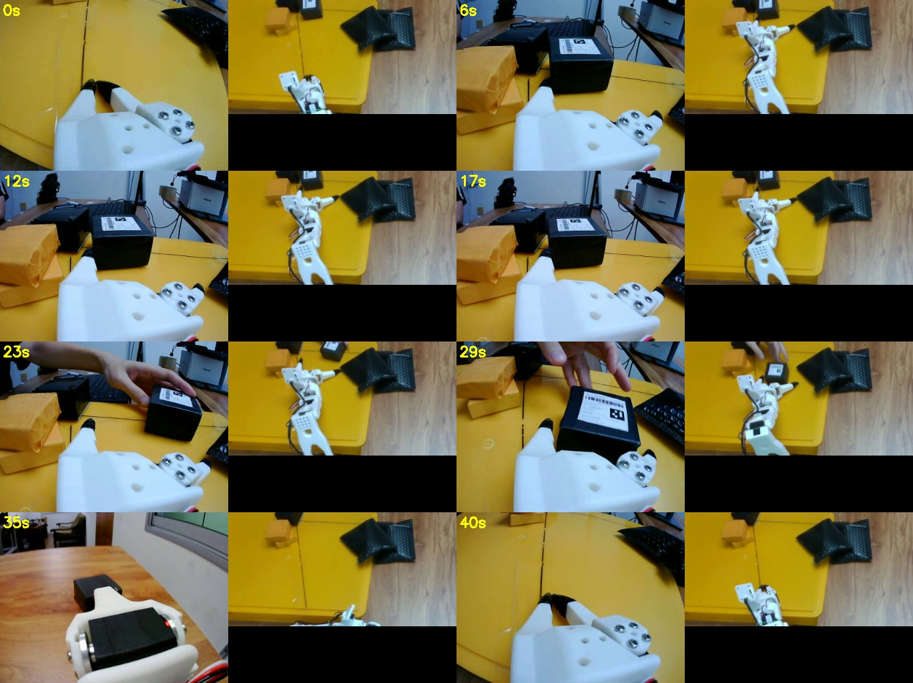

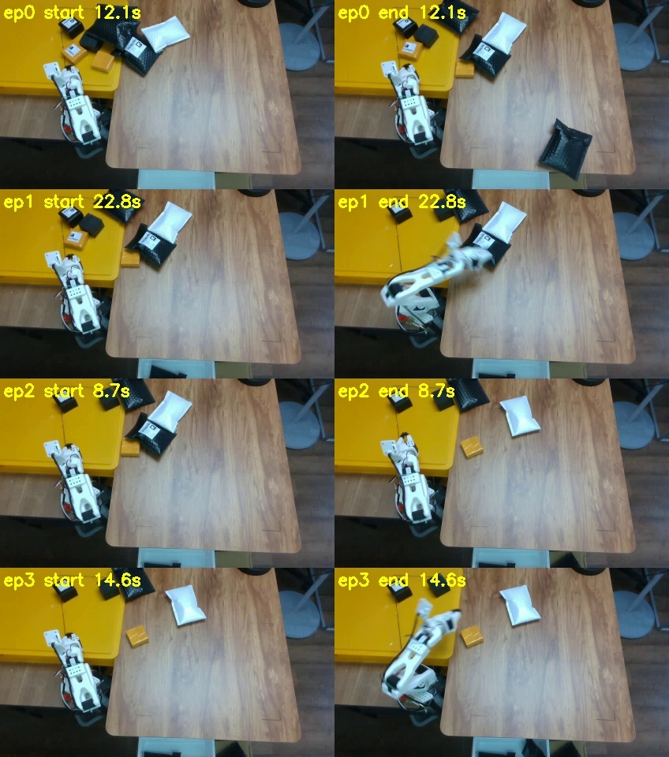

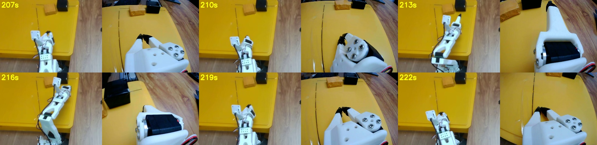

Recordings: `Low101/rollout_eval_parcel_<model>_<level>` (LeRobot
models) and `runs/bsp/<model>_parcel_<level>_<time>/` (BSP models).

## DAgger and new skills (dataset B)

Goal: teach SmolVLA B the states where it failed (item 9), and keep
the old skill. We did three rounds. Each round changed one thing.

### Round 1: corrections of all failures (failed)

- Data: 83 corrections (`Low101/rollout_dagger_parcel_b`, 60,409
  frames), tags `black_box`, `box_stack`, `far_edge` and `on_table`.
  The policy runs, and the operator takes over with the leader arm
  (Tab, takeover, Tab).
- Fine-tune: dataset B + corrections, 15k steps. The corrections were
  about 45 % of the merged frames.
- Robot: both DAgger models (`smolvla_b_dg`, `smolvla_bsp_b_dg`)
  stayed at home. They turned the wrist a little and did not reach.

We found the cause in four steps:

1. Each correction ended with about 1.4 s at home with no motion. At
   the home pose, the share of frames that leave fell from 69 % to
   46 %.
2. `trim_corrections.py` cut these tails (4,042 frames). The share
   went back to 72 %, but the model still stayed at home (offline).
3. A start test measures the start motion offline: the wrist roll
   turn on the home-pose frame where the old model starts. Old
   SmolVLA B: 32 deg. DAgger, tails cut: 3.7 deg.
4. A control run used dataset B only, with the same recipe and 5k
   steps. It kept the start (27 deg). The DAgger run at 5k had
   6.5 deg. Thus, the corrections caused the stall, not the recipe.

| Home-pose frame | Old SmolVLA B | Control, B only (5k) | DAgger, tails cut (5k) |
|---|---|---|---|
| Old run, start frame: roll turn | 32 deg | 27 deg | 6.5 deg |
| Stalled run at 30 s: roll turn | 34 deg | 33 deg | 7.8 deg |

Lesson: many corrections that start in the middle of the task pull
the model away from the start motion. The start is only about 2 s at
the start of each dataset B episode, and no correction has it.

### Round 2: one skill at a time

We changed the data, not the recipe. Recipe for all runs: from
`smolvla_parcel_b_80k`, lr 1e-4, warm-up 500, batch 12. Only the
action expert trains (100M of 450M parameters).

- Far edge (`smolvla_b_fe`): 16 corrections that start in the hover
  pose at the far edge. `trim_corrections.py --mode pull` keeps only
  the pick and the place (6,377 frames, about 7 % of the mix). Flip,
  exit push and return are the same as in dataset B, so we cut them.
  We dropped 4 corrections: 3 that start at home and 1 with a bad
  grasp.
- Box on box (`smolvla_b_box`): 20 full demos in dataset B style
  (`Low101/parcel-skill-boxstack-cut`, 13,965 frames). We cut the
  wait at the start (hands in the scene) to 0.5 s before the first
  motion.
- Both (`smolvla_b_fb`): dataset B + far edge + box demos 3 times,
  15k steps.

The start test is the gate before the robot. Pass: roll turn at
least 15 deg, and a grasp-pose error near the old model.

| Model | Roll turn | Skill fit (deg) | B fit (deg) | Robot |
|---|---|---|---|---|
| Old SmolVLA B | 32.0 | 6.5 (box), 16.3 (far edge) | 1.2 | - |
| `smolvla_b_fe` (5k) | 29.4 | 2.4 | 1.6 | Far edge: works |
| `smolvla_b_box` (5k) | 19.8 | 3.5 | 1.7 | `ref3`: works. Box on box: fails |
| `smolvla_b_fb` (10k of 15k) | 21.1 | 1.4 | 1.4 | See round 3 |
| `smolvla_b_fe15` (15k) | 31.9 | 1.5 | 1.4 | Not tested |

Findings:

- **Short fragments keep the start motion.** The far-edge fragments
  are 7 % of the mix, not 45 %. The start stayed (29.4 deg), and
  the far-edge grasp works on the robot.
- **The box model was underfit.** It grasped at table height, so it
  took the bottom box or pushed the full stack. In 5k steps it saw
  each box frame about 0.7 times. With the box demos 3 times and 15k
  steps, the box fit fell from 3.5 to 1.4 deg.
- **Pick the checkpoint with the start test.** For `smolvla_b_fb`,
  15k fits a little better than 10k, but the roll turn falls to
  14.2 deg. The box demos start with a level wrist (6 deg turn, 31
  deg in dataset B), and the model moves toward that start.
- **A restart from a checkpoint erases the start for a short time.**
  `smolvla_b_fe15` starts from `smolvla_b_fe` with a new warm-up. At
  +2.5k steps the roll turn is 3.1 deg. At +5k it is 23.7 deg, and at
  +10k 31.9 deg. Do not use early checkpoints of a restart.

### Round 3: corrections on stacked parcels

On the robot, `smolvla_b_fb` (10k) did not take a direct path to
the stack. The base (shoulder pan) moved to one side first:

| Data | Pan change to the grasp | Overshoot > 5 deg, one side | Overshoot > 5 deg, other side |
|---|---|---|---|
| Dataset B (93 episodes) | +25 deg | 17 % | 1 % |
| Box demos (20) | +23 deg | 10 % | 5 % |
| `smolvla_b_fb` on the robot (6) | +3 deg | 33 % | 17 % |

The demos take a direct path, so the detour comes from the model.
The fix is corrections in the states where the model goes wrong.

- Data: 32 corrections on box-on-box stacks
  (`Low101/rollout_dagger_far_stack`): 10 at the far edge, 10 in the
  middle and 12 near. The policy starts by itself. The operator takes
  over at the first error and goes directly to the top box.
- Check: we looked at the top and wrist camera frames of each
  episode, not only at the joint values. We removed 2 episodes:
  - Episode 11 (middle): a hand moves the stack at 2.5-4 s during
    the approach. Then the arm moves away from the stack and comes
    back (a detour).
  - Episode 24 (near): 18.7 s. The arm releases the box at about
    10 s, and the gripper stays closed on nothing from 12 s.
- Cut: `trim_corrections.py --mode pull --grip-drop 25` keeps the
  approach, the pick and the place (30 episodes, 5,161 frames,
  `Low101/rollout_dagger_far_stack_pull`). The grasp rule is a drop
  of 25 from the highest gripper command, so a grasp on a big box
  also counts.
- Fine-tune (`smolvla_b_fbs`): from `smolvla_b_fb` 10k, the round 2
  mix + the stacked-parcel fragments (205 episodes, 126,877 frames),
  10k steps.

Offline results (`parcel_vla/finetuning/pick_checkpoint.py`,
`outputs/train/skill_report_fbs.md`). The fit is the mean grasp pose
error 0.5 s before the grasp, in deg. The stacked-parcel set has 27
grasps, the box set 20 and dataset B 22.

| Checkpoint | Roll | Stacked fit | Box fit | B fit | Passes |
|---|---|---|---|---|---|
| `smolvla_b_fbs` 2.5k | 17.6 | 2.5 | 2.3 | 3.1 | no |
| `smolvla_b_fbs` 5k | 15.2 | 2.1 | 1.9 | 2.2 | no |
| `smolvla_b_fbs` 7.5k | 16.2 | 1.8 | 1.6 | 1.9 | yes |
| `smolvla_b_fbs` 10k | 18.3 | 1.8 | 1.3 | 1.7 | yes |
| `smolvla_b_fb` 10k | 21.1 | 3.5 | 1.4 | 1.4 | yes |
| `smolvla_b` | 32.0 | 4.8 | 6.5 | 1.2 | reference |

- The stacked-parcel fit is half of the `smolvla_b_fb` fit (1.8 and
  3.5 deg). The box skill stays (1.3 and 1.4 deg).
- The B fit is 0.5 deg more than the old model, in the limit of
  1 deg.
- The roll turn is 18.3 deg. This passes (15 deg or more), but the
  old model turns 32 deg. The start motion is weaker than before.
  Check the start on the robot first.
- Pick: 10k (`last`). It is equal to 7.5k on the stacked parcels and
  better on the box, dataset B and the roll.
- The fit test now finds a grasp on this set with the same rule as
  the cut (a drop of 25). With the old rule (below 30), the grasps
  on big boxes were not found.

Robot results (`smolvla_b_fbs` 10k, box on box, 5 episodes,
`Low101/rollout_eval_parcel_smolvla_b_fbs_hard`). Settings: RTC,
`FREEZE=1`, `RTC_EXACT_DELAY=1`, `COMPILE=default`, Python control.
Each episode is the top box of one stack.

| Ep | Stack | Result | Time (s) |
|---|---|---|---|
| 0 | orange box on top, middle | pick, place, push off, home | 25 |
| 1 | black box on orange box, middle | pick, place, push off, home | 22 |
| 2 | orange box on top, middle | pick, place, push off, home | 30 |
| 3 | black box on orange box, far | stall, then grasp at 75 s | 87 |
| 4 | orange box on orange box, far | no pick | 105 |

- 3 of 5 episodes are good. In each good episode, the arm goes
  directly to the top box and takes only that box. The pan detour of
  `smolvla_b_fb` did not occur.
- Episode 3: the arm goes near the stack and back for about 60 s. A
  hand moves the stack at 38 s and 59 s. Then the arm grasps the
  black box and places it in the flip zone.
- Episode 4: the arm reaches the stack at 13 s, then goes back home
  and stops there from 26 s to 52 s. After that, it does not pick
  the top box. The stack is at the far edge, and both boxes are
  orange.
- The failures are at the far edge. The middle stacks are good.
- Motion: command jerk 0.12-0.16 deg/frame², 1.2-1.8 direction
  changes per second. This is the same as `smolvla_b_fb` (0.13-0.17,
  1.0-1.5).
- 5-parcel heap (the same heap as `smolvla_b` on Nov 11, 240 s):
  `smolvla_b_fbs` cleared 2 of 5 (black bag at 10 s, black box at
  140 s). The arm stays still for 42 % of the run (`smolvla_b`: 16 %,
  `smolvla_b_fb`: 7 %). It opens the gripper above the orange boxes
  but does not go down to grasp them. `smolvla_b` cleared 3 of 5.
  The fine-tune made the stacks better but the normal heap worse.
  The offline start test showed the same loss (roll 18 deg against
  32 deg).
- `smolvla_b_fb` 10k (Nov 16) on a different, easier heap (the
  operator changed the heap; 4 parcels at the start: plain orange
  box, small labelled orange box, black box, white bag): 4 of 4
  cleared in 190 s, still 1 % of the run. A hand moved the white bag
  once at about 70 s. This is not a fair comparison with the
  `smolvla_b_fbs` run above.
- 3-parcel heap (white bag, black bag, small labelled orange box, no
  stack; the same heap for both models, Nov 16, 180 s limit):

  | Model | Cleared | Run time | Still | Jerk | Flips/s |
  |---|---|---|---|---|---|
  | `smolvla_b_fbs` 10k | 3/3 | 85 s | 7 % | 0.147 | 1.1 |
  | `smolvla_b_fb` 10k | 3/3 | 75 s | 0 % | 0.158 | 1.2 |

  Both clear the heap. `smolvla_b_fb` is faster and does not stop.
  The operator also found its motion on the old skill smoother.
- Heap with a box on a box (white bag, black box label up on a plain
  orange box label down, near the far edge): the operator rates it
  hard for both models. Saved runs: `smolvla_b_fbs` episode 7 (tray
  clear at 48 s) and episode 8 (tray clear at 79 s: bag, black box,
  then orange box). The `smolvla_b_fb` run is not in the dataset.
- Orange box (label down) on the black box (label up), both models
  (operator rating):
  - `smolvla_b_fbs` is not usable. It uses the new top-box grasp on
    normal boxes that are not on a stack. On a normal 2-parcel heap
    in the stack zone, it does not know what to do.
  - `smolvla_b_fb` 10k does both. It does the stack pick (not
    perfect), and it changes back to the old push for a normal box in
    the stack zone.
- Do not have other programs open during a run. An earlier session
  with Chrome open made the loop slow (down to 6 Hz) and the jerk 2.7
  times higher. Those episodes were deleted. Also start with the
  wrist roll at the home pose of the demos. A 180 deg turn of the
  wrist is not in the training data.

SmolVLA-BSP version (`smolvla_bsp_b_fb`, offline only):
`parcel_vla/finetuning/queue_bsp_skill.sh fb|fbs`. It starts from
`smolvla_b_fb` 10k (selected: fbs is not usable on normal heaps) and
trains 30k steps on its own data mix, with the recipe of
`smolvla_bsp_parcel_b_40k`. The reference for the offline tests is
`smolvla_bsp_b`. A BSP plan is one segment (about 0.5 s), so it turns
the roll less than a 1 s SmolVLA plan. The roll limit was 15/32 of
the reference roll (now 20/32, see round 4). Results:
`outputs/train/skill_report_bsp_<fb|fbs>.md`.

Results of `smolvla_bsp_b_fb` (Nov 17, 30k steps in 10.3 h, final loss
0.112), fit in deg:

| Checkpoint | Roll | Far-edge fit | Box fit | B fit |
|---|---|---|---|---|
| 5k | 5.6 | 6.0 | 4.3 | 3.7 |
| 10k | 18.0 | 2.1 | 2.5 | 2.5 |
| 15k | 3.5 | - | 2.0 | 2.5 |
| 20k | 24.5 | - | 1.5 | 2.0 |
| 25k | 25.7 | - | 1.2 | 1.8 |
| 30k | 8.2 | - | 1.0 | 1.8 |
| `smolvla_bsp_b` (reference) | 15.4 | 15.7 | 6.5 | 1.2 |

- The far-edge group picked 20k. The box group picked 30k (box fit
  1.0 deg), but its roll of 8.2 deg fails the new limit (9.6 deg).
- From 15k the fit test finds no far-edge grasp ("-"), so the
  far-edge pick has a weak base.
- Robot candidates: 25k (best roll, box fit 1.2 deg, B fit 1.8 deg),
  then 20k.
- The roll changes much between checkpoints (3.5 to 25.7 deg). Do
  not use one checkpoint without the start test.
- Not tested on the robot.

### How the fine-tune works, and why fbs tilted to the new skill

SmolVLA has two parts. The vision-language model (VLM) changes the
three camera images and the task text into features. The action
expert makes a 1 s chunk of joint commands from these features.

- In all our fine-tunes, the VLM is frozen (`train_expert_only`,
  `freeze_vision_encoder`). Only the action expert trains.
- Each training step takes 12 random frames from the merged dataset.
  All frames have the same chance. A correction frame has no extra
  weight. The `intervention` column is removed before the merge.
- The weight of a skill is its share of the frames. Repeating a
  dataset in the merge increases its share.
- The action expert is a generative model (flow matching). It can
  keep more than one approach for one scene type. It does not
  assume one approach. It selects an approach with about the same
  chance as in the training data for similar scenes.

Shares of the frames in the two mixes:

| Part | Frames | fb mix | fbs mix |
|---|---|---|---|
| Dataset B (old skill) | 73,444 | 60 % | 58 % |
| Far-edge corrections | 6,377 | 5 % | 5 % |
| Box-stack demos (merged 3 times) | 13,965 x 3 | 34 % | 33 % |
| Stacked-parcel corrections | 5,161 | - | 4 % |

The corrections are only 4 % of fbs. The box-stack demos are one
third of both mixes, because we merged them 3 times.

Frames seen since `smolvla_b` (80k steps on dataset B, about 13
passes):

| Model | Dataset B frames | Box-stack frames | Stacked-parcel corrections |
|---|---|---|---|
| `smolvla_b_fb` 10k | +1 time each | 3 times each | 0 |
| `smolvla_b_fbs` 10k | +2 times each | 6 times each | 1 time each |

fbs started from fb and used the same mix again. Thus the box-stack
data had 3 times the weight of dataset B, two times in sequence. Both
runs used the learning rate of the first training (1e-4).

Why fbs uses the top-box grasp on normal boxes:

1. A box next to a box and a box on a box look almost the same in
   the top camera. The frozen VLM did not learn the difference.
2. All the datasets have the same task text, so the text gives no
   help.
3. The stacked-parcel corrections are in the middle and near part of
   the stack zone. Normal heaps are in the same place.
4. No correction shows "use the old push here". DAgger only fixes
   the states that the operator corrected.

The offline tests showed the tilt: the roll turn went from 32 deg
(`smolvla_b`) to 21 deg (fb) to 18 deg (fbs). The B fit went from
1.2 deg to 1.4 deg to 1.7 deg. The old skill is not lost, because
dataset B is more than half of each mix. The preference changed.

### Lessons: precautions when you add a new skill

1. Record a good demo dataset of the new skill first. Then fine-tune
   one time, from the base model, on a balanced mix.
2. Do not add corrections on top of a new-skill fine-tune, and then
   fine-tune again from that model. Each round adds drift. The
   model can tilt to the new skill and lose the old skill. More
   corrections are then necessary (a "DAgger loop").
3. Keep the dataset balanced. Keep the old skill at 60 % or more of
   the frames. Keep each new skill at 10-20 %. Do not merge a small
   new set many times to make it stronger.
4. If the scenes of two skills look alike, the model needs a signal
   to select the skill: different task texts, or corrections in both
   directions (new skill here, old skill there).
5. If you use DAgger, also correct the cases where the new skill is
   wrong. Record the old push on normal heaps, where the model starts
   the new grasp.
6. Use a lower learning rate for a fine-tune on top of a fine-tune
   (for example 3e-5), or fewer steps.
7. Use a strict offline gate before the robot test: roll turn 25 deg
   or more, B fit at most 0.3 deg more than the base model. The gate
   that we used (15 deg, 1 deg) let fbs pass.
8. Test the old skill on the robot after each fine-tune, on the
   normal heap, not only the new skill.

### Round 4: one balanced mix of all skills

Why: fbs gave the box-stack demos too much weight. They were 33 % of
the frames, because we merged them 3 times. The far-edge fragments
worked at only 5 % of the mix. Thus a small share is enough when the
data is clean. Round 4 merges each part one time and adds the
black-box and on-table corrections of round 1.

Data (`Low101/parcel-sort-b-all`):

| Part | Source | Episodes | Frames | Share |
|---|---|---|---|---|
| Dataset B (old skill) | `parcel-sort-b` | 99 | 73,444 | 65 % |
| Box-stack demos | `parcel-skill-boxstack-cut` | 20 | 13,965 | 12 % |
| On-table corrections | `rollout_dagger_on_table_cut` | 19 | 7,645 | 7 % |
| Black-box corrections | `rollout_dagger_black_box_cut` | 23 | 7,094 | 6 % |
| Far-edge corrections | `rollout_dagger_far_edge_pull` | 16 | 6,377 | 6 % |
| Stacked-parcel corrections | `rollout_dagger_far_stack_cut` | 30 | 5,141 | 5 % |
| Total | | 207 | 113,666 | 100 % |

How we made the correction sets:

1. The round 1 tags come from the session log and the session order.
   Episodes 20-42 are `black_box`. Episodes 64-82 are `on_table`. At
   episode 20 the start pose changes from a far reach (shoulder lift
   +34 to +52 deg) to a near pose (-71 deg).
2. All frames of the raw corrections are operator frames
   (`intervention` = 1). Thus no policy frames are in the mix.
3. Black box: `trim_corrections.py --mode pull` keeps the approach,
   the grasp and the lift (16,293 -> 7,291 frames).
4. On table: the corrections push the parcel off the table, with no
   grasp. They come from `rollout_dagger_parcel_b_trim` (home tails
   cut).
5. `trim_corrections.py --mode start` cuts the still start of each
   black-box, stacked-parcel and on-table correction to 0.5 s before
   the first motion (197, 20 and 289 frames cut).

All corrections together are 24 % of the frames. Round 1 failed at
45 %, and round 2 worked at 7 %. Thus the start motion is the main
risk, and the early check tests it first.

Steps (`parcel_task/queue_all.sh`, offline only, no robot):

1. Run A (`smolvla_b_all`): from `smolvla_b_fb` 10k, the best model
   on the robot (normal heap and stacks). 20k steps, because the data
   is larger. Learning rate 5e-5, half of the earlier runs (lesson 6).
2. Stop at 10k. `early_check.py` scores 5k (log only) and 10k.
3. If 10k passes, continue run A to 20k (resume from 10k).
4. If 10k fails, run B (`smolvla_b_allb`): from the base `smolvla_b`,
   learning rate 1e-4, 20k steps (lesson 1). Checks at 10k and 20k
   are logged only.
5. `pick_checkpoint.py` scores all checkpoints on five skill sets.
   Report: `outputs/train/skill_report_all.md`.
6. If a checkpoint passes rules 1-2 in all five sets, train the
   SmolVLA-BSP version (`smolvla_bsp_b_all`, 30k steps) from the
   passing checkpoint with the lowest mean fit. If no checkpoint
   passes, the queue stops.

Early check at 10k (all rules must pass):

| Rule | Pass | Source |
|---|---|---|
| 1. Leaves home | grip >= 0.9 at 1.6 s, roll turn >= 20 deg | `smolvla_b_fb` 10k: 21.1 deg. fbs (18.3 deg) failed the normal heap |
| 2. Old skill kept | B fit <= 2.2 deg | `smolvla_b` (1.2) + 1 |
| 3. New skills learned | mean black-box and on-table fit < 9.6 deg | `smolvla_b_fb` 10k mean |
| 4. Box skill kept | box fit <= 2.4 deg | `smolvla_b_fb` 10k (1.4) + 1 |

Rules 2-4 are loose on purpose. Rule 1 is the strict rule, because
the start motion broke rounds 1 and 3. The final report uses the same
roll limit (`ROLL_FRAC` = 20/32 of the reference: 20 deg for SmolVLA,
9.6 deg for SmolVLA-BSP).

Reference scores (`outputs/train/early_check_refs.json`), fit in deg:

| Model | Roll | Black box | On table | Box | B |
|---|---|---|---|---|---|
| `smolvla_b` | 32.0 | 6.3 | 12.9 | 6.5 | 1.2 |
| `smolvla_b_fb` 10k | 21.1 | 6.8 | 12.4 | 1.4 | 1.4 |

Expectations and risks:

- Black box against black bag is the weakest part. The VLM is frozen,
  and the two parcels look almost the same. Only the bag pushes in
  dataset B are on the other side. A clear fix needs the skill
  planner (a different task text for each skill).
- The offline fit does not show the skill selection. Even
  `smolvla_b` has a black-box fit of 6.3 deg. Only the robot test
  shows if the model grasps the black box and pushes the bags.
- The on-table fit uses the gripper close during a push, not a real
  grasp. It is a weak score.
- A learning rate of 5e-5 protects the old skill, but it can learn
  the new skills slowly.

Time (start in the evening, no robot runs during training):

| Result | SmolVLA report | SmolVLA-BSP done |
|---|---|---|
| Run A passes at 10k | about +8 h | about +19 h |
| Switch to run B | about +11.5 h | about +22.5 h |
| No checkpoint passes | as above | no BSP |

The 6 GB GPU cannot train and run the robot at the same time. To test
the SmolVLA model on the robot during the BSP training, stop the BSP
queue. A new start trains the BSP model from step 0.

Robot test after the offline report:

1. Normal 3-parcel benchmark heap, 3 runs. Compare with
   `smolvla_b_fb` 10k (3/3, 75 s). If the old skill is worse, stop.
2. Box on a box, middle and far edge.
3. Black box next to the black bags.
4. One parcel alone on the table.
5. Record the success, the time and the motion for each case. Add
   the result to this section and to the project page (story and
   engineering views).

#### Round 4 results

Offline (`skill_report_all.md`, fit in deg):

| Checkpoint | Roll | B | Black box | On table | Stack | Far edge | Box | Result |
|---|---|---|---|---|---|---|---|---|
| `smolvla_b_all` 10k | 22.9 | 1.3 | 2.8 | 3.8 | 1.8 | 1.5 | 2.0 | Pass |
| `smolvla_b_all` 15k | 10.5 | | | | | | | Fail (roll) |
| `smolvla_b_all` 20k | 8.2 | | | | | | | Fail (roll) |

- At 10k, the black-box fit is 2.8 deg (fb 10k: 6.8). The on-table
  fit is 3.8 deg (fb 10k: 12.4).
- After 10k, the start roll falls below the limit. More steps make
  the start motion weak again. The robot candidate is 10k.
- The SmolVLA-BSP version (`smolvla_bsp_b_all`, 30k steps from 10k)
  fails all sets: roll 1.6-5.2 deg (limit 9.6), B fit 2.5-3.7 deg.
  The cause is open. It is not used.

Robot (2026-11-18), `smolvla_b_all` 10k, RTC, compile default,
180 s for each episode. Dataset
`rollout_eval_parcel_smolvla_b_all_hard`, scores in
`results/benchmark/rollout_eval_parcel_smolvla_b_all_hard/scores.csv`.

| Ep | Case | Parcels | Cleared | Time (s) | Help | Problem |
|---|---|---|---|---|---|---|
| 0 | Normal heap of 3 | 3 | 3 | 108 | 1 | 45 s of grasp retries on the orange box |
| 1 | Heap of 4 | 4 | 3 | 173 (limit) | 1 | One orange box left at the time limit |
| 2 | Box on a box | 3 | 3 | 137 | 0 | 30 s still at home, 50 s of retries on the stack |
| 3 | Black box next to black bag | 2 | 2 | 50 | 0 | None |
| 4 | Box alone on the table | 2 | 2 | 44 | 0 | 20 s over the empty tray. Box pushed off label up |

Findings:

1. The model does all the new cases. The black box next to the
   black bag is clean, and this case failed in round 1.
2. The box on a box and the box on the table are cleared with no
   help, but slowly.
3. Grasp retries on orange boxes cost the most time (episodes 0-2).
   The gripper opens and closes many times before it holds the box.
   The bags do not show this problem.
4. The arm stays still or moves over an empty tray for 20-30 s
   (episodes 2 and 4). The start trim did not remove all of this.
5. One sort error: in episode 4, the labelled box went off the table
   label up. The gripper did not open, so there was no flip.
6. The operator moved a parcel two times (episodes 0 and 1).
7. `smolvla_b_fb` 10k cleared the normal heap in 75 s on Nov 16. That
   run also had a missed grasp on the white bag. Thus the two models
   are similar on the normal heap. The 75 s run had good luck.

Result: the model does the new cases one at a time. On normal heaps
it is not firm (see "Final benchmark"), so the benchmark uses
`smolvla_b_fb` 10k.

### Proposal: a skill planner that gives the task text

The VLM is not used well now. All the datasets have one task text,
and the language test showed that SmolVLA then ignores the text. A
small planner can select the skill for each step and send it as the
task text.

Skills and a preset priority order:

| Priority | Skill | Task text (example) |
|---|---|---|
| 1 | Box on a box | "pick the top box off the stack" |
| 2 | Parcel at the far edge | "pick the parcel at the far edge" |
| 3 | Box | "place the box in the flip zone" |
| 4 | Bag | "place the bag in the flip zone" |
| - | Flip and exit | "flip the label down and push it off the table" |
| - | Tray empty | "go home" |

How it works:

1. At home, between parcels, the planner looks at the top and side
   camera images.
2. It finds the parcels and their state: stacked, at the far edge,
   box or bag.
3. It selects the skill with the highest priority, and sends that
   task text to SmolVLA.
4. SmolVLA does the skill. The planner does not change the text
   during a skill, only at home.

Planner options, from simple to complex:

| Option | How it finds the state | Cost |
|---|---|---|
| Rules + ArUco labels | Label position and size in the top camera; a box on a box is higher in the side camera | Low; the labels exist, but a label down is not seen |
| Small detector (for example YOLO) | Boxes and bags with positions; overlap and size for a stack | Labelled images (frames from our datasets) |
| VLM question (for example SmolVLM2 or Qwen2.5-VL 3B) | "Is a box on another box? Which parcel is nearest the far edge?" | 0.5-2 s for each question, at home only |

This is the same idea as hierarchical robot policies (for example
Hi Robot and pi0.5). A high level selects the sub-task in text, and a
low level policy does it.

What is necessary:

1. Give each episode a skill task text. The datasets exist; only the
   `tasks` metadata changes. Dataset B needs a box or bag tag for each
   episode.
2. Fine-tune one time from `smolvla_b`, on a balanced mix with the
   new texts.
3. Test offline before the robot: on the same frame, a different
   text must give the action of that skill (the language test).
4. Change `rollout_mixed.py`, so that the task text can change
   between parcels.
5. Add the planner. Start with rules, then a detector if necessary.

Risks:

- The new-skill sets are small (16-30 episodes). The model can still
  use the images more than the text. The offline language test shows
  this before the robot test.
- A wrong planner decision gives a wrong skill. Keep the rules simple,
  and log each decision with its image.
- A change of text during a motion can cause a jump. Change the text
  only at home.

### Planner test: SmolVLM2-2.2B, offline (Nov 16)

The VLM only describes the scene. Code applies the priority. The VLM
answers 5 yes/no questions: box on a box, parcel at the far edge, box,
bag, tray empty. P(yes) comes from the "Yes" and "No" logits of one
forward pass, so the VLM does not write text.

Test set (`parcel_vla/planner/`):

- 135 frames at the home pose, from dataset B starts and the robot
  runs (`collect_home_frames.py`). Each frame has the top, side and
  wrist camera images.
- We labelled each frame by eye (`labels.csv`). 10 frames are skipped
  (a hand in the image, or not clear). 120 frames have a skill label:
  71 far edge, 25 stack, 19 box, 5 empty tray.
- The "far edge" label is a judgement. Most heaps are near the far
  edge.

Results:

| Method | Stack AUC | Stacks found | Far edge AUC | Skill accuracy | Time per decision |
|---|---|---|---|---|---|
| Zero-shot, top + side, no tiles | 0.74 | 4 % (1/25) | 0.82 | 69 % | 1.5 s |
| Zero-shot, top + side + wrist, tiles | 0.90 | 60 % | - | - | 4.4 s (stack question only) |
| Linear probe on VLM features + zero-shot for box and empty, top + side + wrist, no tiles | 0.96 | 92 % (23/25) | 0.98 | 81 % | about 2 s (5 x 0.4 s) |

- `vlm_planner.py`: the zero-shot planner. `stack_variants.py`:
  camera and prompt variants. `probe.py`: the linear probe.
- Zero-shot finds boxes, bags and an empty tray well (AUC 0.93-0.98).
  It does not find a box on a box well. "On top of" is difficult for a
  2.2B VLM in these images.
- The wrist camera at home sees the stack from the side. Together
  with the top and side cameras, the stack AUC goes up from 0.85 to
  0.90 (with tiles).
- Image tiles make the stack answer better (AUC 0.74 to 0.85) but 10
  times slower. Without tiles, one question takes about 0.1 s.
- Linear probe: the VLM reads the question and the three images. The
  hidden state of the last token goes to a logistic regression for
  each question. It learns our label definitions from 125 frames. The
  test is a 5-fold cross-validation by episode, so frames of one
  episode are never in training and test at the same time.
- With the probe, the planner selects the correct skill in 81 % of
  the frames (zero-shot: 69 %). It finds 23 of 25 stacks. It also
  calls 12 frames "stack" that are not a stack (8 far edge, 4 box).

Limits:

- One person labelled the frames. The stack frames come from a few
  sessions on one day. The probe can learn those sessions and not
  stacks in general. Test it on new heaps before the robot uses it.
- A false "stack" sends the stack skill to a normal box. That is the
  failure of `smolvla_b_fbs`. Thus, increase the stack threshold, or
  ask the question again before the planner selects the stack skill.

Smaller VLM (Nov 19): at run time, the planner and SmolVLA use the
same 6 GB GPU. SmolVLM2-2.2B needs about 4.5 GB, so it does not fit
next to SmolVLA. We ran the same linear probe with
SmolVLM2-500M-Video-Instruct (about 1 GB, features on the CPU,
`probe.py --model ... --device cpu`, `probe_cv_SmolVLM2-500M-*.csv`).

| Question | 2.2B AUC | 500M AUC | False yes, 2.2B / 500M (threshold 0.5) |
|---|---|---|---|
| Stack | 0.96 | 0.84 | 12 / 39 |
| Far edge | 0.98 | 0.92 | 2 / 4 |
| Box | 0.92 | 0.85 | 0 / 1 |
| Bag | 1.00 | 0.99 | 0 / 1 |
| Tray empty | 0.97 | 0.95 | 82 / 46 |

- 500M finds bags as well as 2.2B, but it is much worse on stacks: 39
  false stacks in 100 frames (2.2B: 12). Thus 500M alone is not
  sufficient for the stack skill.
- A higher threshold does not solve this. At 0.9, 500M finds 15 of 25
  stacks with 14 false stacks. 2.2B finds 20 with 7 false stacks.
- On the CPU, 500M needs about 26 s for the 5 questions. Thus the
  planner must use the GPU.
- Next: test 2.2B in 4 bits on the GPU (about 1.5-2.5 GB). Also
  measure the GPU memory of SmolVLA during a rollout.

Planner test: kind of the next parcel (Nov 19). The policy selects
the target from the image (robot test A). Thus the planner must give
the kind of the parcel that the policy goes to next. Labels: dataset
B, 99 episodes (the operator takes that parcel next; box/bag tag of
`make_skill3.py`). Probe = logistic regression on the VLM features,
cross-validation by heap.

| View (`parcel_vla/planner/`) | Model | Zero-shot | Probe | Time |
|---|---|---|---|---|
| Home: top + side + wrist, "parcel nearest the table" (`next_kind.py`) | 2.2B | 49 % | 78 % | 0.41 s |
| Home, same | 500M | 51 % | 74 % | 0.34 s |
| Wrist, 1 s before the grasp (`wrist_kind.py`) | 2.2B | 52 % | 97 % | 0.16 s |
| Wrist, 1 s before the grasp | 500M | 55 % | 99 % | 0.09 s |

1. From the home pose, the VLM cannot find "the nearest parcel"
   (zero-shot at chance). The probe learns the next parcel in 74-78 %
   of the heaps only.
2. A fixed rule (the parcel nearest to the flip zone) is not correct
   for heaps. In heaps, the operator takes the top parcel first (for
   example episodes 40, 60, 80: a box first, the bag is nearer to the
   table). Also, parcels that touch make one region in the image.
3. During the approach, the wrist camera shows the parcel in front of
   the gripper. The probe finds box or bag in 97-100 % (500M: 1 GB,
   0.1 s). With the gripper still closed, the result is the same
   (99 %).
4. Limit: in dataset B, the approach is different for boxes and bags.
   Thus the probe can also read the approach, not only the parcel. On
   the 8 episodes of robot test A (text and target do not agree), the
   parcel in front of the gripper 1 s before the grasp is not always
   the parcel that the arm takes. The arm can change its target in
   the last second. This is not clear yet.
5. Possible planner: the home probe gives the first text, and the
   wrist check changes the text one time during the approach. Test
   this on the robot as a log only first.

Live planner (`parcel_vla/planner/live_planner.py`, `PLANNER=log|drive` in
`run_parcel.sh`): a thread next to the policy reads the robot
observations. The top view plans, the wrist camera verifies.

0. Plan source (`PLAN_FROM`, default `probe`): the home probe
   (SmolVLM2-500M on the top, side and wrist crops at home, trained
   on the next parcel of the operator in dataset B, 74 %) or the top
   view below. Both are logged at each home visit. The operator
   reports that the policy takes the row nearest to the robot first,
   but not always the parcel nearest to the flip zone. Thus the
   learned habit (probe) is the default, not the fixed rule.
1. Top view (`parcel_vla/planner/topview.py`, a few ms): colour regions in the
   tray. Orange
   is a box, white is a bag, black is a bag when it is large (more
   than 6000 px), else a box. A small white region is a label. The
   rank is the operator's order: the row nearest to the robot first,
   then the parcel nearest to the flip zone (distance to a point
   below the tray at the flip-zone side). The skill of parcel 1 is
   the text.
2. Verify (approach, every 1 s until the grasp, 0.12 s): the wrist
   probe (SmolVLM2-500M) gives box or bag in front of the gripper, and
   if it agrees with the text in use. It changes the text only with
   `WRIST_SWITCH=1`. In the first drive run, the wrist image showed
   the black box and the black bag, and the probe said box with P 1.0.
   But the arm took the black bag (grasp at 9.3 s), so the plan (bag)
   was correct and the switch was wrong.
3. Limit: a black box that touches a black bag makes one black region
   (a bag). A watershed cut also cut single bubble bags into pieces,
   so it is not used.
4. Log: each call with the plan, P(bag), the text in use, agree or
   not, and the image (`debug_logs/planner_<time>.csv`, the plan
   image shows the ranks).
5. GPU: SmolVLA and the 500M wrist model use 1.9 GB at the peak.

Robot drive runs (Nov 19, `rollout_bench_parcel_smolvla_b_sk3d_planner_drive`,
heaps of 4 with one parcel of each kind, `PLAN_FROM=probe`):

1. The operator still had to set the skill with the keys. The policy
   and the planner both confuse the black box and the black bag.
2. The home probe says "bag" in 27 of 31 home visits, also when only
   boxes are in the tray. Home visits with one parcel left:

| Tray | Visits | Probe correct | Top view correct |
|---|---|---|---|
| Black box only | 2 | 1 | 2 |
| Orange box only | 4 | 1 | 4 |
| White bag only | 4 | 4 | 4 |

3. Thus the home probe of dataset B does not transfer to these runs
   (possible cause: small changes of the camera view and the light).
   The colour regions of the top view are correct in these cases.
4. Next: a heap without the black bag (white bag, orange box, black
   box, with a box on a box), `PLAN_FROM=view`. The operator sets the
   stack skill (key 3) after the plan call.

Next for the planner:

1. Record 20-30 new home frames of new heaps (stacks and no stacks).
   Test the probe on them without new training.
2. Set the stack threshold for few false stacks.
3. Add the planner to `rollout_mixed.py` as a log only. It records
   its decision at each home visit, and the robot does not use it.
4. When the decisions are correct, give the task text to a SmolVLA
   model that was trained with skill texts.

### Skill-text model: language test (Nov 18-19)

Question: does SmolVLA use the task text when each skill has its own
text? If not, a planner cannot select the skill, and more demos do not
help. Offline only, no robot.

Data (`Low101/parcel-sort-b-sk3`, `parcel_vla/skill_texts/make_skill3.py`): a
copy of `parcel-sort-b-all` with one text for each episode. The
far-edge and on-table corrections are not used.

| Text | Episodes | Frames |
|---|---|---|
| "pick the box and place it in the flip zone" | 49 dataset B + 23 black-box corrections | 45,324 |
| "pick the bag and place it in the flip zone" | 50 dataset B | 35,214 |
| "pick the top box off the stack" | 20 box-stack demos + 30 stacked-parcel corrections | 19,106 |

- Box or bag (dataset B): a box keeps the gripper open above 20 for
  the full carry (9-21 s). A bag lets the gripper close in less than
  7 s. We checked 96 episodes by eye, and all agree.
- Held out (not trained): dataset B episodes 40, 60, 80 (box) and
  50, 70, 85 (bag), with a box and a bag in the tray. Also box-stack
  demos 117, 124, 131 and black-box corrections 167, 176, 185.
- Training (`parcel_vla/skill_texts/queue_skill3.sh`): `smolvla_parcel_b_sk3_10k`
  from `smolvla_b` (80k), learning rate 1e-4, 10k steps, 160
  episodes (91,531 frames). Only the action expert trains.

Test (`parcel_vla/skill_texts/lang_test.py`): held-out frames from the start to
0.5 s after the grasp, every 10 frames (346 frames). For each frame,
the model predicts the next 1 s with each of the 3 texts and the same
noise. The correct text also runs with a second noise seed.

- Wins: frames where the correct text has the lowest error against
  the human action.
- Shift: the change of the prediction with another text, against the
  noise (same text, other seed).
- Grip: the highest predicted gripper value. A box grasp opens wider
  than a bag grasp.

Pass: the correct text wins in 80 % or more of the frames in each
group, and the shift is larger than the noise.

Control: `smolvla_b_all` 10k (one text for all data) on the same
frames (`outputs/train/skill3_lang_control.md`). The texts move the
prediction by 0.3-1.4 deg, less than the noise (1.6-2.9 deg). The
correct text wins in 8-30 % of the frames. Thus this model ignores the
text, as expected.

Result (`outputs/train/skill3_lang.md`, 10k): fail. No group has 80 %
wins.

| Group | Correct text | Wins | Shift: box/bag swap | Shift: top text | Noise |
|---|---|---|---|---|---|
| Dataset B, box | box | 57 % | 0.28 | 2.16 | 1.35 |
| Dataset B, bag | bag | 62 % | 0.40 | 2.97 | 1.62 |
| Black box next to bags | box | 24 % | 0.32 | 4.52 | 1.99 |
| Box on a box | top | 54 % | 1.84-1.90 | - | 2.11 |

1. The model ignores "box" against "bag". The shift is 0.3-0.4 deg,
   less than the noise. The two texts are different in one word only.
   The wins come only from the frames where the top-box text is worse.
2. The model reacts to the top-box text. The shift is 2-4.5 deg, more
   than the noise. With this text, the gripper opens earlier (start
   of a stack: 33 against 3-4).
3. But on the stack frames, the top-box text does not fit the human
   better than the other texts (4.06 against 4.04-4.09 deg). The
   image already shows the stack.
4. Thus the model reads a text that is different in many words, but
   not a change of one word. This is the same as the colour word in
   the cube test.

Robot (Nov 19, `smolvla_b_sk3` 10k, operator as the planner): the
operator selects the text during the run with keys 1/2/3
(`rollout_mixed.py`, `LIVE_SKILL=1`). With the top-box text, the arm
does the top-box grasp. Thus the text selects the skill on the robot,
when the texts are different in many words.

Two causes are possible for box against bag:

1. The texts are different in one token of 11.
2. The image already gives the answer. Each scene has one recording,
   and the operator takes the top parcel first. Thus the text adds no
   information, and the model can ignore it.

Test of cause 1: train again with box and bag texts that are
different in many words, on the same data. If the box/bag shift then
becomes larger than the noise, cause 1 is correct. If not, cause 2 is
correct, and the data must have the same scene with two texts.

The texts of this test (`make_skill3.py --variant distinct`,
`smolvla_parcel_b_sk3d_10k`) have no shared word. Only the line end
that the tokenizer adds is the same:

| Skill | Text |
|---|---|
| Box | "grasp rigid box with wide grip and set it at flip zone" |
| Bag | "pinch soft bag by its edge then drop onto table" |
| Top box | "lift upper carton off stacked pile" |

The texts also give the difference in the motion: a box grasp opens
the gripper wide (52-97), and a bag grasp opens it less (26-52). Same
data, held-out episodes and recipe as `smolvla_parcel_b_sk3_10k`.

Result (`outputs/train/skill3d_lang.md`, 10k):

| Group | Wins | Error: correct / other text | Shift: box/bag swap | Noise | Shift with one-word texts |
|---|---|---|---|---|---|
| Dataset B, bag | 85 % | 2.44 / 3.89 | 3.41 | 1.63 | 0.40 |
| Dataset B, box | 75 % | 2.09 / 2.56 | 1.35 | 1.38 | 0.28 |
| Black box next to bags | 48 % | 4.61 / 5.20 | 2.11 | 2.08 | 0.32 |
| Box on a box | 41 % | 4.08 (top) / 4.00-4.22 | 1.99-2.25 | 2.15 | 1.84-1.90 |

1. Cause 1 is correct. With texts that have no shared word, the model
   reads box against bag. On the bag frames, the box text moves the
   prediction 2 times more than the noise (one-word texts: 0.4 deg,
   less than the noise).
2. The effect is selective: the bag text fits the bag frames best,
   and the box text fits the box frames best. The one-text control
   prefers the new bag text on the bag frames (91 %), but also on the
   box frames (32 % wins for box). Thus the control has a bias to one
   text, and it does not follow the text. Its errors are also 2 times
   larger.
3. The bag effect is stronger than the box effect. On the box frames,
   the shift is at the noise level, but the bag text has a larger
   error.
4. The black box next to the black bags is still difficult (48 %).
5. On the stack frames, the result does not change. The image
   already shows the stack.
6. The strict pass rule (80 % in each group) fails. But the box/bag
   effect is now larger than the noise. Next: robot test with the
   operator as the planner (keys 1 and 2, the same scene with each
   text).

Robot test A (Nov 19, `smolvla_b_sk3d` 10k, 8 episodes, dataset
`rollout_bench_parcel_smolvla_b_sk3d_skilltext`): one box and one bag
side by side, each text on the same scene, box left and right.

1. The text does not select the target. The arm always goes to the
   parcel that is nearest to the flip zone first.
2. The text changes the grasp. With the box text on a bag, the arm
   uses the box grasp on the bag.
3. When the text and the image do not agree (for example, the box
   text when the arm goes for a bag), the arm hesitates. It changes
   between the two approaches.
4. Cause: in dataset B, the scene selects the target (the operator
   takes the nearest or top parcel), and the text only goes with the
   kind of that parcel. Thus the model learned "target from the
   image, grasp from the text".
5. Thus the planner must send the text for the parcel that the policy
   goes to (the nearest parcel). To select the target with the text,
   the data must have the same scene with two texts and two targets.

Robot test C (Nov 19, dataset
`rollout_bench_parcel_smolvla_b_sk3d_skilltext_c`, 3 episodes): a box
on a box and a bag. In episode 0, the operator pressed key 3 (top
box), then key 2 (bag). The arm took the top box off the stack, then
the bag. The operator reports that this works well. Thus the skill
text, changed between parcels, gives the correct skill for each
parcel. The image alone did not give this result in the earlier
models (`smolvla_b_fbs`, `smolvla_b_all`).

### Findings: skill text and planner on the robot (Nov 19)

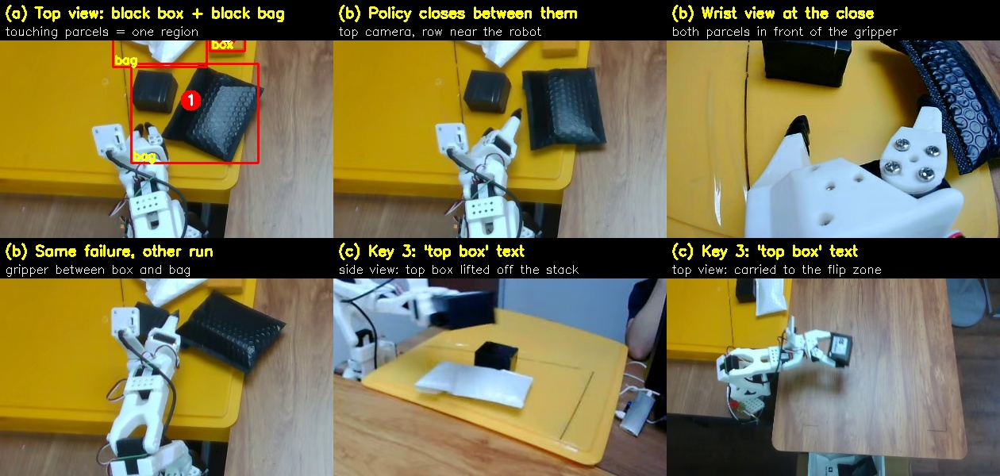

Figure: `figures/skill_text_findings.jpg`, made with
`parcel_vla/planner/findings_figure.py`.

Finding 1: touching parcels look like one parcel.

1. In the top view of the planner (panel a), the black box and the
   black bag touch. The colour regions make one region of the two.
2. The policy shows the same problem in its motion (panel b). In the
   drive runs, the gripper closes in the gap between the black box
   and the black bag. The gripper closes on air, then opens again
   over the tray (episode 0, 9.4-10.7 s; episode 2, 15.7-25.2 s).
3. This occurs most in the row nearest the robot, and when the tray
   has many parcels.
4. Panel a shows the colour regions of the planner. SmolVLA does not
   give regions, thus we cannot show what its image encoder sees.
   Only the grasp point shows that the policy aims at the two parcels
   as one target.
5. The planner and the policy fail on the same scenes: dark parcels
   that touch. Thus a better parcel detection is necessary for the
   planner and for the policy.

Finding 2: the skill text changes the grasp at once (panel c).

1. In Test C, the operator pressed key 3 (top-box text). The arm
   lifted the top box off the stack and put it at the flip zone.
2. Then the operator pressed key 2 (bag text). The arm took the bag.
3. The image alone did not give this result in the earlier models.
   Thus the text selects the skill, when the texts have no shared
   word.

What this means for the two-level system (planner gives the text,
policy does the motion):

1. The policy part works. The text selects the skill (grasp height,
   gripper opening), and the image selects the target.
2. The planner part is the weak part. It must find each parcel and
   its kind, also when parcels touch. Colour regions and the home
   probe both fail on the black box next to the black bag.
3. Necessary next work:
   - A better parcel detection for the planner (for example, a
     detector trained on our parcels, or a depth camera to separate
     touching parcels).
   - More episodes for each skill, for better generalisation.
   - The same scene with two texts and two targets, if the text must
     also select the target.

### Last training run: 5 skills with distinct texts (Nov 19)

Question: in round 4, one model with all skills (`smolvla_b_all`, one
text) hesitated on normal heaps. Does the same data work when each
skill has its own text?

Data (`Low101/parcel-sort-b-sk5d`, `make_skill3.py --variant
distinct5`): the `sk3d` data, plus the far-edge and on-table
corrections with their own texts. No two texts share a token.

| Skill | Text | Training episodes | Frames |
|---|---|---|---|
| Box | "grasp rigid box with wide grip and set it at flip zone" | 66 | 41,815 |
| Bag | "pinch soft bag by its edge then drop onto table" | 47 | 32,637 |
| Top box | "lift upper carton off stacked pile" | 47 | 17,079 |
| Far edge | "reach far rim, pull parcel closer" | 13 | 5,339 |
| On table | "sweep lone item beyond wooden desk border" | 16 | 6,435 |

- Held out: the `sk3d` held-out episodes, plus far-edge corrections
  101, 107, 113 and on-table corrections 190, 197, 204.
- Training (`VARIANT=distinct5 queue_skill3.sh`):
  `smolvla_parcel_b_sk5d_10k` from `smolvla_b` (80k), learning rate
  1e-4, 10k steps, 189 episodes (103,305 frames).
- Test: `lang_test.py` with 5 texts
  (`outputs/train/skill5d_lang.md`).
- Compare with `sk3d` (do 2 more skills make the 3 skills weaker?)
  and with `smolvla_b_all` (same data, one text).
- Limit: the far-edge corrections do not start at home. Thus on the
  robot, send the far-edge text (key 4) after the arm leaves home.

Result (`outputs/train/skill5d_lang.md`, 10k). Chance level is 20 %
with 5 texts and 33 % with 3 texts.

| Group | Correct text | Wins `sk5d` | Wins `sk3d` | Shift `sk5d` | Noise `sk5d` |
|---|---|---|---|---|---|
| Dataset B, bag | bag | 89 % | 85 % | 3.49 | 1.61 |
| Dataset B, box | box | 74 % | 75 % | 1.27 | 1.43 |
| Black box next to bags | box | 43 % | 48 % | 1.98 | 2.13 |
| Box on a box | top | 19 % | 41 % | 1.76-2.22 | 2.17 |
| Far edge | far | 34 % | - | 2.01-3.11 | 2.69 |
| On table (13 frames) | push | 0 % | - | 3.52-5.85 | 4.08 |

1. The 2 new skills do not make the 3 old skills weaker. The bag
   result is a little better, and the box result does not change.
2. The model does not follow the 2 new texts. On the far-edge frames,
   the far-edge text has the lowest error (4.89 against 5.21-5.48
   deg), but it wins in 34 % of the frames only. On the on-table
   frames, all texts have an error of approximately 10 deg. Thus the
   model does not learn the push motion.
3. Cause: the 2 new skills have 13 and 16 training episodes only
   (5,339 and 6,435 frames). Rounds 2 and 3 showed that a skill needs
   approximately 20 good episodes or more.
4. On the stack frames, the image still selects the motion, as in
   `sk3d`. The robot test C showed that the top-box text works on the
   robot.
5. The one-text control (`smolvla_b_all`) has larger errors. But it
   did not see these texts in training. Thus this comparison is not
   fair, and we do not use it as a result.
6. Thus one model can keep 5 skill texts. Each new skill also needs
   enough demos. A text does not replace the data.

## Next steps

1. Run the offline evaluation and the robot tests on SmolVLA 80k and
   SmolVLA-BSP.
2. Test SmolVLA-BSP on the robot with `--compile default` at 1x, 1.5x
   and 2x. Then read the margin with `parcel_vla/bsp/diagnose_bsp.py`.
3. Test time scaling for SmolVLA with RTC (for example, 36 Hz for
   1.2x). Then compare the success rate.
4. Do fair robot comparisons: Diffusion-BSP at 1x, and the medium and
   hard levels.
5. Record the pick and place in full episodes. Then retrain the
   pick-and-place skill.
6. DAgger (human corrections) after the approach change.
7. Removed from the plan: RL (HIL-SERL).
8. Dataset B, robot test on training-like heaps: 5 parcels, with
   bags on bags and no box on a box. Then heaps of 7-8 parcels, to
   see whether the models can clear a larger heap.
9. DAgger with a human in the loop (HIL) for the failed states of
   dataset B: a box on a box, a parcel alone on the table, and a
   parcel at the stack edge. The policy runs, and the operator takes
   control with the leader arm when the policy goes wrong. Then
   fine-tune on the corrections, so that the actions in these states
   become possible for the policy. This item now comes before item
   15: the models are not reliable enough for a benchmark heap.
   - Tool: `parcel_vla/finetuning/dagger_parcel.sh` (LeRobot `dagger` rollout
     strategy, corrections only, dataset
     `Low101/rollout_dagger_parcel_b`).
   - Targets from the 8-parcel heap: a grasp at the far edge, a
     parcel alone on the table, and the black box (grasp, not the
     bag push). Target from the medium level: a box on a box (take
     the top box only, then the bottom box in the next correction).
     About 20-30 corrections for each target.
   - Then drop the `intervention` column, merge the corrections
     with dataset B, and fine-tune each model from its last
     checkpoint (a few thousand steps, not a new training).
   - Test again on the same heaps as before the corrections.
10. Export the models to TensorRT or ONNX Runtime (FP16). Start with
    the Diffusion U-Net (plan 85-93 ms), then the SmolVLA action
    expert (plan about 200 ms). Keep the Python caller. Use the same
    procedure as the compiled denoising step: benchmark with
    `parcel_vla/inference_improvement/bench_plan.py`, compare the output in degrees, then test on
    the robot. Put the new engine behind a flag. Target: a plan time
    1.5-3x shorter.
11. Move the control loop to a C++ process. The process owns the
    Feetech servo bus and runs the B-spline loop at a fixed rate.
    Python sends each new plan through shared memory or ZeroMQ. This
    removes the GIL contention between the planner thread and the
    control thread in `run_bsp_parcel.py`. Measure the tick jitter
    (p50, p95, max) before and after. Target: smoother motion at 2x.
12. Look at the other processes for the same type of gain:
    - Camera capture and image preparation in a separate process,
      with the newest frame in shared memory.
    - Video encode and dataset write out of the control path during
      recording.
    - A C++ or Rust servo driver with sync read and sync write, to
      cut the bus time for each tick.
    Profile each process first. Change a process only if the profile
    shows that it causes a delay or jitter.
13. Do not rewrite the full project in Rust or C++. Training,
    datasets and the Hugging Face Hub stay in Python. The GPU sets
    the plan time, and the cameras and servo bus set the loop limits.
14. Benchmark after each of items 10-12 with the rule below. Record
    the gain of each item against the same reference.
15. Find a benchmark heap that all models clear. Use 3 parcels.
    If a model fails, change the heap, not the count. Use bags on bags, no
    box on a box, and no small labelled orange box (the SmolVLA
    models do not grasp it on the 5-parcel heap). From the 8-parcel
    heap, two more rules:
    - Keep all parcels at least one box width from the far edge and
      the right edge of the tray. The models do not grasp at the far
      edge.
    - Do not put the black box in the benchmark heap. The models
      use the bag push on it.

    Benchmark heap (heap of 3): white bag, black bag on the white
    bag, orange box label down (one flip). The heap of 4 is not
    reliable enough for a benchmark, so the test starts with 3.

    Take a photo of the heap and mark the parcel positions on the
    tray. Then all later robot tests (items 10-12, DAgger, new
    models) use this same heap, so that the results are comparable.
    - Run each model 3 times on the heap.
    - The heap is good if each model clears all parcels in 3 of 3
      runs, with no help.
    - Record the time for each parcel and the label result for each
      model. These numbers are the robot reference.

16. Skill planner with a task text for each skill (see "Proposal: a
    skill planner that gives the task text"). First give the
    datasets skill texts and fine-tune one time from `smolvla_b` on a
    balanced mix. Then run the offline language test. Then add a
    rule planner with a preset priority order.
17. Round 4: one balanced fine-tune with all skills (see "Round 4:
    one balanced mix of all skills"). Offline gate first, then the
    robot test on the normal heap before the new cases.
18. Final benchmark and videos with `smolvla_b_fb` 10k (see
    "Final benchmark (Nov 18-19)").
19. Project page (from Nov 19): the page and a short video that shows
    the findings, for employers. The page also shows the future plan
    (items 20-21).
20. Record 20-25 new box-stack demos of good quality. Use them as the
    box-stack skill, not a fine-tune on corrections.
21. Skill planner (item 16) with the new box-stack skill.

Status (Nov 18):

| Item | Status |
|---|---|
| 1-4 | Done |
| 5-6, 9 | Done: pick-and-place dataset B, DAgger rounds 1-3 |
| 7 | Removed |
| 8 | Done: 5- and 8-parcel heaps |
| 10 | Done for Diffusion (TensorRT FP16, robot: plan 87 -> 18 ms). SmolVLA: no gain, not used |
| 11 | Done: C++ control (robot: tick max 24.1 -> 20.4 ms) |
| 12 | 12c done (part of 11). 12a and 12b not necessary |
| 14 | Done (benchmark table and robot A/B test) |
| 15 | Done: 3-parcel heap (white bag, black bag, small labelled orange box) |
| 16 | Not started. Planner test offline only |
| 17 | Done: 10k passes offline and on the new robot cases (Nov 18) |
| 18 | Done Nov 18: heap3 pilot (12), kind sets (28 runs). Nov 19: unseen |
| 19 | From Nov 19 |
| 20-21 | After the project page |

### Final benchmark (Nov 18-19)

Each set has its own dataset (`eval_parcel.sh --set <name>`). The
kind sets run on Nov 18. `unseen` runs on Nov 19.

Model: `smolvla_b_fb` 10k. The benchmark started with
`smolvla_b_all` 10k, but we stopped it after 3 `heap3` episodes
(`rollout_bench_parcel_smolvla_b_all_heap3`). On normal heaps it does
not select a skill firmly. It changes between skills and hesitates
at the stack zone. It works only when the scene is simple, for
example one stack or one parcel on the table. `smolvla_b_fb` has
fewer skills and works better on normal heaps. Thus each new skill in
one model makes the skill selection weaker. This is the reason for a
planner that selects the skill (see "Proposal: a skill planner").

The heap3 pilot (12 episodes, results below) showed that the number
of parcel kinds affects the result more than the number of parcels.
Thus the benchmark sets change the number of kinds. Kinds: orange
box, black box, black bag, white bag. The 2-kind and 3-kind sets have
3 parcels, so they add to the pilot episodes. A heap of 4 kinds needs
4 parcels. `kind1_many` (1 kind, 5 parcels) is the control: if it
stays good, more parcels alone do not cause the fails.

| Set | Kinds | Parcels | Pilot | New | Total | Time limit | Reset |
|---|---|---|---|---|---|---|---|
| `kind1_2` | 1 | 2 | - | 5 | 5 | 120 s | 45 s |
| (pilot) | 1 | 3 | 4 | - | 4 | 180 s | 60 s |
| `kind1_many` | 1 | 5 | - | 5 | 5 | 300 s | 90 s |
| `kind2` | 2 | 3 | 3 | 5 | 8 | 180 s | 60 s |
| `kind3` | 3 | 3 | 5 | 5 | 10 | 180 s | 60 s |
| `kind4` | 4 | 4 | - | 10 | 10 | 240 s | 60 s |
| `unseen` | - | 3 | - | 10 | 10 | 180 s | 60 s |

Heap rules:

- Mix the labels: about half of the parcels label up.
- Change the parcel positions in each episode. Use the full stack
  zone, also the edges.
- `kind1_2` and `kind1_many`: change the kind between episodes (bags
  and boxes).
- `kind2`: mostly bag + box pairs (the pilot has bag + bag and box +
  box).
- `kind4`: one of each kind.
- Do not put a box on a box on purpose. Bags can lie on bags. The
  stack case is in the edge-case tests and the heap3 pilot.
- `unseen`: use only parcels that are not in any dataset (Nov 19).
- Do not build far-edge or on-table cases on purpose. They come
  during the run: a missed grasp can push a parcel to the far edge,
  and a dropped parcel can stay on the table. The fine-tunes of
  rounds 1-4 are for these cases.
- Write the parcels in `--note`, for example "black bag x2, orange
  box x2".

Score for each episode (`bench_sheets.py`, then fill in
`scores.csv`):

| Column | Meaning |
|---|---|
| cleared | parcels off the table |
| wrong_label | parcels that went off the table label up |
| help | times the operator moved a parcel |
| cases | edge cases seen: `box_on_box`, `far_edge`, `on_table` |
| time_s | episode length (from the data) |
| home_s | time the arm is still at the rest pose (from the data) |

An episode is a success if all parcels are cleared with 0 wrong
labels and 0 help. Report for each set: the success rate, the
parcels per minute, the time still at home, and the failure types.

Procedure for each set:

1. Close Chrome and other large programs.
2. Put the robot at home, with the wrist roll at home.
3. Build the first heap.
4. Start the set (command below).
5. When the episode ends, build the next heap in the reset time.
6. If the heap is ready early, push the Right arrow.
7. If you move a parcel during an episode, remember the episode.
   Write it down after the set.

```bash
export CKPT_STEP=010000 FREEZE=1 RTC_EXACT_DELAY=1 COMPILE=default
export ROLLOUT_ARGS="--inference.type=rtc \
--inference.rtc.execution_horizon=10 --inference.queue_threshold=30"
E=parcel_vla/benchmark/eval_parcel.sh
bash $E smolvla_b_fb --set kind2 --level medium --episodes 5 \
  --parcels 3 --time 180 --reset 60
```

For the other sets, change `--set`, `--level`, `--episodes`,
`--parcels`, `--time` and `--reset` as in the table above. Then:
`python -m parcel_vla.benchmark.bench_sheets
rollout_bench_parcel_smolvla_b_fb_<set>`.

Robot time: about 1.5 h for the five kind sets, and 0.5 h for
`unseen`. If a set is stopped early, the saved episodes stay. A new
start with the same `--set` adds episodes to the same dataset.

#### heap3 pilot results (`smolvla_b_fb` 10k, 12 episodes)

Scores: `results/benchmark/rollout_bench_parcel_smolvla_b_fb_heap3/scores.csv`.
"Help" = the operator moved a parcel (4 episodes, checked on the
video).

| Heap type | Episodes | All cleared | No help | Time (s) |
|---|---|---|---|---|
| One kind, bags (3 black bags, 3 white bags) | 2 | 2 | 2 | 65, 70 |
| Bags only, 2 kinds | 1 | 1 | 0 | 72 |
| One kind, boxes, with a box on a box | 2 | 2 | 2 | 128, 138 |
| Boxes only, 2 kinds | 1 | 1 | 1 | 83 |
| White bag and 2 orange boxes | 1 | 1 | 0 | 137 |
| 3 kinds | 5 | 4 | 3 | 86, 96, 103, 155; 1 fail |
| Total | 12 | 11 | 8 | mean 103 |

- Rate: 33 parcels in 18.9 min, 1.7 parcels per minute.
- The only fail is a 3-kind heap. The model moved the white bag to
  the tray edge, then stayed at home.
- Bag heaps are the fastest and the most constant (65-72 s).
- Most of the lost time is the arm still at home for 30-70 s. It
  occurs before a box, mostly a box on a box or at the far edge.
  The model does not select the next skill.

`smolvla_b_all` 10k on the same heaps (6 episodes,
`results/benchmark/rollout_bench_parcel_smolvla_b_all_heap3/scores.csv`): 1 heap
with 0 parcels cleared in 143 s, 1 clean run (65 s), and 3 slow runs
(124-162 s). Thus `smolvla_b_fb` is the benchmark model.

#### Kind set results (`smolvla_b_fb` 10k, Nov 18)

Scores: `results/benchmark/rollout_bench_parcel_smolvla_b_fb_<set>/scores.csv`.
The 2-kind and 3-kind rows include the pilot episodes with the same
number of kinds. Each help is on the video and has a time in the
`note` column.

| Heap | Episodes | All cleared | Success | Parcels cleared | Help (per episode) | Parcels/min | At home |
|---|---|---|---|---|---|---|---|
| 1 kind, 2 parcels | 6 | 6 | 4 | 12/12 | 2 (0.3) | 2.2 | 18% |
| 1 kind, 3 parcels (pilot) | 4 | 4 | 4 | 12/12 | 0 (0) | 1.8 | 19% |
| 2 kinds, 3 parcels | 8 | 8 | 2 | 24/24 | 7 (0.9) | 1.7 | 14% |
| 3 kinds, 3 parcels | 10 | 8 | 5 | 25/30 | 4 (0.4) | 1.5 | 34% |
| 1 kind, 4 parcels | 6 | 4 | 1 | 18/23 | 5 (0.8) | 1.3 | 14% |
| 4 kinds, 4 parcels | 6 | 2 | 0 | 17/24 | 17 (2.8) | 1.0 | 30% |

- Success: all parcels cleared, 0 wrong labels and 0 help.
- At home: `home_s` as a part of the total episode time.
- Not counted: 5 runs that stopped in the first 12 s (`kind1_many`
  e5, `kind4` e6-e9).
- `kind1_many` has 4 parcels (one run has 3), not 5. Thus it has the
  same number of parcels as `kind4`, and it is a direct control.
- `kind4` has 6 runs, not 10. The operator stopped the set because
  almost every run needed help.

Findings:

1. A heap of 4 kinds is the hardest. No episode was a success, and
   the operator helped in all 6 episodes (17 times). Only 2 of 6
   episodes cleared all parcels.
2. With the same number of parcels (4), 4 kinds needed 3.4 times
   more help than 1 kind (17 against 5). It cleared all parcels in 2
   episodes, against 4 for 1 kind.
3. More parcels also make the task harder. With 1 kind, 3 parcels
   gave 4 successes in 4 episodes, and 4 parcels gave 1 success in 6.
   Thus the number of kinds and the number of parcels both have an
   effect. The pilot result is only partly true.
4. With 3 parcels, 1 kind is the best heap (4 successes in 4). 2
   kinds and 3 kinds show no clear order in this sample (2 in 8 and 5
   in 10). The large step is from 1 kind to a mixed heap.
5. Help for each parcel kind (31 helps in the new sets): white bag
   10, black box 10, orange box 7, black bag 4. In `kind4`, 8 of 17
   helps are on the white bag. The white bag stays in the tray in 3
   of the 4 `kind4` episodes that did not clear all parcels.
6. All 5 far-edge cases in the new sets are boxes. With 2 parcels of
   1 kind, all 3 bag heaps were a success (mean 44 s). Only 1 of 3
   box heaps was a success (mean 67 s).
7. The flip skill is reliable: 1 wrong label in 108 cleared parcels
   (`kind1_many` e1, a black bag at 106 s).
8. In `kind4`, the arm is still at home for 30% of the time, against
   14% for 1 kind with 4 parcels. The arm waits and does not select
   the next parcel. In `kind3` e2, it waited for 145 s of 179 s.
9. These results agree with operator findings 1 and 2 (below) for 1
   kind against 4 kinds. They do not show a difference between 2 and
   3 kinds.

#### Findings from the benchmark (operator)

1. The model is good when the scene has few parcel kinds. Kinds:
   orange box, black box, black bag, white bag. With 1-2 kinds, or
   only bags or only boxes, it is more constant and more accurate.
   With 3 or more kinds, the skill selection is not firm.
2. Thus one VLA policy does not select the skill well in a mixed
   scene. This is a limit of the VLA at this data size, and the
   reason for a planner.
3. Good demos give a better skill than fine-tunes on corrections.
   `smolvla_b_fb` is constant because its box-stack demos are
   consistent, but they are poor demos. The fine-tunes of rounds 1-4
   made the skill selection weaker.
4. Plan for the planner phase: record 20-25 new box-stack demos of
   good quality. Use them as the box-stack skill, with a skill text
   from the planner.

### Benchmark rule for items 10-12

Measure every change against one fixed reference. Then the record
shows the gain of each item, and the gain of items 11 and 12 is not
mixed with the gain of item 10.

1. Before item 10, record the reference with the current code: same
   checkpoint, same frames, same robot setup, same flags.
2. Save the reference numbers in the table below, with the git commit
   and the command.
3. Make one change only.
4. Run the same benchmark again. Measure the noise floor first (two
   runs with no change).
5. If the output error is larger than the limit, stop and fix the
   change before the robot test.
6. Run the robot test on the benchmark heap (item 15).
7. Add one row to the table. Write "no gain" if the gain is in the
   noise floor.
8. Keep the change behind a flag. The next item starts from the best
   row so far, but the table also keeps the gain against the
   reference.

Metrics:

| Area | Metric | Tool |
|---|---|---|
| Plan | plan time p50, p95 (ms) | `parcel_vla/inference_improvement/bench_plan.py` |
| Plan | output error against the PyTorch output (deg) | `parcel_vla/inference_improvement/bench_plan.py` |
| Plan | GPU memory (MB) | `parcel_vla/inference_improvement/bench_plan.py` |
| Control | tick period p50, p95, max (ms); late ticks (%) | debug log |
| Control | servo bus time for each tick (ms) | debug log |
| Control | direction reversals per second | `parcel_vla/bsp/diagnose_bsp.py` |
| Camera | frame age at plan start (ms) | debug log |
| Robot | success, time to done (s) at 1x, 1.5x, 2x | `results_bsp_parcel.csv` |

Results (fill in after each item). Units: plan and tick in ms, error
in deg, done in s. "Gain" is against the reference row.

| Item | Change | Plan p50/p95 | Err | Tick p95/max | Rev/s | Done | Gain |
|---|---|---|---|---|---|---|---|
| ref | current code, Diffusion-BSP B | 87.7/105.7 | 0 | 20.13/30.69 | | | - |
| ref | current code, SmolVLA-BSP B | 258.0/261.4 | 0 | | | | - |
| ref | SmolVLA-BSP B, `--compile default` | 148.0/163.2 | 0.141 | | | | 1.74x |
| 10a | Diffusion, TensorRT FP32 | 35.0/59.4 | 0.064 | | | | 2.51x |
| 10a | Diffusion, TensorRT FP16 | 13.1/13.2 | 0.149 | | | | 6.69x |
| 10b | SmolVLA, TensorRT BF16 | 225.8/234.6 | 2.330 | | | | no gain |
| 10b | SmolVLA, TensorRT + compile | 164.9/175.3 | 2.329 | | | | no gain |
| 10c | SmolVLA, 5 flow steps, eager | 137.3/150.6 | 2.12* | | | | 1.88x |
| 10c | SmolVLA, 5 flow steps, compile | 123.1/134.0 | 2.12* | | | | not used |
| 11 | C++ control process | | | 20.07/25.04 | | | max -5.6 |
| 10a+11 | TensorRT FP16 + C++ control | 15.6/33.0 | | 20.07/20.17 | | | 5.3x, max -10.5 |
| 12a | camera process | not built | | | | | - |
| 12b | recording out of control path | not built | | | | | - |
| 12c | servo driver, sync read/write | part of 11 | | | | | bus max 5.5 -> 1.4 |

The results come from offline tests only. Robot tests (Rev/s and Done)
need the benchmark heap (item 15) and an operator.

- Plan rows: `parcel_vla/inference_improvement/bench_plan.py`, 5 fixed dataset B frames, fixed
  noise, 40 repeats. The noise floor (two eager runs) is 0 deg and
  less than 1 % in time.
- Tick rows: `parcel_vla/inference_improvement/bench_control.py loop`, 50 Hz, Diffusion-BSP B at
  1.5x, a fake arm, real cameras and the video writer on. The
  "10a+11" plan time is in the loop, with the cameras and the video.
- Servo bus: Present_Position read of 6 servos (read only). Python
  driver p50 1.30 ms, max 5.46 ms. C++ driver p50 1.01 ms, max
  1.41 ms, 0 errors.
- Full data: `results/inference_improvement/summary.md`.

Findings:

1. Diffusion FP16 is the largest gain: 6.7x faster, error 0.15 deg.
   This error is the same as the compiled SmolVLA error, which
   passed on the robot.
2. SmolVLA TensorRT gives no gain. The VLM already runs in BF16 and
   is not the slow part. The error of 2.3 deg is too large (rule 5),
   so the robot test does not start. The cause is open. Do not use
   `--trt bf16` with SmolVLA until it is fixed.
3. The C++ control process removes the long ticks. With Python
   control, cameras and video, one tick took 30.7 ms. With C++, the
   longest tick was 25.0 ms in one run and 20.2 ms in the next run.
4. With the FP16 planner, the planner uses the GPU for a shorter
   time. Then Python control also stays near 20 ms (max 20.9 ms).
5. A camera process (12a) is not necessary. `read_latest()` takes
   less than 0.1 ms, and the frame age is 24-32 ms at p50.
6. Recording (12b) is not part of the BSP robot runs. No change.
7. Fewer SmolVLA flow steps (10c) give a small gain. The error (*)
   is against the 10-step output: max 2.12 deg, mean 0.51 deg. With
   compile, the vision encoder (about 73 ms) and the prefix pass
   (about 21 ms) are the fixed part. Thus 5 steps save only 25 ms.
   We keep 10 steps.

Robot test of items 10a and 11 (2026-11-16). Diffusion-BSP B,
3-parcel heap (white bag, black bag, small orange box), DDIM 10,
1.5x, max step 6, blend 0.2, 3 episodes for each run (B: 4).

| Run | Plan mean/p95 | Hold % | Tick p99/max | Rev/s | Done | OK |
|---|---|---|---|---|---|---|
| A: `--trt off --control python` | 87/95 | 0.1-1.2 | 21.4/24.1 | 0.8-2.3 | 23.7, 15.3 | 2/3 |
| B: `--trt fp16 --control python` | 18/36 | 0 | 22.4/24.5 | 1.2-2.6 | 19.2, 14.6 | 2/4 |
| C: `--trt fp16 --control cpp` | 19/34 | 0 | 20.1/20.4 | 1.4-2.5 | 15.4, 16.0 | 2/3 |

- TensorRT FP16 plans 4.8x faster on the robot. Each plan arrives
  0.1-0.4 s before the segment ends, so the arm does not hold.
- The C++ loop keeps all ticks within 0.4 ms of 20 ms. On a quiet PC,
  Python ticks are also on time (0 % late).
- Rev/s and success do not change. The seam jump (8-13 deg p95)
  comes from the difference between plans, not from the plan delay.
- The fails (B: 2 place, C: 1 place, A: 1 flip) are in the same
  range as the Nov 11 runs without TensorRT (2 of 9 place fails).
- The C++ runs keep the ticks in `ep<n>_cpp_ticks.npy`.
  `diagnose_bsp.py` does not read this file yet.
- Bug found: the results CSV did not show the blend of Diffusion
  runs. The first baseline then ran with blend 0 and jerked (rev/s
  6.4). `run_bsp_parcel.py` now logs the blend for all models.

How to switch between the old and the new code (the old code is the
default):

| Part | Old | New |
|---|---|---|
| Planner engine | `--trt off` | `--trt fp16` (Diffusion) |
| Control loop | `--control python` | `--control cpp` |

Both flags are on `parcel_vla/robot/run_bsp_parcel.py`. Build the engines
with `parcel_vla/inference_improvement/trt_plan.py build <model> --dtype fp16`. Build the C++
process with `make -C parcel_vla/inference_improvement/ctl`. The code and
packages before items 10-12 are in `baseline_pre10/`.
