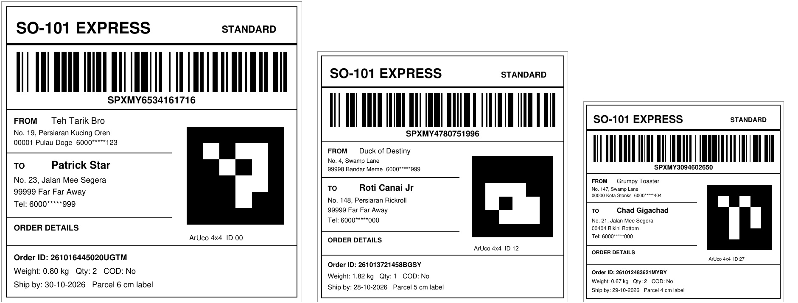

# labels

This folder holds the shipping labels of the parcels. Each label has a
unique ArUco marker (`DICT_4X4_100`). After a run, a script finds the
marker in the front camera and gives the parcel ID and the label side.
The policy does not get the marker ID. The design and the camera test
are in [`writeup.md`](../../../docs/writeup.md), section "Parcel task
preparation".

| File | Purpose |
|---|---|
| `make_labels.py` | Make the label PDFs and `labels.csv` |
| `labels.csv` | Marker ID, size and tracking number of each label |
| `parcel_labels_A4.pdf` | All labels, 6, 5 and 4 cm |
| `parcel_labels_test_A4.pdf` | One label of each size, for the test |
| `test_aruco_live.py` | Live marker test on one camera |
| `parcel_inventory.csv` | Marker ID, kind, colour and role of each parcel |

The annotated frames of the live test go to `runs/live_tests/`.

```bash
python -m parcel_vla.setup.labels.make_labels --sizes 4,5,6
python -m parcel_vla.setup.labels.test_aruco_live
```

All names and addresses on the labels are fictional. Print the PDFs at
100% scale. Use the 5 cm or 6 cm labels: about half of the 4 cm labels
fail with the front camera.


