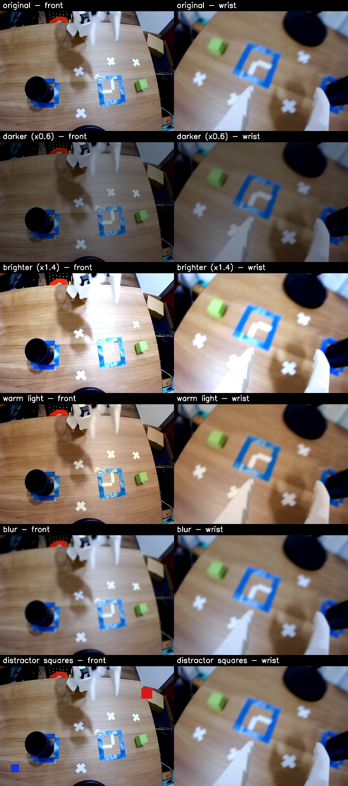
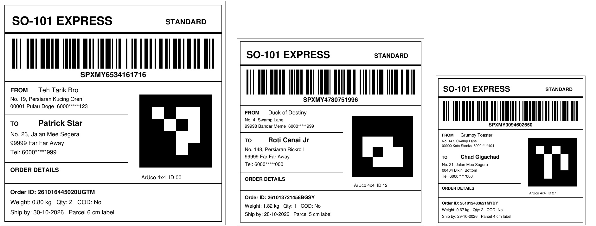
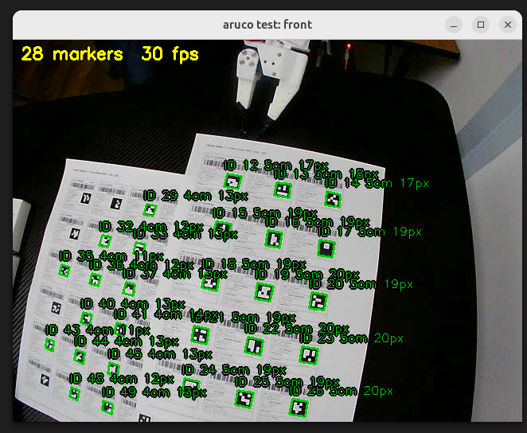
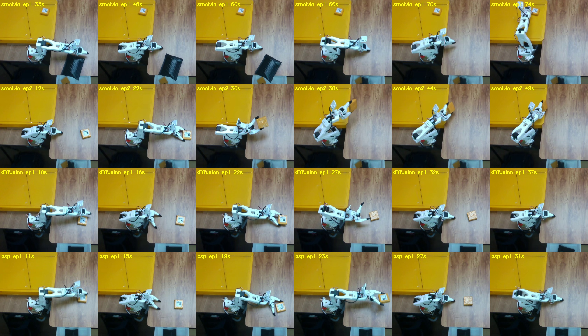
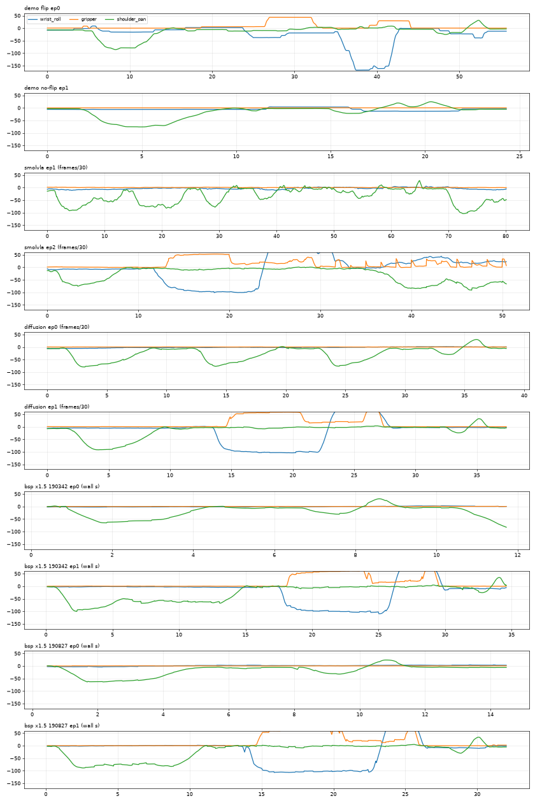
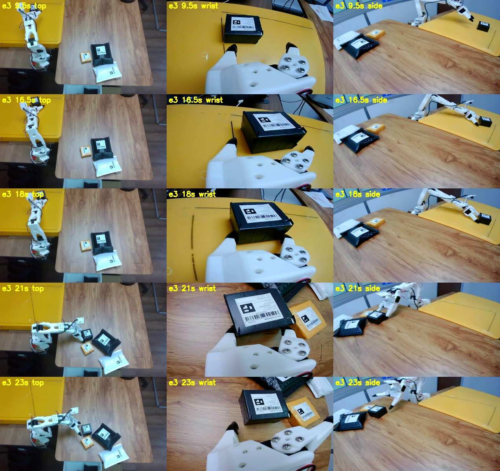
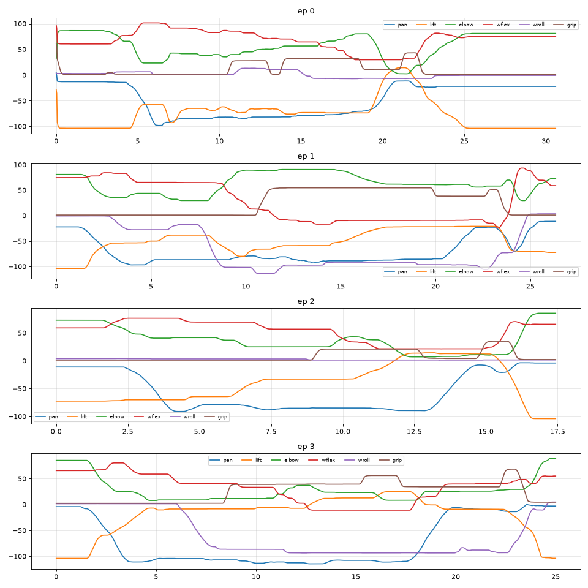

# SO-101 pick-and-place: ACT vs Diffusion Policy vs SmolVLA

Task: pick a green cube and place it into a bin with a LeRobot SO-101
arm, trained by imitation learning from teleoperated demonstrations.

## Hardware

- SO-101 follower (12 V, Feetech STS3215) and SO-101 leader (5 V).
- Cameras: wrist camera + fixed front (top-down) camera, 640x480, 30 fps.
- Training laptop: NVIDIA RTX PRO 500 Blackwell, 6 GB VRAM.

## Datasets

| Dataset | Episodes | Frames | Cube start positions |
|---|---|---|---|
| `lerobot-so101-first-act` | 50 | 32,589 | Varied cube and bin layout, inconsistent home pose |
| `second-act-attempt` | 51 | 26,583 | One fixed spot (blue-taped square) |
| `third-act-attempt` | 151 | 66,907 | Episodes 0-80: blue square (30 with random offsets/rotations); 81-150: five taped X marks, 14 each |

## Models

### How they differ

| | ACT | Diffusion Policy | SmolVLA |
|---|---|---|---|
| Starting knowledge | Only an ImageNet image encoder; everything else learned from the 151 episodes | Same | Internet-scale vision and language, plus robot pretraining on community data |
| Reads instructions | No | No | Yes |
| How it outputs actions | Predicts the chunk directly (one pass); trained as a variational autoencoder with L1 loss | Removes noise over 10 steps; U-Net | Removes noise over 10 steps with flow matching; transformer |
| Can represent several valid ways to do the task | Limited: tends to average them | Yes | Yes |
| Size (as trained here) | 52M | 89M | 450M (100M trained) |
| Chunk length | 100 steps (3.3 s) | 32 steps run out of 64 predicted | 50 steps (1.7 s) |
| Speed on the laptop | Fastest | Medium | Slowest |

In one sentence: ACT and Diffusion are specialists trained from scratch on
this one task; SmolVLA is a generalist that already understands images and
language, adapted to this task.

### Training settings (6 GB laptop GPU)

| Model | Data | Start from | Steps | Batch | Notes |
|---|---|---|---|---|---|
| ACT `act_second_attempt` | 51 square eps | scratch | 100k | 8 | Baseline |
| ACT `act_square_ft20k` | eps 0-80 (square) | ACT 100k | +20k | 8 | Square-only fine-tune |
| ACT `act_all_ft50k` | all 151 | ACT 100k | +50k | 8 | |
| Diffusion `diffusion_all_100k` | all 151 | scratch | 100k | 16 | U-Net shrunk to (256, 512, 1024): default 278M params did not fit 6 GB; images resized to 320x240, 90% random crop; DDIM, 10 inference steps |
| SmolVLA `smolvla_all_100k` | all 151 | `lerobot/smolvla_base` | 100k | 12 | Batch 12 = largest that fits (16 OOM); cameras renamed front->camera1, wrist->camera2, 1 empty camera slot; LR decay stretched to 100k steps; mixed precision not supported; ~35 h |

## Debugging story (first attempt)

1. First ACT model jerked at frames 100, 200, 300 (largest jump 69.9 deg):
   it ran the whole 100-step chunk blind before re-planning.
   Temporal ensembling reduced the largest jump to 3.1 deg, but the arm
   then stalled and never closed the gripper.
2. Comparing rollouts with the demos showed the rollout start pose was
   outside the training data (shoulder lift about -58 deg vs -92 to -104 in
   the demos) and the table layout varied too much across demos.
3. Camera-reliance test: on demo frames the policy's predicted reach
   followed swapped front-camera images fully (shift about 1.0), but on
   rollout frames the cameras had about 4x less influence: the live scene
   looked unfamiliar, so the policy ignored it.
4. Fix:
   - Re-recorded a new dataset (`second-act-attempt`) with the green cube
     at one stable starting position instead of a changing layout.
   - Added static tape markers on the table (blue squares for the cube
     and the bin) so the scene could be reset to the same layout before
     every episode.
   - Returned the arm to the same home pose before each episode.
   - Kept temporal ensembling at rollout time to remove the chunk jumps.

## Second attempt: why it did not generalise

The stable layout fixed the first attempt: the policy now worked at the
taped spot. But all 51 episodes of `second-act-attempt` started the cube in
the same blue square, so the policy failed at any new position. Recording 100
more episodes (`third-act-attempt`) spread across five X marks addressed this.

## Offline evaluation (no robot)

Test 1: mean absolute error (deg, 5 arm joints) of the next 1 s of
predicted actions vs the human demo. (*) = positions not in that model's
training data.

| Model | Blue square | X marks |
|---|---|---|
| ACT 100k (51 square eps) | 2.55 | 9.33 (*) |
| ACT square +20k (81 square eps) | 1.13 | 7.59 (*) |
| ACT all +50k, at 25k | 1.33 | 2.39 |
| ACT all +50k, at 50k | 1.16 | 1.82 |
| Diffusion at 50k | 2.90 | 3.53 |
| Diffusion at 100k | 1.43 | 1.64 |

Test 2: image swap at motion start (300 pairs of X-mark episodes). Keep the
arm state, swap in camera images from an episode with the cube at another X.
0 = prediction ignores the swap, 1 = fully follows the other cube.

| Model | Swap both cameras | Swap front only |
|---|---|---|
| ACT 100k (51 square eps) | 0.00 | 0.00 |
| ACT square +20k | 0.02 | 0.00 |
| ACT all, at 25k | 0.41 | 0.32 |
| ACT all, at 50k | 0.75 | 0.56 |
| Diffusion at 50k | 0.12 | 0.09 |
| Diffusion at 100k | 0.41 | 0.30 |

Takeaways:
- Square-only models ignore the cameras for choosing where to reach; more
  data at the same spot did not help, spreading cube positions did.
- ACT all at 50k fits best and reads the cube position most strongly.
- Diffusion at 100k fits about as well but uses the images less.
- Limits: the 151-episode models were evaluated on their own training
  data; offline scores rank models but do not replace robot success rates.

SmolVLA on Test 1 and Test 2: TODO.

### Language test (SmolVLA, offline, 837 demo frames)

Same frames, same noise seed, only the instruction changed. "Shift" =
change in the predicted next 1 s of arm actions vs the training
instruction (deg); "error" = vs the human actions (deg).

| Instruction | Shift | Error |
|---|---|---|
| Training: "pick green cube and place into the bin" | 0.00 | 1.03 |
| "pick the red cube and place into the bin" | 0.91 | 1.39 |
| "take the cube out of the bin and put it on the table" | 3.54 | 3.72 |
| "" (empty) | 4.13 | 4.33 |
| "wave at the camera" | 5.47 | 5.59 |
| Control: training instruction, different noise seed | 0.81 | 1.04 |

Finding: changing "green" to "red" moves the predictions no more than
random noise does, so the model ignores the colour word. Rewriting the
whole sentence does change the actions, but only by making them worse,
not by doing a different task. Trained on a single instruction, SmolVLA
treats the text as a fixed input; it reacts to unfamiliar text, not to
its meaning. Following instructions needs data with several different
instructions.

### Robustness to image changes (offline, 837 demo frames)

Error of the next 1 s of arm actions vs the human actions (deg), with
synthetic changes applied to the camera images. (+x%) = increase over
the unchanged images.

| Change | ACT all @50k | Diffusion @100k | SmolVLA @100k |
|---|---|---|---|
| None | 1.44 | 1.48 | 1.03 |
| Darker (x0.6) | 1.68 (+17%) | 2.24 (+51%) | 1.43 (+39%) |
| Brighter (x1.4) | 1.75 (+22%) | 2.62 (+77%) | 1.54 (+50%) |
| Warm light | 1.48 (+3%) | 1.92 (+30%) | 1.21 (+17%) |
| Blur | 4.00 (+178%) | 2.92 (+97%) | 2.48 (+142%) |
| Two coloured squares pasted in | 1.44 (+0%) | 1.47 (-1%) | 1.09 (+6%) |

Findings:
- SmolVLA has the lowest error under every change.
- ACT degrades least, in relative terms, under lighting changes but
  worst under blur.
- Diffusion is the most sensitive to lighting.
- The pasted squares barely mattered for any model. They were static
  and far from the cube, so real distractor objects on the table are
  the stronger test.
- Limits: training-set frames and synthetic image changes; robot trials
  are the real test.

## Robot evaluation

Protocol: `test_protocol.md` (10 taped spots, 2 trials each, same home
pose and layout for every model). Raw results: `results.csv`.

| Model | Seen spots | New spots | Overall |
|---|---|---|---|
| ACT 100k (baseline) | TODO | TODO | TODO |
| ACT all +50k | TODO | TODO | TODO |
| Diffusion 100k | TODO | TODO | TODO |
| SmolVLA 100k | TODO | TODO | TODO |

### Finding: a distractor on a trained spot pulls SmolVLA, not ACT or Diffusion (open)

Status: observed by the operator on 2026-10-24 (spot SQ, condition
SQD, model `smolvla`). A controlled test must confirm it. A vision
model (Gemini) check from frame grids was not reliable: it reported
picks that did not occur. Use a measured landing point instead.

Observation:

- Condition SQD puts a blue cube next to the green cube.
- If the blue cube is on an X mark or another spot used for the green
  cube in training, SmolVLA goes first to a point between the two
  cubes.
- If the blue cube is on a spot that training did not use, SmolVLA
  ignores it and picks the green cube.

First measurement (scorer, 2026-10-24). "On a trained spot" = blue
cube within 1.2 cm (half a cube width) of a training start position.
Both models scored 10/10 at SQ without the blue cube.

| Model | Blue cube position | Trials | Picked | Placed | First close to the side |
|---|---|---|---|---|---|
| `smolvla` | On a trained spot (0.0-1.0 cm) | 6 | 0 | 0 | 0.3-5.1 cm |
| `smolvla` | Not on a trained spot (1.8-5.6 cm) | 3 | 3 | 2 | 1.6-1.8 cm |
| `act_aug` | On a trained spot (0.2-1.2 cm) | 4 | 3 | 3 | 0.1-1.3 cm |
| `act_aug` | Not on a trained spot (2.1 cm) | 1 | 1 | 1 | 0.9 cm |
| `diffusion` | On a trained spot (0.1-0.9 cm) | 3 | 3 | 3 | 0.2-2.2 cm |
| `diffusion` | Not on a trained spot (4.8 cm) | 1 | 1 | 1 | 0.4 cm |

- `diffusion` trial 4 is not in the table: setup error. At t=0 the
  green cube was still in the bin; the operator moved it at about 14 s.

- One `smolvla` trial is not in the table: the scorer did not find the
  blue cube.
- `blue_train_cm` = blue cube to the nearest training start position.
  `blue_green_cm` = blue cube to green cube. It is 8.7-18.6 cm for all
  trials of both models, so the distance between the cubes does not
  explain the difference.
- The first close lands near the green cube (`close_frac` -0.14 to
  0.22), not half way to the blue cube. For `smolvla` the blue cube
  pulls the grasp to the side and the grasp misses. It does not make a
  "between" target.
- `smolvla`, on vs not on a trained spot (picked 0/6 vs 3/3): Fisher
  p = 0.012. Inside the second session only: 0/2 vs 3/3.
- Blue cube on a trained spot, picked: `smolvla` 0/6, `act_aug` 3/4,
  `diffusion` 3/3. `smolvla` vs `act_aug` + `diffusion` (0/6 vs 6/7):
  Fisher p = 0.005.
- Result: the effect is in SmolVLA, not in ACT or Diffusion. The same
  data and the same layout do not distract the two models that train
  their own vision encoder. So the cause is not only the data; the
  model type matters. A possible reason: SmolVLA keeps its pretrained
  vision encoder frozen, and its general "object" features respond to
  any cube. ACT and Diffusion train their ResNet on this scene, so
  their features can separate the green cube from the blue cube.
- The sample is small (13 trials with the blue cube on a trained
  spot), so this is a strong lead, not proof.
- Pixel-to-cm scale: median training cube size of the 5 nearest
  training start positions (fixed camera, so it holds for any light).

Episodes (video source for the write-up canvas):

- Datasets are in `~/.cache/huggingface/lerobot/Low101/<dataset>/`.
- Front video: `videos/observation.images.front/chunk-000/file-000.mp4`.
  Wrist video: the same path with `observation.images.wrist`.
- "Clip" = start and end time of the episode in that mp4 file (s).
- Frame grids: `spot_review/vlm/<dataset>/ep<n>.jpg`.

| Dataset | Ep | Blue on trained spot | blue_train_cm | blue_green_cm | close_frac | close_off_cm | Stage | Clip (s) |
|---|---|---|---|---|---|---|---|---|
| rollout_smolvla_SQD_20261024_175929 | 0 | yes | 0.2 | 14.9 | 0.13 | 3.4 | none | 0.0-17.5 |
| rollout_smolvla_SQD_20261024_175929 | 1 | yes | 0.2 | 14.2 | 0.16 | 3.6 | reach | 17.5-35.6 |
| rollout_smolvla_SQD_20261024_175929 | 2 | yes | 0.2 | 15.0 | 0.12 | 5.1 | reach | 35.6-53.8 |
| rollout_smolvla_SQD_20261024_175929 | 3 | yes | 0.2 | 13.9 | 0.02 | 2.6 | reach | 53.8-72.2 |
| rollout_smolvla_SQD_20261024_180518 | 0 | no | 3.1 | 12.7 | 0.05 | 1.8 | place | 0.0-12.8 |
| rollout_smolvla_SQD_20261024_180518 | 1 | yes | 0.0 | 16.5 | 0.22 | 1.3 | none | 12.8-30.4 |
| rollout_smolvla_SQD_20261024_180518 | 2 | no | 5.6 | 18.6 | 0.11 | 1.6 | place | 30.4-42.7 |
| rollout_smolvla_SQD_20261024_180518 | 3 | yes | 1.0 | 8.7 | 0.13 | 0.3 | reach | 42.7-60.4 |
| rollout_smolvla_SQD_20261024_180518 | 4 | not found | - | - | - | - | place | 60.4-72.9 |
| rollout_smolvla_SQD_20261024_180518 | 5 | no | 1.8 | 12.8 | 0.04 | 1.8 | lift | 72.9-90.8 |
| rollout_act_aug_SQD_20261024_183632 | 0 | yes | 1.2 | 12.3 | 0.08 | 0.9 | reach | 0.0-20.1 |
| rollout_act_aug_SQD_20261024_183632 | 1 | no | 2.1 | 10.3 | 0.03 | 0.9 | place | 20.1-32.2 |
| rollout_act_aug_SQD_20261024_183632 | 2 | yes | 0.9 | 9.0 | -0.14 | 1.3 | place | 32.2-47.5 |
| rollout_act_aug_SQD_20261024_183632 | 3 | yes | 0.2 | 14.6 | -0.06 | 0.1 | place | 47.5-61.7 |
| rollout_act_aug_SQD_20261024_183632 | 4 | yes | 0.4 | 17.5 | 0.02 | 1.1 | place | 61.7-81.9 |
| rollout_diffusion_SQD_20261024_184444 | 0 | yes | 0.4 | 17.8 | 0.09 | 0.2 | place | 0.0-14.3 |
| rollout_diffusion_SQD_20261024_184444 | 1 | no | 4.8 | 13.3 | 0.11 | 0.4 | place | 14.3-27.2 |
| rollout_diffusion_SQD_20261024_184444 | 2 | yes | 0.1 | 15.7 | 0.03 | 0.9 | place | 27.2-40.7 |
| rollout_diffusion_SQD_20261024_184444 | 3 | setup error | - | - | - | - | lift | 40.7-60.4 |
| rollout_diffusion_SQD_20261024_184444 | 4 | yes | 0.9 | 8.8 | 0.03 | 2.2 | place | 60.4-79.5 |

Model comparison video pair (blue cube on a trained spot, same spot
type, different model):

- `smolvla` misses: `rollout_smolvla_SQD_20261024_175929` ep 3 (blue
  0.2 cm from a trained spot, clip 53.8-72.2 s).
- `act_aug` picks and places: `rollout_act_aug_SQD_20261024_183632`
  ep 3 (blue 0.2 cm from a trained spot, clip 47.5-61.7 s).
- `diffusion` picks and places: `rollout_diffusion_SQD_20261024_184444`
  ep 2 (blue 0.1 cm from a trained spot, clip 27.2-40.7 s).

Best video pair (same session, same model, only the blue cube moves):

- Blue on a trained spot, grasp misses:
  `rollout_smolvla_SQD_20261024_180518` ep 3 (clip 42.7-60.4 s).
- Blue off the trained spots, first grasp works and the cube goes in
  the bin: `rollout_smolvla_SQD_20261024_180518` ep 2 (clip
  30.4-42.7 s).
- Backup for the miss: `rollout_smolvla_SQD_20261024_175929` ep 3
  (clip 53.8-72.2 s). The green cube stays in the square and the arm
  goes to the bin empty (checked by eye).

Related: the instruction test ("pick blue cube and place into the
bin", green and blue cube on the table). SmolVLA still goes for the
green cube. Dataset `rollout_smolvla_SQDUO_20261024_181315`:

| Ep | Stage | Clip (s) | Note |
|---|---|---|---|
| 0 | none | 0.0-17.1 | no grasp |
| 1 | lift | 17.1-33.9 | lifts the green cube, not the blue cube |

Possible cause (hypothesis):

- The policy learned where cubes appear more strongly than which color
  to pick. The instruction says "green cube", but the training data
  never had a second cube, so color was not needed.
- The same spatial prior can explain the bias toward the square. In
  training, 81 of 151 episodes put the cube on the square.

Test to confirm it (if time allows):

1. Keep the green cube on one spot, for example SQ.
2. Put the blue cube on a trained spot (an X mark) for 10 trials.
3. Put the blue cube on an untrained spot at the same distance for 10
   trials.
4. Record the first approach target: green, blue, or between.
5. Compare `pick_success`, `task_success` and `miss_cm` between the
   two groups.
6. Repeat with `smolvla_aug` and, if time allows, with ACT and
   Diffusion.

Evidence for the write-up: one side-by-side video pair (blue cube on
a trained spot and on an untrained spot) and one small table of first
approach targets.

## B-spline execution (BSP): faster and smoother motion (open)

Reference: B-spline Policy, https://b-spline-policy.github.io/.

### What we built

- ACT-BSP and Diffusion-BSP: the same models, but each prediction is
  one B-spline segment. A segment is 16 knot times and 16 control
  points for the 6 joints. Both models start from the trained
  baselines and train on `third-act-attempt` (ACT 30k steps,
  Diffusion 40k steps).
- Executor `bsp/run_bsp.py`: a 50 Hz control thread samples the
  curve by wall-clock time, tau = elapsed x 30 fps x speed. A
  planner thread makes the next segment when the current one is 50%
  used. Thus the speed does not depend on the inference rate.
- Debug tools: `--sweep` (one episode per speed, debug logs),
  `bsp/diagnose_bsp.py` (per-episode table) and
  `bsp/grid_executor.py` (offline grid test of the executor
  settings on demo frames).

### First robot runs (cube at SQ, 1 trial per speed)

ACT-BSP succeeded at 1x, 1.5x, 2x and 2.5x (8.7 s, 12.9 s, 8.0 s,
6.2 s). One trial per speed is not enough for a claim.

### Problem: Diffusion-BSP jerks above 1x

The user saw jerks at 1.35x with the default settings. The first
sweep (10 DDIM steps, `--max-step 4`, no blend) showed the cause:

- At each segment switch, the new segment starts 7-9 deg (p95, arm
  joints) away from the last command. This happens at every speed.
- Inside a segment the motion is smooth up to 2x (0% clamped ticks).
- The 4 deg per tick limit spreads each jump over 2-3 ticks. The
  user sees this as a jerk.
- Higher speed gives more switches per second (1.8/s at 1x, 4.9/s at
  3x). Direction reversals increase from 4.6/s to 23.2/s.

Cause: Diffusion starts each plan from new random noise, so two
plans 0.3 s apart do not agree.

### Offline grid test (demo frames, no robot)

DDIM steps x noise, 30 frame pairs, plans 15 frames apart (arm
joints, deg):

| DDIM steps | Plan time | Error vs demo (median) | Jump between plans (p90) |
|---|---|---|---|
| 10 | 88 ms | 5.4 | 11.2 |
| 5 | 48 ms | 5.1 | 10.3 (6.7 fixed noise) |
| 3 | 32 ms | 5.9 | 11.8 |
| 2 | 23 ms | 19.9 | 22.4 |

Executor simulation (4 episodes, 1,920 settings):

- A 0.2 s blend between segments cuts reversals 4-10x up to 2.5x.
  It does not increase the error against the demo.
- `--max-step` does not change smoothness. It sets how closely the
  arm follows the curve at high speed (p95 error at 3x: 36 deg at
  step 4, 15 deg at step 8).
- With the blend, fixed noise gives no clear gain.

### Robot results after the fix

Settings: `--ddim-steps 5 --max-step 6 --blend 0.2`. Direction
reversals per second (lower is smoother):

| Speed | Old settings | New, random noise | New, fixed noise |
|---|---|---|---|
| 1x | 4.6 | 0.5 | 0.1 |
| 1.5x | 8.4 | 1.2 | 1.6 |
| 2x | 8.3 | 2.5 | 3.5 |
| 2.5x | 19.1 | 6.8 | 7.6 |

- Ticks cut by the step limit: 1.5-8% before, 0-0.4% after.
- Plan time: 115-140 ms before, 85-93 ms after.
- 2x with the new settings is smoother than 1x with the old ones.
  The simulation predicted 2.2 reversals/s at 2x; the robot gave 2.5.

Success, all runs with the new settings (1 trial per speed per
sweep, 4 sweeps):

| Speed | Success | Done (s) |
|---|---|---|
| 1x | 3/3 | 8.7-12.9 |
| 1.25x-1.75x | 3/5 | 6.3-8.7 |
| 2x | 2/4 | 5.0-6.4 |
| 2.5x | 3/4 | 4.4-5.5 |
| 3x | 1/2 | 4.8 |

The old-settings sweep had 6/7. Smoothness is clearly better. A
success rate at the same level as 1x is not shown yet.

### Open questions

- Why do the failures above 1x happen? Look at the failure videos in
  `bsp/runs/sweep_*`.
- The arm lags its command by 13-30 deg (arm joints, at plan time),
  also at 1x. Thus it is not the servo speed limit. A possible cause:
  the gripper presses into the table or the cube during the grasp.
  Per-joint lag logs can show this.

### Next

5 trials at 1x and 5 at 2x with the locked settings. Then compare
success and completion time (claim: faster at equal success).

## Parcel task preparation: ArUco labels for benchmarking

The parcel task needs a score that does not depend on a person. Each
parcel has a shipping label with a unique ArUco marker, in place of
the QR code. The marker is for benchmarking after training, during
inference. A script finds the marker in the front camera after each
run. It gives the parcel ID, the parcel position and the label side:
if the marker is visible, the label is up. The policy does not get
the marker ID. The marker is only part of the label image, the same
in training and in inference.

### Label design

- Shopee-style layout: courier header, Code 128 tracking barcode,
  sender, recipient and order details, and an ArUco marker.
- All names, streets, towns and postcodes are fictional (for example
  "SpongeBob SquarePants, Conch Street, 00404 Bikini Bottom").
  Postcodes 00xxx and 99xxx and phone numbers 6000... do not exist in
  Malaysia.
- Sizes: 6 x 6 cm (marker 19.5 mm), 5 x 5 cm (16.3 mm) and 4 x 4 cm
  (13 mm). Dictionary `DICT_4X4_100`, one ID per label (IDs 0-50).
  `labels.csv` maps each ID to its size and tracking number.
- First design problem: a solid black header with white text was
  found as a false marker at camera resolution. The header is now
  black text on white. After this change, the rendered pages gave
  0 false detections.
- Print at 100% scale on matte paper. Each page has a 50 mm ruler to
  check the scale.

### Live camera test (front camera, 640 x 480)

The full 5 cm and 4 cm sheets were put flat on the table, in the
front camera view. `test_aruco_live.py` found the markers in each
frame and logged them.

Video of the live test:
[`parcel_labels/test_check_on_front_cam_aruco.webm`](parcel_labels/test_check_on_front_cam_aruco.webm)
(70 s).

Result, sheets not moving (160 s, 4754 frames at 30 fps):

| Label | Labels in view | Marker width | Found in >= 90% of frames | Found in < 50% of frames |
|---|---|---|---|---|
| 5 x 5 cm | 15 | about 19 px | 13 | 0 |
| 4 x 4 cm | 24 | about 12 px | 9 | 12 |

- 5 cm labels: the camera finds all of them in almost every frame.
- 4 cm labels: about half of them fail. Markers of 11-13 px are at the
  limit of the detector.
- False detections: 0 while the sheets did not move; 5 in 220,000
  detections in the full 22-minute front run. The wrist camera gave
  21 in 34,000. All false IDs were not in `labels.csv`, so a check
  against `labels.csv` removes them.
- The 6 cm sheet was only in view while it moved, so this test gives
  no detection rate for it. Its markers are larger than the 5 cm
  markers.

Decision: use 5 cm labels (or 6 cm) on the parcels for the benchmark.
Do not use 4 cm labels with the front camera at this distance.

Files: `parcel_labels/make_labels.py` (makes the label PDFs and
`labels.csv`), `parcel_labels/test_aruco_live.py` (live test, one
camera), `parcel_labels/parcel_labels_A4.pdf` (all labels) and
`parcel_labels/parcel_labels_test_A4.pdf` (one label per size).

## Parcel task: process and results

The parcel task is a small version of Figure AI's parcel sorting.
How the BSP versions of each policy are made: `bsp/README.md`.

### Task

One parcel per episode:

1. Start at the home pose.
2. Push or pull the parcel from the stack zone to the flip zone.
3. If the label is up, flip the parcel.
4. Push the parcel off the table, label down.
5. Go back to the home pose.

Parcels: black box, yellow box, black bag and white bag. Each one has
an ArUco shipping label (see the label section above).

### Setup

| Camera | Device | Size | Policy name (SmolVLA) |
|---|---|---|---|
| Top | RealSense colour (YUYV) | 848x480 | `camera1` |
| Wrist | USB camera 2607053 (MJPG) | 640x480 | `camera2` |
| Side | USB camera 2607071 (MJPG) | 640x480 | `camera3` |

The 848x480 top view has the same 16:9 field of view as 1280x720
with less than half the pixels. At 1280x720, the encoder dropped
frames.

### Dataset A1 (`Low101/parcel-sort-a`, private)

- 100 episodes, 101,642 frames, 30 fps, 3 cameras.
- 15 heaps, from `parcel_task/schedule_A1.csv`: 25 episodes for each
  parcel kind, 63 with the label up and 37 with the label down.
- One task text: "sort the parcel so the label faces down and push
  it off the table".
- Phase marks: the operator presses Space at the end of the push and
  at the end of the flip. `parcel_task/phase_marks_A1.csv` has the
  marks. The phases are push, flip and exit.
- The phases are only in the marks file. The dataset has one task,
  and all models are full-task models.

Medians: 39 s for an episode with a flip, and 21 s without a flip.

Tools (`parcel_task/`):

| File | Purpose |
|---|---|
| `record_parcel.sh` | Record one heap of the schedule (3 cameras) |
| `record_preview.py` | `lerobot-record` with a live 3-camera preview and Space marks |
| `check_episodes.py` | Check the episode lengths, marks and video frames |
| `cut_phases.py` | Segments for each phase, from the marks |
| `make_schedule.py` | Make the heap schedule |

### Models

| Model | Start from | Steps | Batch | Final loss |
|---|---|---|---|---|
| `diffusion_parcel_a1_80k` | scratch | 80k | 16 | 0.005 |
| `diffusion_bsp_parcel_40k` | `diffusion_parcel_a1_80k` | 40k | 16 | 0.016 |
| `smolvla_parcel_a1_20k` | `lerobot/smolvla_base` | 20k | 12 | 0.068 |
| `smolvla_parcel_a1_80k` | `smolvla_parcel_a1_20k` | +60k | 12 | 0.029 |
| `smolvla_bsp_parcel_20k` | `smolvla_parcel_a1_80k` | 20k | 12 | 0.131 |

- Diffusion: each camera is resized to 240x424 before the stack
  (`parcel_task/train_mixed.py`). Other settings: U-Net
  (256, 512, 1024), horizon 64, 2 observation steps and AMP.
- SmolVLA 80k: a fine-tune from step 20k with a new LR schedule
  (warmup 1000, cosine decay over 60k). A plain resume to 80k would
  run 50k steps at the minimum LR.
- Training ran on the laptop GPU (6 GB), one job at a time
  (`parcel_task/queue_smolvla80k.sh`). SmolVLA 80k took about 20 h,
  and SmolVLA-BSP took about 18 h.
- The checkpoints are in `models/` (see `README.md`).

### Offline evaluation (no robot)

Script: `parcel_task/offline_eval.py`. Results:
`parcel_task/offline_eval/`. SmolVLA is the 20k checkpoint here.

- Held-out: 7 episodes that are not in training.
- Training reference: 7 training episodes.

Test 1: mean absolute error (deg, 5 arm joints) of the next 1 s of
predicted actions, compared with the human demo. For BSP, frames
outside the segment range are not scored.

| Model | Push | Flip | Exit | All, held-out | All, training ref |
|---|---|---|---|---|---|
| Diffusion | 6.57 | 5.97 | 8.78 | 6.94 | 2.30 |
| Diffusion-BSP | 6.84 | 7.21 | 10.43 | 7.86 | 3.03 |
| SmolVLA 20k | 6.93 | 6.36 | 9.13 | 7.30 | 4.12 |

Phase columns are held-out errors.

Test 2: label decision. At the end of the push, the model must choose
"flip" (label up) or "exit" (label down). The predicted next 1 s is
compared with the futures of all training episodes. The demo motion
shows the choice about 0.5 s after the mark. Thus the test uses
mark + 15 frames and mark + 30 frames.

| Model | Correct at +15 (100 training eps) | Correct at +30 |
|---|---|---|
| Probe on the demo futures | 89 | 92 |
| Diffusion | 82 | 81 |
| Diffusion-BSP | 83 | 83 |
| SmolVLA 20k | 87 | 78 |

The 7 held-out episodes are too few for a result.

Test 3: image swap at the decision point (100 pairs). Keep the arm
state of a flip episode, and use the images of a no-flip episode (or
the opposite way). "Follows" = the prediction changes to the kind of
the images.

| Model | Follows the images, +15 | +30 |
|---|---|---|
| Diffusion | 0.75 | 0.69 |
| Diffusion-BSP | 0.72 | 0.68 |
| SmolVLA 20k | 0.78 | 0.61 |

Findings: all three models read the label from the images. The exit
phase has the largest error offline.

### Robot pipeline fixes

| Problem | Cause | Fix |
|---|---|---|
| The control loop ran at 10-15 Hz | `prepare_observation_for_inference` converts the images to float on the CPU | `fast_prepare` sends uint8 to the GPU first (`parcel_task/rollout_mixed.py`). The loop now runs at about 25 Hz |
| SmolVLA motion jittered | Noise between the actions in a chunk | Moving average of 7 actions on the chunk (`SMOOTH=7`) |
| The loop dropped to 5 Hz with no image | The Rerun viewer blocked `rr.log` | Rerun is off by default. An mpv preview reads the newest frame in a thread |
| Keys did not work during a run | mpv read the terminal keys | `--input-terminal=no`, and a global key listener |
| Diffusion was slow | DDPM, 100 steps (0.8 s) | DDIM, 10 steps (0.1 s) |

Scripts:

- `parcel_task/run_parcel.sh`: Diffusion or SmolVLA through
  `lerobot-rollout`.
- `parcel_task/run_bsp_parcel.py`: Diffusion-BSP, with the BSP
  executor and a 3-camera episode video.
- `parcel_task/eval_parcel.sh`: one entry point for all models.

`eval_parcel.sh` flags:

- `--level easy|medium|hard`
- `--episodes`, `--parcels`, `--parcel`, `--where`, `--label`
- `--time`, `--speed`, `--no-record`

Logs: `parcel_task/eval_logs/` and `parcel_task/results_bsp_parcel.csv`.

Levels:

- Easy: 2-3 parcels, near the flip zone, not at the edge of the stack
  zone.
- Hard: more than 4 parcels, at the edge of the stack zone. The black
  box is also a hard case.

### Robot comparison (easy level)

Scene: a black bag with the label down, then a yellow box with the
label up. SmolVLA is the 20k checkpoint.

| Model | Black bag (no flip) | Yellow box (flip) |
|---|---|---|
| Diffusion-BSP, 1.5x | One push, done in 12-15 s | Flip and exit, done in 32-35 s |
| Diffusion | 3 push attempts, 38 s | Good flip and exit, 37 s |
| SmolVLA 20k | Slow exit (about 66 s), then it went to the next parcel | Flip attempt with gripper chatter; fail |

- All three models chose the correct branch (flip or no flip).
- Diffusion-BSP succeeded in all 5 episodes (1 at 1x, 4 at 1.5x).
- The ranking is the opposite of the offline ranking: Diffusion-BSP
  was the best on the robot.
- On the robot, the push from the stack zone was the weak phase, not
  the exit.
- Limits: few trials, easy level only, and BSP ran at 1.5x.

### New pull approach (pilot)

The push from the stack zone is not consistent in the demos. The
operator pushes or pulls in different ways for each parcel, so the
models retry.

1. First demo (`parcel-approach-demo`): reach over the heap with an
   open claw, then pull. It is the same for all kinds, but slow
   (25-35 s for each pull).
2. Grasp pilot (`parcel-grasp-pilot`, 4 episodes): use the same
   method as the flip.
   - Box: close the gripper on the side walls (wrist roll about
     -95 deg).
   - Bag: pinch the edge and pull (wrist roll about 0 deg).

| Episode | Parcel | Alignment | Carry |
|---|---|---|---|
| 0 | White bag | 13 s | 2.5 s |
| 1 | Yellow box | 16 s | 2 s |
| 2 | Black bag | 8 s | 2.3 s |
| 3 | Black box | 14.5 s | 2 s |

- The carry is one smooth motion of 2-2.5 s in every episode.
- The two grasp modes have very different wrist rolls, so a policy
  can learn the split.
- The box grasp has almost the same wrist pose as the flip.
- The labels stay visible after the release.
- To improve: the alignment is slow (8-16 s). Turn the wrist and open
  the gripper during the reach.

## Next steps

1. Run the offline evaluation and the robot tests on SmolVLA 80k and
   SmolVLA-BSP.
2. Add SmolVLA-BSP to `run_bsp_parcel.py`.
3. Do fair robot comparisons: Diffusion-BSP at 1x, and the medium and
   hard levels.
4. Record the grasp-based pull in full episodes. Then retrain the
   pull skill.
5. DAgger (human corrections) after the approach change.
6. RL (HIL-SERL), if time allows.
